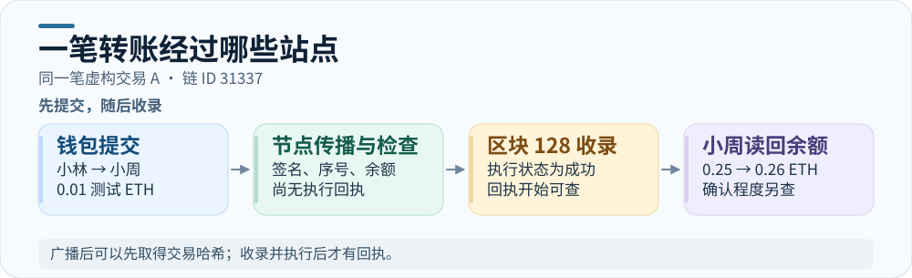

# 第 01 章 · 一笔转账怎样被写进区块

小林点下发送，准备给小周转 **0.01 测试 ETH**。他先看到「待处理」。过了一会儿，同一条记录变成「成功」，小周的余额也从 0.25 变成了 0.26。两次观察之间发生了什么？

这笔交易叫**转账 A**。它来自一份虚构的以太坊式本地测试账本（链 ID 为 `31337`）。地址和交易哈希都是占位值，读者直接用下面的记录练习即可。

## 先读一条浏览器记录

**区块浏览器（block explorer）**把节点提供的链上数据整理成可读页面。使用浏览器核对一笔付款时，先认准网络，再用交易哈希找到那一笔请求。转账 A 的静态字段如下。

| 浏览器字段 | 转账 A | 能回答什么 |
| --- | --- | --- |
| 网络（Network） | 本地测试链 A | 我在哪一份账本上查？ |
| 发送方（From） | 小林 `0x00000000000000000000000000000000000000a1` | 谁发起转账？ |
| 接收方（To） | 小周 `0x00000000000000000000000000000000000000b2` | 钱转给谁？ |
| 金额（Value） | `0.01` 测试 ETH | 这笔请求转多少？ |
| 交易哈希（Transaction hash） | `0xaaaaaaaaaaaaaaaaaaaaaaaaaaaaaaaaaaaaaaaaaaaaaaaaaaaaaaaaaaaaaaaa` | 怎样找到这笔具体请求？ |

第一次观察时，已知一台节点收到了请求，尚未找到收录它的区块，也没有执行回执。第二次观察时，页面显示区块号 `128`，执行结果为「成功」。**区块（block）**包含按顺序排列的交易，区块号表示它在这条历史中的高度。**回执（receipt）**记录交易执行后的结果。转账 A 在这份账本成功执行后，小周的余额增加了 0.01。

## 从提交到执行

一笔**交易（transaction）**是发送者授权的一项链上操作。这次操作是给一个地址转账。钱包把已签名的请求交给接入的节点。节点会核对格式和签名等条件，并把可接受的请求转发给其他节点。请求可以在等待时被看到。随后，区块提议者把符合条件的交易排进一个候选区块。其他节点按同一套规则核验区块，重新检查执行的结果。浏览器读取已接纳的区块和回执，再更新页面。

*图 01　原创流程图。节点收到交易、区块收录和浏览器显示结果是三个观察点。依据课程的交易生命周期讲解绘制。[Updraft · The Lifecycle of a Transaction](https://github.com/Cyfrin/Updraft/blob/1d7138f18fbe26bfff82a091df118efda52f29e7/courses/blockchain-basics/4-blockchain-architecture/12-the-lifecycle-of-a-transaction/%2Bpage.md#L1-L79)*

区块是否仍处在网络采用的历史中，是执行成功之后的另一项检查。交易刚收录时，可以用区块号找到它。随着链继续推进，还可以看它获得了多少后续区块，以及协议何时给出最终性（finality）。浏览器各自的「待处理」「确认」表现可能不同，先对照区块、回执和链上确认状态。这个区别在[第 04 章](./04-blocks-and-consensus.md)用两个候选区块展开。

## 常见误区

- **拿到交易哈希就能确认到账。** 哈希可以在提交阶段得到。核对到账要看正确的网络、收款地址及金额，还有实际的收录区块和回执。
- **浏览器找不到，说明转账失败。** 当前查询的网络、浏览器的索引进度和它是否已看到请求都影响结果。执行失败指账本存在对应的失败回执。
- **只核对金额就够了。** 同一人可能收到多笔同额款项。用网络和哈希锁定某一笔，再核查具体地址和结果。

## 练习与核对

1. 给定转账 A 的哈希和「待处理」标签，小周现在能确认什么？  
   **核对**　能用哈希指认该请求。要确认它在哪个区块、是否执行成功，还需要相应区块和回执。
2. 浏览器随后显示区块 128 和成功回执，小周应核对哪些字段？  
   **核对**　先核对网络，找到该哈希，再查看接收方地址、金额、所在区块和结果。这个例子没有其他余额变动，因此小周从 0.25 增至 0.26 测试 ETH。
3. 如果钱包切到另一网络，输入同一个哈希可能怎样？  
   **核对**　新的查询目标是另一份账本，通常找不到转账 A。把回执截图交给别人时也应保留网络信息。

[第 02 章](./02-wallets-keys-signatures.md)接着解释小林如何授权。[第 03 章](./03-state-execution-and-gas.md)再计算小林实际支出了多少。

## 来源

- 课程测试网练习的发送及区块浏览器验证两步。沿用其观察顺序，正文页面和字段值采用转账 A 的虚构数据。[Updraft · Sending First Transaction on a Testnet，L1–52](https://github.com/Cyfrin/Updraft/blob/1d7138f18fbe26bfff82a091df118efda52f29e7/courses/blockchain-basics/3-sending-transactions/7-sending-first-transaction-on-a-testnet/%2Bpage.md#L1-L52)
- 课程的交易广播、收录与确认过程。[Updraft · The Lifecycle of a Transaction，L1–79](https://github.com/Cyfrin/Updraft/blob/1d7138f18fbe26bfff82a091df118efda52f29e7/courses/blockchain-basics/4-blockchain-architecture/12-the-lifecycle-of-a-transaction/%2Bpage.md#L1-L79)
- 转账情境参考 Public & Private Keys（p. 25，L630–646）的付款示意。[《Web3 Fundamentals》](../../../refs/B3_Web3_Fundamentals.md)

[全书目录](../README.md) · [本章来源映射](../../../planning/beginner/source-map.md#ch-01)
