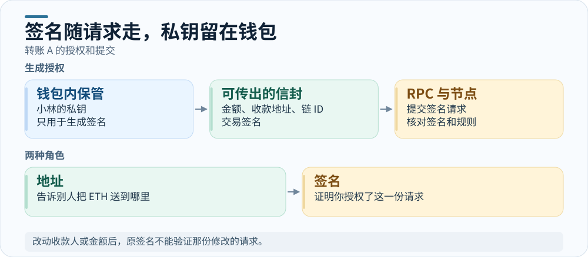

# 第 02 章 · 钱包、私钥与交易签名

小林把自己的公开地址写在群里，方便同学转测试 ETH。小周也知道[转账 A](./01-trace-a-transfer.md)的付款地址和金额。为什么小周能核对这笔付款，却只有掌握相应密钥的人才能以小林的普通账户发出新的转账？

## 把钱包、账户和钥匙分开

链上的**账户（account）**是在账本中识别和记录状态的对象。钱包（wallet）通常是查看账户、准备请求、管理密钥或调用签名设备的工具。例如，小林从钱包看到一笔 ETH，节点返回的账户余额才是这条链的余额记录。换一个能使用相同密钥的自托管钱包，仍可访问对应账户。

| 对象 | 在转账 A 中的作用 |
| --- | --- |
| 地址（address） | 识别账本里的付款方或收款方。小周把自己的地址给小林收款。 |
| 私钥（private key） | 为普通外部拥有账户授权。小林的签名工具用它签署请求。 |
| 公钥（public key） | 用于核验由相应私钥产生的签名。以太坊普通外部拥有账户的地址由公钥派生。 |
| 签名（digital signature） | 证明这份特定请求获得相应密钥授权，验证者可核对授权对应的付款账户与请求内容。 |
| 恢复短语（recovery phrase） | 某些钱包用它恢复一组派生密钥。拿到短语的人可能取得这些账户的签名能力，因此它属于秘密。 |

转账 A 的小林和小周都是**外部拥有账户（externally owned account, EOA）**，此处按普通无代码账户处理。**合约账户（contract account）**则由部署在其地址上的程序控制。当一笔请求触发它，程序按规则执行。有哪些规则由合约代码决定，[第 08 章](../03-contracts-and-foundry/08-first-solidity-contract.md)会第一次部署其中一种。

## 钱包发出的信息

小林确认网络、收款地址和 0.01 测试 ETH 后，钱包整理交易字段，再请求签名。签名可以由本机软件钱包完成，也可以交给硬件钱包。签好的请求经**远程过程调用（remote procedure call, RPC）**接口提交给节点。RPC 可用于提交交易，也可查询余额和回执。

*图 02　原创授权示意。签名留在公开的交易一侧供节点核验，签名用的私钥保存在钱包或签名设备中。依据课程的密钥和签名示例绘制。[Updraft · Introduction to Signatures](https://github.com/Cyfrin/Updraft/blob/1d7138f18fbe26bfff82a091df118efda52f29e7/courses/blockchain-basics/4-blockchain-architecture/5-introduction-to-signatures/%2Bpage.md#L1-L81)*

把签名看作只对一份特定请求有效的签章。原请求写着付 0.01 给小周，签名覆盖请求内容。如果收款地址或金额发生变化，原签名无法继续证明小林批准了这份改过的请求。节点能根据请求和签名核验发送方的身份，无需取得私钥。这里的签名关注授权和内容完整性。普通公开链上的收款地址和金额仍可查阅。加密（encryption）解决的是谁能看到内容，适用于不同的场景。

## 谁实际保管密钥

**自托管（self-custody）**的典型情况是用户控制密钥，钱包或设备代用户操作。**托管（custody）**服务中的提现则往往由服务方审批和签名，用户名与登录密码只是该服务的访问凭据。软件与硬件是钱包实现形态，托管与自托管描述持钥权。热钱包（hot wallet）的签名环境联网，冷钱包（cold wallet）则把签名密钥和联网环境隔开。使用独立的硬件签名设备时，联网主机可以准备和提交请求，私钥由设备保管。判断任何一套钱包方案时，问清楚谁能签名、密钥在哪里、谁能恢复账户。

主网（mainnet）和测试网（testnet）是独立网络。测试环境适合用来练习核对签名与提交，转账 A 所用的本地测试链是其中一种教学环境。付款前先比对钱包和浏览器所选的网络，再确认签名窗口所显示的请求字段。网站正文中的付款说明与钱包实际要求授权的内容都值得检查。[钱包接网页的全过程](../03-contracts-and-foundry/13-wallet-to-dapp.md)会演示这一点。

交易哈希是标识，不是钥匙或签名。若要分辨内容指纹、签名授权和区块承诺，接着读[第 02A 章哈希与 Merkle 证明](./02a-hashes-and-merkle-proofs.md)。

## 常见误区

- **把地址当成公钥或登录凭据。** 地址用于定位账户，签名者使用私钥授权。对于 EOA，地址与公钥存在派生关系，两者的表示及用途各异。
- **认为一条签名能重复授权新的付款。** 原签名绑定原请求。批准另一笔金额或收款人不同的交易需要相应的新授权。
- **借给别人恢复短语来帮忙查余额。** 查公开账本只需要网络和地址。能够恢复密钥的资料会把签名权交给看到它的人。

## 练习与核对

1. 小周想核对转账 A，只向小林要哪两项资料就能开始？  
   **核对**　网络和交易哈希。若只想查询某个地址的余额，则用网络和账户地址。
2. 把公开地址、交易哈希、请求签名、私钥和恢复短语放到「可见资料」或「秘密资料」两栏。  
   **核对**　在本例的公开账本中，地址、哈希和交易签名属于可见资料，私钥和恢复短语应保持秘密。
3. 已签名转账的收款地址改变后，节点能把它认作小林原来批准的付款吗？  
   **核对**　原签名对应的是原内容。要授权改过的请求，须由有权签名者重新批准。

已经授权的请求还要通过余额、交易序号和费率检查。[第 03 章](./03-state-execution-and-gas.md)会把这些检查放回转账 A。

## 来源

- 钱包职责、持钥及支付授权。[Updraft · What Is a Wallet?，L1–51](https://github.com/Cyfrin/Updraft/blob/1d7138f18fbe26bfff82a091df118efda52f29e7/courses/blockchain-basics/3-sending-transactions/2-what-is-a-wallet/%2Bpage.md#L1-L51) · [Updraft · Introduction to Signatures，L1–81](https://github.com/Cyfrin/Updraft/blob/1d7138f18fbe26bfff82a091df118efda52f29e7/courses/blockchain-basics/4-blockchain-architecture/5-introduction-to-signatures/%2Bpage.md#L1-L81)
- Crypto Wallet 和 Public & Private Keys（pp. 24–25，L606–646）。取付款请求及签章的教学思路，账户和密钥术语采用以太坊文档。《Web3 Fundamentals》 · [Ethereum accounts](https://ethereum.org/developers/docs/accounts/) · [JSON-RPC API](https://ethereum.org/developers/docs/apis/json-rpc/)
