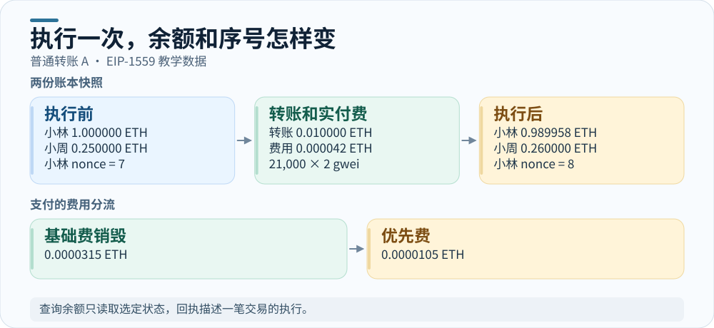

# 第 03 章 · 链上状态、执行与 Gas

[转账 A](./01-trace-a-transfer.md)付给小周 0.01 测试 ETH，小林的余额却少了 0.010042。小周收到的金额跟付款请求一致，额外的 0.000042 到了哪里？要对上这笔账，得同时看请求、回执和执行前后的账户状态。

## 请求、区块、回执和状态

**链上状态（onchain state）**是执行到某一时刻时，账本所记录的账户余额、账户序号和合约数据等信息。交易（transaction）是请求，区块（block）给请求定序，回执（receipt）记录某笔交易执行的结果。状态是处理这些请求之后的账本。这四个对象可以分别查询。

| 对象 | 在转账 A 中查到什么 |
| --- | --- |
| 交易 | 谁向谁转 0.01 测试 ETH、交易类型、序号、费用限制 |
| 区块 | A 进入高度为 128 的区块，该区块的单位 Gas 基础费为 1.5 gwei |
| 回执 | `status = 0x1`，实际使用 `21000` Gas，有效 Gas 价格为 `2 gwei` |
| 账户状态 | 小林 1 → 0.989958，小周 0.25 → 0.26，余额单位均为测试 ETH |

查询余额可以让节点运行 `eth_getBalance`，指定地址和要查看的区块高度。它返回该状态下的余额，读请求本身不广播交易，也不动用账户资金。以后读合约函数时还会用到 `eth_call`，它让节点以指定状态模拟调用并返回结果。查看一笔已提交交易的执行结果则用它的哈希找回执。浏览器记录和链上状态分别回答「刚才执行了什么」与「账本现在是什么样」。

## 节点怎样执行一次付款

[第 02 章](./02-wallets-keys-signatures.md)说明了签名如何授权。执行时还要核对交易属于当前链，发送方余额能覆盖转账金额和费用上限，序号符合当前账户状态。**账户序号（nonce）**在本例中是小林下一笔交易应使用的序号。转账 A 消费序号 7，之后变为 8。原交易再次抵达时已不符合账本的下一序号。**链 ID（chain ID）**参与转账 A 的签名，减少在另一个链 ID 下重复使用同一份已签名交易的可能。不同链仍各自保存和判断状态。

以太坊的执行层按区块顺序应用每笔交易。普通转账在本例中扣小林的付款及手续费、增加小周的余额。涉及合约时，**以太坊虚拟机（Ethereum Virtual Machine, EVM）**执行合约字节码，以输入和当时的状态计算结果。若顶层合约调用回退（revert）且交易已经入块，这次执行的合约变动会被撤回，交易回执可以显示 `status = 0x0`，已消耗的 Gas 仍会结算，发送方序号也已使用。完成的普通转账在这里有成功回执。第 08 章从[写入再读回一个合约值](../03-contracts-and-foundry/08-first-solidity-contract.md)开始练习状态转换。

## 算清转账 A 的费用

**Gas**衡量执行操作耗用的资源。付款用的是 ETH。单位 Gas 价格把前一个数字转换成后一个数字。`wei` 是 ETH 的最小计量单位，`1 gwei = 10^9 wei`，`1 ETH = 10^18 wei`。节点接口会用十六进制表示一些数量，例如序号 `0x7` 是 7，区块高度 `0x80` 是 128，`gasUsed = 0x5208` 是 21000。地址和交易哈希用十六进制字符书写时仍是标识符，通常原样比对。

转账 A 是采用 EIP-1559 的 Type 2 交易。设费用上限 `maxFeePerGas = 3 gwei`，小费上限 `maxPriorityFeePerGas = 0.5 gwei`。收录区块里的单位 Gas 基础费为 1.5 gwei。

1. 从 3 gwei 的费率上限扣除 1.5 gwei 基础费，还可给 1.5 gwei 小费。请求最多给 0.5 gwei，所以实际小费是两者较小的 0.5 gwei。
2. 有效 Gas 价格等于基础费加实际小费，为 2 gwei。普通转账的接收方无代码，输入为空且未使用访问列表，本例使用 21000 Gas。
3. 把 `21000 × 2 gwei` 换算得到 `42000000000000 wei`，即 **0.000042 ETH**。基础费部分 0.0000315 ETH 被销毁，优先费用 0.0000105 ETH 记给区块的费用接收地址。

交易把 Gas 上限设为 21000，按 3 gwei 计算的最高费用是 0.000063 ETH。账户需有能力承担这个上限以及转账金额。最终按使用的 Gas 和实际费率收费，故小林剩 `1 − 0.01 − 0.000042 = 0.989958`，小周变成 `0.25 + 0.01 = 0.26`。这组教学数据假设它们没有别的余额变动。

*图 03　原创账本图。以转账 A 的数值拆开款项和 Gas 费用，费用去向依据 EIP-1559 规则。[EIP-1559 · Specification](https://eips.ethereum.org/EIPS/eip-1559#specification)*

## 常见误区

- **把 21000 当作所有操作的费用。** 21000 是转账 A 消耗的 Gas 单位数。手续费还要乘单位价格，包含合约执行的数据和操作也会改变 Gas 用量。
- **按费用上限写最终支出。** 上限用于约束授权的最大费用。要对账，读取实际的 `gasUsed` 和 `effectiveGasPrice`。
- **看到回退就认为发送人余额和序号原封不动。** 入块后才回退的交易仍有执行消耗，且占用了发送方的序号。还没通过有效性检查的请求属于另一种情况。

## 练习与核对

1. 用 `gasUsed = 0x5208`、`effectiveGasPrice = 2 gwei` 算出实付费用。  
   **核对**　`0x5208 = 21000`。费用 42000 gwei，即 0.000042 ETH。
2. 小林一开始有 1 测试 ETH，转出 0.01。小周开始有 0.25，回执成功。两者的新余额是什么？  
   **核对**　小林 0.989958，小周 0.26。手续费由发送方付，小周按转账金额入账。
3. 要看小周在区块 128 的余额，以及这笔交易是否成功，应检索哪两项？  
   **核对**　用小周地址和区块高度查询账户状态，用转账 A 的哈希查询执行回执。

[第 04 章](./04-blocks-and-consensus.md)会用两个候选区块继续追问，节点怎样就应采用的状态达成一致。

## 来源

- Gas 单位、费用和交易执行顺序。[Updraft · Gas in Depth，L1–81](https://github.com/Cyfrin/Updraft/blob/1d7138f18fbe26bfff82a091df118efda52f29e7/courses/blockchain-basics/4-blockchain-architecture/11-gas-in-depth/%2Bpage.md#L1-L81) · [Updraft · The Lifecycle of a Transaction，L1–79](https://github.com/Cyfrin/Updraft/blob/1d7138f18fbe26bfff82a091df118efda52f29e7/courses/blockchain-basics/4-blockchain-architecture/12-the-lifecycle-of-a-transaction/%2Bpage.md#L1-L79)
- Ethereum’s business model 的 Gas 算例（pp. 20–21，L518–545）和 Cryptographic Hash Function 的两种 nonce 语境（p. 7，L136–156）。金额和回执为自拟。《Web3 Fundamentals》
- 类型化交易、费率、回执状态和链 ID 的规范来源。[EIP-1559](https://eips.ethereum.org/EIPS/eip-1559) · [EIP-658](https://eips.ethereum.org/EIPS/eip-658) · [EIP-155](https://eips.ethereum.org/EIPS/eip-155) · [Ethereum JSON-RPC API](https://ethereum.org/developers/docs/apis/json-rpc/)
