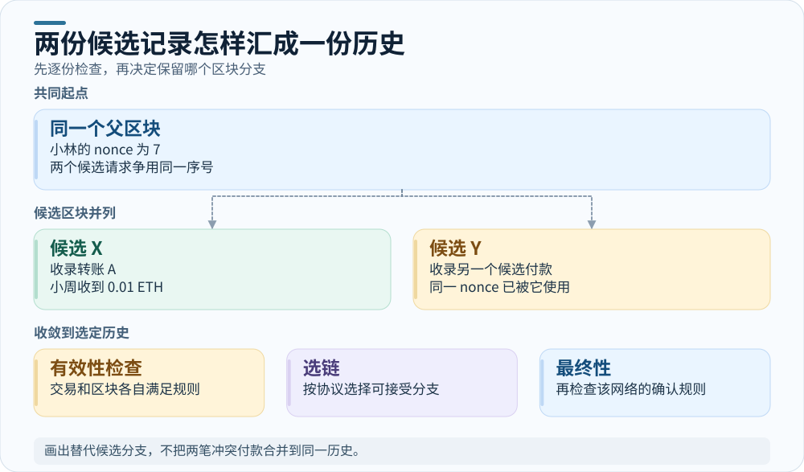

# 第 04 章 · 节点、区块与共识

[转账 A](./01-trace-a-transfer.md)让小周的余额增加 0.01 测试 ETH。假如两台节点同时收到不同的候选区块，各自都能从同一份旧账本算出一个合法的新余额，它们怎样选出接下来应该使用的账本？

## 04.1 共享账本如何对齐

区块把一组有序交易写成新的历史记录。区块头保存前一块的哈希（hash），这个字段把区块连起来。**哈希**是按规则算出的定长摘要，常用来检查数据是否发生变化。修改旧区块的内容，通常会使该块哈希改变，下一块保存的前块哈希便对不上。网络再靠验证规则和共识决定采用什么历史。

**全节点（full node）**运行客户端软件，独立核验收到的区块。提议者负责准备新块，其他节点可以检验区块是否引用可接受的父区块、交易是否合法、执行结果是否正确。把每项工作分清楚，就能看出为什么即使某个参与者有资格出块，其他节点仍要检查它的提案。

拿转账 A 当候选 T1。想象另一笔候选 T2，也从小林最初的 1 测试 ETH 支出，承诺向另一个人付 0.995 测试 ETH。它与 T1 使用相同的序号 7 和费用上限。两个候选分别从同一份旧状态执行时，都可以通过本例的余额和序号检查。若网络采用先收录 T1 的历史，小林的序号已变成 8，余额已降到 0.989958，原来的 T2 就不符合序号和余额条件。这里比较的是两份纸面候选记录。

*图 04　原创候选区块图。两个节点可以先看到不同的有效候选，随后按协议收敛。依据课程的共识与最终性讲解绘制。[Updraft · Consensus Fundamentals](https://github.com/Cyfrin/Updraft/blob/1d7138f18fbe26bfff82a091df118efda52f29e7/courses/blockchain-basics/4-blockchain-architecture/3-consensus-fundamentals/%2Bpage.md#L1-L61)*

这就是理解**双花（double spending）**的入口。同一笔可用资金可以出现在彼此冲突的候选请求里，验证和共识共同决定哪些支出能进入网络认可的历史。

| 工作 | Bitcoin 的工作量证明（Proof of Work, PoW） | Ethereum 的权益证明（Proof of Stake, PoS） |
| --- | --- | --- |
| 怎样产生候选块 | 矿工竞相完成协议要求的哈希计算。 | 协议从验证者中选择每个时隙的区块提议者。 |
| 谁核对、怎样采用历史 | 全节点检验区块，并以累计工作量选择有效的链。 | 节点检验区块。验证者的证明投票（attestation）参与选链及检查点最终性。 |
| 为什么参与 | 符合条件的出块可获区块补贴和交易费。 | 验证者投入质押，正确履职可获奖励，某些可证明的违规会触发罚没。 |
| 怎样看记录是否稳定 | 随有效链上后续区块累积，重组风险降低。 | 先观察交易位于当前采用的区块，再观察协议是否最终确定其所在历史。 |

**确认（confirmation）**通常表示交易已进入当前采用的历史，随后可以观察有多少后续区块。**最终性（finality）**是协议对这段历史稳定性的更强保证，各网络的条件不同。区块刚收录时若节点随后采用另一条候选分支，所发生的是重组（reorganization）。协议升级的**软分叉（soft fork）**和**硬分叉（hard fork）**讨论的是验证规则的兼容性。典型的软分叉收紧有效性条件，按新规则产生的区块仍符合旧规则。采用不向后兼容的新规则需要升级，若部分参与者继续采用旧规则，可能留下两条持续的链。Ethereum 与 Ethereum Classic 的历史分流是一个实例。[《Web3 Fundamentals》· Forks（p. 13，L314–340）](../../../refs/B3_Web3_Fundamentals.md)

## 04.2 公链、私有链与联盟链

想象身边有三本账本，分别对应公链（public blockchain）、私有链（private blockchain）和联盟链（consortium blockchain）的常见配置。社区把捐款公开，居民都可以按照规则捐钱。一所学校管理器材借还，让获准的师生和员工登记。几所学校建立教材调拨账本，共同约定谁能加入以及如何改规则。把这些场景转成技术问题，分别要查读权限、提交权限、核验和出块资格、规则变更权。

| 示例配置 | 谁能读 | 谁能提交 | 谁能核验或出块 | 谁能改变规则 |
| --- | --- | --- | --- | --- |
| 公链 · 社区捐款网络 | 公众查阅捐款记录 | 任何人可提交符合协议条件的捐款 | 任何人可核验，满足协议条件并获选的参与者出块 | 网络参与者按其升级流程协调 |
| 私有链 · 一所学校的器材借还账本 | 校方授权的师生和员工 | 获准的借用者或经办人 | 校方指定节点参与验证和出块 | 校方按内部流程决定 |
| 联盟链 · 多所学校的教材调拨账本 | 成员学校和获准的观察者 | 由成员授权的经办人 | 成员按共同规则指定节点 | 各成员按共同议定的表决或签署条件变更 |

**访问权限**逐项问某个操作需不需要事先许可。说「无需许可（permissionless）」或「许可制（permissioned）」时，可以加上具体动作。例如，三所学校可以把教材账本公开给社会，出块节点仍只能来自白名单。公开查阅、独立核验和参与出块的门槛可以各不相同。

**治理（governance）**问谁有权改变规则。上面的白名单由谁维护、增加成员需要几家同意，都由联盟的治理约定决定。在许可网络中，Hyperledger Fabric 的通道策略就可以分别规定成员、背书及配置变更要求。Ethereum L1 的协议升级则涉及参与者提出、讨论、实现和采纳新规则。第 20 章另以[一个合约权限交给治理流程](../04-assets-protocols-and-governance/20-governance-before-dao.md)为例，理解应用里的规则权。[Hyperledger Fabric 2.5 · Policies](https://hyperledger-fabric.readthedocs.io/en/release-2.5/policies/policies.html) · [Ethereum governance](https://ethereum.org/governance/)

## 04.3 从以太坊的运行职责认识 Layer 1

以太坊的**基础层（Layer 1, L1）**按本网络的规则执行和验证交易、收录顺序、确定历史并结算结果。在这里，结算指网络按协议认可结果，使后续操作有依据。转账 A 模拟的正是这类基础账本。每个区块能承载的执行和数据都有上限。[第 05 章](../02-scaling-and-multichain/05-l1-congestion-to-l2.md)将追问，怎样在基础层继续核验结果的前提下让更多交易执行。

## 常见误区

- **区块哈希相连，就自然只有一条候选链。** 两个有效块可以引用同一个父块。哈希关系说明它们如何相连，验证和选链规则决定该跟随哪一个。
- **把读账本、验证和出块都写成同一项权限。** 可读数据可以向公众开放。出块节点仍可由单独的协议资格或组织白名单决定。
- **把已入块等同于最终确定。** 入块给出可定位的执行证据，协议的确认和最终性规则说明此证据对应的历史有多稳定。

## 练习与核对

1. 转账 A 占用序号 7。执行后，小林的原候选 T2 能接在它后面吗？  
   **核对**　原 T2 的序号为 7，账本下一个序号已是 8。A 之后的余额 0.989958 也低于 T2 的 0.995 转账额。
2. 三所学校的账本向公众展示，各学校有授权经办人，出块节点要列入白名单，改规则须三所学校同意。分别说明权限和治理权。  
   **核对**　资料公开可读，提交和出块分别受经办人授权、白名单限制。规则由三家依约共同变更，是这套配置的联盟治理。
3. 一个区块换成同一规则下的另一候选，与客户端因规则不兼容各自沿用不同规则，分别是什么现象？  
   **核对**　前者是分支重组，后者在描述硬分叉及可能的持续分链。

## 来源

- 共识、最终性和 PoS 的角色。[Updraft · Consensus Fundamentals，L1–61](https://github.com/Cyfrin/Updraft/blob/1d7138f18fbe26bfff82a091df118efda52f29e7/courses/blockchain-basics/4-blockchain-architecture/3-consensus-fundamentals/%2Bpage.md#L1-L61) · [Updraft · How PoS Blockchains Work，L1–59](https://github.com/Cyfrin/Updraft/blob/1d7138f18fbe26bfff82a091df118efda52f29e7/courses/blockchain-basics/4-blockchain-architecture/6-how-pos-blockchains-work/%2Bpage.md#L1-L59)
- 共享账本、链类型、双花、PoW、PoS 和分叉案例。取 The Backbone（pp. 4–6，L75–132；p. 13，L314–340）与 Mechanics（pp. 26–31，L648–798）。学校和社区案例是正文自拟。分析指南 Closing Thoughts（目录 p. 23，L386–394）用于理解公开数据的可观察性。[《Web3 Fundamentals》](../../../refs/B3_Web3_Fundamentals.md) · [《A Guide to Fundamental Analysis in Crypto》](../../../refs/A-Guide-to-Fundamental-Analysis-in-Crypto.md)
- 首笔公开网络交易和虚拟测试网的访问对照。Fabric 配置策略与 Ethereum 的升级过程作为官方补充。[Updraft · Sending Your First Transaction，L1–12](https://github.com/Cyfrin/Updraft/blob/1d7138f18fbe26bfff82a091df118efda52f29e7/courses/blockchain-basics/3-sending-transactions/5-sending-your-first-transaction/%2Bpage.md#L1-L12) · [Hyperledger Fabric 2.5 · Policies](https://hyperledger-fabric.readthedocs.io/en/release-2.5/policies/policies.html) · [Ethereum governance](https://ethereum.org/governance/)
- 两条链各自的共识规则。Bitcoin 白皮书 §4–5 讲工作量及网络，Ethereum 文档的 How does Ethereum proof-of-stake work? 与 Finality 讲验证者职责和检查点。[Bitcoin 白皮书](https://bitcoin.org/bitcoin.pdf) · [Ethereum Proof-of-Stake](https://ethereum.org/developers/docs/consensus-mechanisms/pos/)

[全书目录](../README.md) · [本章来源映射](../../../planning/beginner/source-map.md#ch-04)
