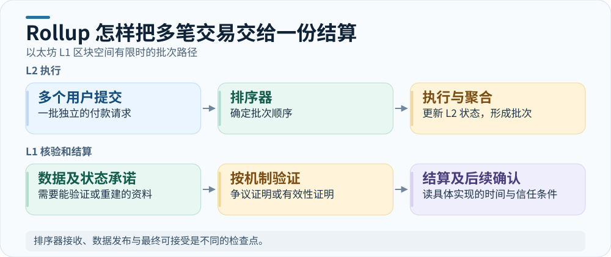

# 第 05 章 · 从 L1 拥堵到 Layer 2 Rollup

周末活动结束，几十个人同时向社区付款。[第 04 章](../01-ethereum-l1/04-blocks-and-consensus.md)里的基础链可以逐笔处理，只是每个区块能提供的执行资源有限。一部分付款要等后面的区块，想优先入块的用户也可能愿意多付费。可不可以把多笔付款放在另一层处理，再交一份底层能核验的结果？

## 把执行移到二层

**二层（Layer 2, L2）**在基础层之上处理操作，并依托 L1 提供某些安全和结算保证。本章看以太坊上的 **Rollup**。它在 L2 排序、执行交易，把一批交易所需的数据提交给 L1。与重放 L2 全部交易相比，L1 可以用发布的数据和协议约定的验证机制来判断二层提交的状态更新。

回想[转账 A](../01-ethereum-l1/01-trace-a-transfer.md)，基础层区块直接收录那一笔转账。另设纸面例子，让小林和另外三位参与者在同一个 Ethereum Rollup 上支付。四笔各自的授权请求交给**排序器（sequencer）**，按选定顺序执行。举例来说，第一笔花费落账后，下一笔转账若付不起金额与费用，就无法通过交易有效性检查。执行结果仍分别可看，但提交到以太坊的数据可把多笔请求打成一个压缩批次（batch）。这个四笔的例子只说明分工，批次大小、成本和收录方式由实际设计决定。

*图 05　原创 Rollup 流程图。将排序、执行、数据发布及状态验证分开，依据以太坊扩容文档的 Rollup 分类绘制。[Ethereum · Scaling](https://ethereum.org/developers/docs/scaling/)*

## 执行、数据可用性、结算

| 职责 | 要回答的问题 | Rollup 中的一种安排 |
| --- | --- | --- |
| 执行（execution） | 交易跑了什么，状态怎样变化？ | L2 按批次顺序执行并得出新状态。 |
| 数据可用性（data availability） | 验证者或重建状态的人能取得必要数据吗？ | Rollup 把重建状态需要的数据发布到 Ethereum。可用数据和状态承诺各有用途。 |
| 结算（settlement） | 哪些 L2 状态更新可以在 L1 上被认可？ | L1 合约按 Rollup 的规则处理承诺、挑战或证明，L1 共识确定相应交易的历史。 |

**状态承诺（state commitment）**可把一份状态用摘要表示。摘要便于比对是否在谈同一份状态，重建状态还需要数据。以太坊也提供附带数据 Blob 的交易格式，供 Rollup 以适合批次数据的方式发布内容。合约可使用其承诺相关信息，Blob 原始字节由网络另外提供，并有独立的可用性安排。[Ethereum · Data Availability](https://ethereum.org/developers/docs/data-availability/) · [EIP-4844](https://eips.ethereum.org/EIPS/eip-4844)

## 两种方式检验更新

**乐观 Rollup（optimistic rollup）**先提交状态承诺。参与者可在规定期间按协议挑战有问题的更新，争议机制处理承诺是否成立。**有效性 Rollup（validity rollup）**用有效性证明（validity proof）让 L1 验证状态转换符合规则。两者都要交代重建状态所需的数据来源。有效性证明回答计算是否符合约定，交易数据是否公开要看另外的设计。

向用户显示「已接收」可能只是排序器认可。「已在 L1 纳入」表示相应批次数据或提交交易能在 L1 查到。要判断结果是否达到协议的最终确认条件，再分别看 L1 的确认和该 Rollup 的规则。举例来说，乐观系统的挑战期或有效性系统的证明验收可能影响提款。检查具体部署时还可以问排序器停机后谁能提交、挑战或升级机制由谁控制，和业务界面的提示相互印证。

## 常见误区

- **把排序器回信当成 L1 结算。** 排序器回应表示入口已处理请求，L1 上的发布、证明或挑战会提供进一步证据。
- **把存一个摘要理解为发布了完整数据。** 摘要可以对照结果，取回或重建数据需要相应的数据可用性。
- **只要能通过桥连接 Ethereum，就是采用 Ethereum 验证的 Rollup。** 带桥的侧链可以使用自己的共识。辨别时要查状态由谁验证、结算在哪里发生，[第 06 章](./06-networks-and-bridges.md)继续用桥说明这一点。

## 练习与核对

1. 把「排序器收到四笔付款」「提交所需数据的交易被 L1 收录」「按 Rollup 规则核验状态更新」放到流程图上。  
   **核对**　第一项发生在 L2 入口，第二项提供 L1 数据发布的证据，第三项是能否认可状态更新的证据。第三项的具体判据取决于 Rollup。
2. L1 上已有状态承诺，社区用户拿不到重建状态所需的数据。还应查哪一项？  
   **核对**　查数据可用性。承诺能帮助核对一份给定状态，必要数据仍要按协议可获得。
3. 两个项目都宣称用有效性证明，能据此断定数据在哪发布吗？  
   **核对**　证明机制和数据发布是两件事。要查该项目的数据是否由 L1 提供可用性，还是采用另一种安排。

## 来源

- 扩容动机、交易批次、排序器和阶段观察。[Updraft · L1s, L2s and Rollups，L1–65](https://github.com/Cyfrin/Updraft/blob/1d7138f18fbe26bfff82a091df118efda52f29e7/courses/blockchain-basics/6-scalability/2-l1s-l2s-and-rollups/%2Bpage.md#L1-L65) · [Updraft · Centralized Sequencers，L1–29](https://github.com/Cyfrin/Updraft/blob/1d7138f18fbe26bfff82a091df118efda52f29e7/courses/blockchain-basics/6-scalability/3-centralized-sequencers/%2Bpage.md#L1-L29) · [Updraft · Rollup Stages，L1–53](https://github.com/Cyfrin/Updraft/blob/1d7138f18fbe26bfff82a091df118efda52f29e7/courses/blockchain-basics/6-scalability/4-rollup-stages/%2Bpage.md#L1-L53)
- Scalability、Roll-Ups 和 Sidechains（pp. 8–11，L162–264）提供扩容及批处理的教学背景。四笔社区付款是自拟情境。《Web3 Fundamentals》
- 对照官方资料核实两类验证与数据发布。[Ethereum · Optimistic Rollups](https://ethereum.org/developers/docs/scaling/optimistic-rollups/) · [Ethereum · Zero-knowledge Rollups](https://ethereum.org/developers/docs/scaling/zk-rollups/) · [Ethereum · Data Availability](https://ethereum.org/developers/docs/data-availability/)
