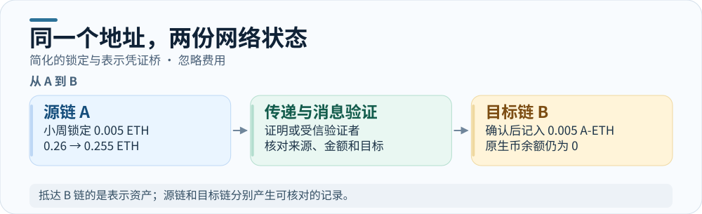

# 第 06 章 · 多链、跨链消息和桥

小周在 A 链上收到[转账 A](../01-ethereum-l1/01-trace-a-transfer.md)，现在有 0.26 测试 ETH。钱包切到 B 链以后，界面上仍是同一个账号地址，原生币余额却显示为零。要让 B 链承认他已交出一部分 A 链资产，需要有人把这件事告诉 B 链，B 链还得能按规则核实。

## 地址可以相同，账本各自维护

本例有两条虚构的 EVM 测试链。钱包在 A 链（链 ID `31337`）和 B 链（链 ID `31338`）使用同一个教学地址。两条链保存各自的区块、余额与交易序号。钱包切换网络后改变了查询目标，A 链的余额仍在原账本。另一个相同地址上的合约代码、原生币或代币也要在该链单独查。

理解多链时，先查每条链怎样验证和结算，再看它如何与其他链发生联系。

| 网络 | 区块和状态由谁确认 | 与另一条链可能怎样关联 |
| --- | --- | --- |
| 独立 L1 | 自己的网络依本协议达成共识并结算。 | 可以接桥，也可以独立运作。 |
| Ethereum Rollup | 执行在 L2，按 Rollup 规则在 Ethereum L1 发布数据、验证状态更新和结算。 | 可以用配套的桥处理两层之间的资产。 |
| 侧链（sidechain） | 用自己的共识和验证规则。 | 可用桥与主链往来，桥的信任条件需要单独检查。 |

链 ID 是交易和接口里的一个网络标识。某链支持 EVM 说明它能以相应规则执行合约，安全模型仍要查这条链本身的验证和结算方式。区分 L1 和 Rollup 时，可以回看[第 05 章的三项职责](./05-l1-congestion-to-l2.md)。

## 用一笔锁定和发行对上两份账

**跨链消息（cross-chain message）**把一个网络已发生的动作或数据送给另一个网络上的接收方。**桥（bridge）**利用这类消息或其他协调机制传递资产或数据。本例采用「锁定／铸造（lock/mint）」模型，忽略操作费，由 B 链服务代为提交目标交易。A 链的测试 ETH 用 B 链上的表示凭证 `A-ETH` 表示。两边的数值都是纸面教学数据。

1. 小周在 A 链锁入 0.005 测试 ETH。源链交易进入区块后，锁定规则留下可核对记录。
2. 消息传递者把锁定信息送到 B 链。目标桥按约定核对来源、锁定和应满足的确认条件，并检查这条消息是否已经处理。
3. 通过后，B 链发行 0.005 `A-ETH` 给小周。小周的 B 链原生余额不变。

*图 06　原创桥接示意。资产锁定、消息核验和目标发行各有证据，依据官方桥接机制绘制。[Ethereum · Bridges](https://ethereum.org/developers/docs/bridges/)*

| 小周能使用的余额 | 桥接前 | B 链完成发行后 |
| --- | ---: | ---: |
| A 链原生测试 ETH | 0.26 | 0.255 |
| B 链的 `A-ETH` 凭证 | 0 | 0.005 |
| B 链原生币 | 0 | 0 |

在这种安排中，典型的反向过程是销毁（burn）目标链凭证，之后由源链释放（release）对应资产。某些跨链代币采用源链销毁、目标链铸造，流动性桥也可能以池中资产付款。先确定讨论的是哪种设计，再按不同账本上的操作核对余额和凭证。

## 查清谁能放行这条消息

A 链显示「已锁定」时，B 链仍可能尚未收到信息。传递消息和核验消息可以是不同角色。目标链可能按源链证明核验，也可能依赖约定的验证者集合或托管服务。能否把资产放到目标地址，还由桥的合约权限决定。阅读一个设计时分开查看以下问题。

| 要核对的证据 | 对应问题 |
| --- | --- |
| 源链收录及确认记录 | 谁锁定、锁了多少，源链状态达到桥规定的确认条件了吗？ |
| 消息记录和验证规则 | 目标按什么证据判断消息来自这笔锁定？谁提交，谁核验？ |
| 目标链交易及回执 | 消息是否已处理，发行记录中的金额和接收地址是什么？ |
| 托管和管理权限 | 谁控制锁仓及铸造权限，谁可以改变验证或释放规则？ |

桥接描述的是两个网络如何传递并接受消息。Rollup 结算描述的是 L1 怎样认可 L2 的状态更新。两种职责可以在同一个系统配合。第 24 章通过[课程 CCIP 与 Rebase 代币](../05-optional-projects/24-ccip-rebase-project.md)把它们落实到源链和目标链的脚本与测试。

## 常见误区

- **同一个地址在不同网络共享余额。** 余额属于所在链的状态。查询时同时核对地址、网络和资产标识。
- **锁定成功就等于目标已经发行。** 两边分别执行。看源链确认及目标链回执，才能判断这次桥接到了哪一步。
- **表示资产和目标链原生币是一类余额。** 目标链可以维护同一地址的多类资产。桥的发行记录和钱包余额栏需要分别查明资产身份。

## 练习与核对

1. 锁定 0.005 测试 ETH 后，B 链暂未处理消息。可以确定哪些账已经变了？  
   **核对**　A 链可用余额减为 0.255。此时还缺目标链发行的证据，B 链的 `A-ETH` 仍是 0。
2. B 链显示小周收到 0.005 `A-ETH`。他有多少 B 链原生币？  
   **核对**　本例仍有 0 原生币。新余额记录属于表示凭证。
3. 两条链都有相似的浏览器，怎样判断桥的目标验证过程？  
   **核对**　看桥的消息验证规则、两端的交易与确认记录、收款地址和相应资产。浏览器界面只负责呈现这些资料。

[第 07 章](./07-what-layer-zero-can-mean.md)继续用「谁验证、谁传递」来判断多链资料里的 Layer 0。

## 来源

- 多链以及课内的跨链课程入口。[Updraft · Many, Many Chains，L1–56](https://github.com/Cyfrin/Updraft/blob/1d7138f18fbe26bfff82a091df118efda52f29e7/courses/blockchain-basics/2-what-is-a-blockchain/6-many-many-chains/%2Bpage.md#L1-L56) · [课程 fork · Advanced Foundry §4，L2240–2328](https://github.com/yuxiaoli/foundry-full-course-cu/blob/b92616c4212d40cacfeeff4ea0f30501cafad094/README.md#L2240-L2328)
- Crypto Bridge（pp. 11–12，L266–308）提供锁定及发行的例子和桥的信任条件。两条链和数值是本章自拟。《Web3 Fundamentals》
- 桥的常见机制、假设和侧链的独立共识。[Ethereum · Bridges](https://ethereum.org/developers/docs/bridges/) · [Ethereum · Sidechains](https://ethereum.org/developers/docs/scaling/sidechains/)
