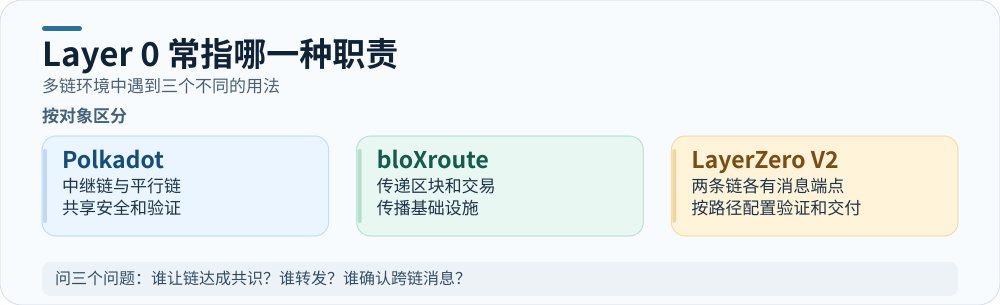

# 第 07 章 · 有了多链背景再读 Layer 0

读完[两条链之间怎样传消息](./06-networks-and-bridges.md)，小周查到三个新说法。一份架构文档说「Layer 0 给其他链提供共享安全」，一家服务说「Layer-0 帮节点更快接收区块」，还有一个跨链协议就叫 LayerZero。字样相近，分别回答的是哪些问题？

## 先确定资料在描述什么

Layer 0 的用法取决于语境。读到它时先找到句子里的对象和动作，再问谁执行、谁验证、谁提供安全，以及什么工作只是传递信息。下面三个例子来自各项目的官方资料，属于课外补充。它们可以用前几章的职责分工来阅读。

*图 07　原创职责对照。三栏分别表示多链共享安全、节点间传播和两链应用消息，依据三份官方架构资料绘制。[Polkadot Wiki](https://developers.polkadot.com/wiki/learn/learn-comparison-ethereum/) · [bloXroute BDN](https://docs.bloxroute.com/core-solutions/blockchain-distribution-network-bdn/overview) · [LayerZero V2](https://github.com/LayerZero-Labs/LayerZero-v2/blob/9c741e7f9790639537b1710a203bcdfd73b0b9ac/README.md)*

## Polkadot 的共享安全

在 Polkadot 的比较文档里，Layer 0 描述一个让多条链共存、共享安全的底层架构。不同**平行链（parachain）**可以执行各自的规则。例如一条处理资产，另一条处理身份。负责收集交易、构造候选区块的协作者（collator）提交候选，**中继链（relay chain）**的验证者按平行链协议参与核验，候选经过验证与可用性检查，再进入中继链所确定的历史。

把箭头画成「各平行链产生候选 → 共享验证安排 → 中继链确认」，就能看出共享安全（shared security）指的是验证和安全工作由多条链共用。它与[第 05 章的 Ethereum Rollup](./05-l1-congestion-to-l2.md)都涉及多处执行和底层验证，但平行链候选如何进入共享安全体系，要看 Polkadot 的平行链协议。[Polkadot · Inclusion Pipeline](https://developers.polkadot.com/reference/parachains/consensus/inclusion-pipeline/)

## bloXroute 的数据传播

在 bloXroute 的资料里，**区块链分发网络（Blockchain Distribution Network, BDN）**位于交易和区块的传播路径上。想象两台已有验证软件的节点。第一台节点产生或接收一份区块数据，分发网络帮助把数据更快传给第二台。每台节点仍按本链规则处理收到的区块。

这个语境的 Layer-0 描述网络传播基础设施。服务可以改变节点何时收到数据，区块的有效性和最后采用的历史依然由所接入链的协议决定。有助于判断的证据是一张拓扑图。看新增的是转发路径，还是更改了核验区块的规则。[bloXroute · Blockchain Distribution Network Overview](https://docs.bloxroute.com/core-solutions/blockchain-distribution-network-bdn/overview)

## LayerZero V2 的跨链消息

**LayerZero**是协议名。V2 的例子是链 A 的应用给链 B 的应用发送一条消息。源链应用把请求交给本链端点合约（Endpoint），协议形成有发送方、接收方和消息内容的包。目标链按接收方配置查验这条路径的消息。配置的去中心化验证者网络（Decentralized Verifier Network, DVN）提供核验结果，满足配置条件后，目标链可登记消息已验证。交付还要由执行者（Executor）等调用方触发目标端点，由应用处理消息。

这个例子有两种验证。链 A、链 B 各按各自的共识确认本链交易，消息从 A 到 B 的可信条件则要看应用选用的验证配置。消息已验证和目标应用已执行也可能是两个观察结果。若要判断一个具体应用，把源链发送、消息验证、目标链调用回执分开查。[LayerZero V2 · Protocol Contracts](https://github.com/LayerZero-Labs/LayerZero-v2/blob/9c741e7f9790639537b1710a203bcdfd73b0b9ac/README.md)

| 问题 | Polkadot | bloXroute BDN | LayerZero V2 |
| --- | --- | --- | --- |
| 文档里的对象 | 多链共享安全架构 | 区块和交易数据的传播网 | 一个跨链消息协议 |
| 流动的对象 | 平行链候选及验证所需数据 | 节点间传播的区块和交易 | 应用之间的消息 |
| 谁核验 | 平行链协议下的中继链验证安排 | 接入网络的节点按该链规则核验 | 应用路径配置决定消息如何验证，各链确认本链执行 |

## 常见误区

- **按 Layer 0、1、2 给所有网络排成同一层级。** 比较职责前先查各资料所描述的架构，判断执行、安全、结算和传播由谁提供。
- **更快收到数据就等于更快最终确定。** 传播是一个输入条件。最终性仍由链的协议判定。
- **把 LayerZero V2 的消息已验证当成目标操作成功。** 再查目标链交易回执，确认接收应用是否按预期执行。

## 练习与核对

1. 一份说明写着「平行链负责自己的交易逻辑，中继链验证者共同提供安全」。对应哪张图？  
   **核对**　Polkadot。这里通过共享验证安排描述多链架构。
2. 节点管理员接入一个更快的中继网络。谁判定收到的区块是否有效？  
   **核对**　节点依所属链的验证规则判断。bloXroute 的例子提供的是传播服务。
3. 应用的目标端点已登记消息通过验证，用户却没看到目标状态变化。还需查什么？  
   **核对**　查目标链是否发生消息的交付执行，再读目标交易回执和应用状态。LayerZero V2 的验证与交付可分开观察。

前七章从用户的一次付款追到了网络的职责。接下来在[第 08 章](../03-contracts-and-foundry/08-first-solidity-contract.md)把同样的方法用到合约。先提交一个小的写入请求，再从合约地址和读回的数值核对结果。[第 24 章的 CCIP 项目](../05-optional-projects/24-ccip-rebase-project.md)用另一套课程实现练习跨链观察。

## 来源

- 参考书 Glossary · Polkadot（p. 52，L1369–1389）列出 Polkadot 的多链背景。三种 Layer 0 语境依据以下官方资料补充。《Web3 Fundamentals》
- High-Level Comparison 与 Architectural Differences 的中继链、平行链和共享安全，以及区块核验流程。[Polkadot Wiki · Polkadot vs. Ethereum](https://developers.polkadot.com/wiki/learn/learn-comparison-ethereum/) · [Polkadot · Inclusion Pipeline](https://developers.polkadot.com/reference/parachains/consensus/inclusion-pipeline/)
- Overview 和 Key Benefits 中的传播职责。[bloXroute · Blockchain Distribution Network Overview](https://docs.bloxroute.com/core-solutions/blockchain-distribution-network-bdn/overview)
- Protocol Contracts 与 MessageLib 介绍端点、验证和执行。[LayerZero V2 · Protocol Contracts](https://github.com/LayerZero-Labs/LayerZero-v2/blob/9c741e7f9790639537b1710a203bcdfd73b0b9ac/README.md) · [EndpointV2.sol · send、verify、lzReceive](https://github.com/LayerZero-Labs/LayerZero-v2/blob/9c741e7f9790639537b1710a203bcdfd73b0b9ac/packages/layerzero-v2/evm/protocol/contracts/EndpointV2.sol)
