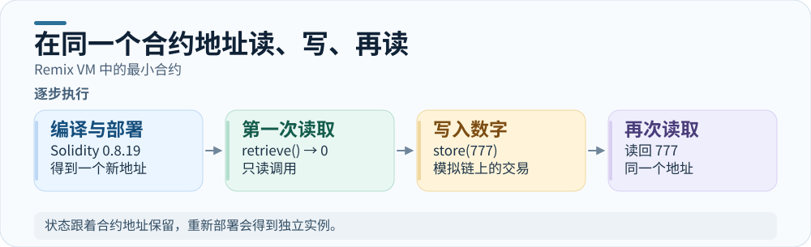

# 第 08 章 · 第一个智能合约与 Solidity

小周想把喜欢的数字写到一块共享记事板上。记事板刚安装时显示 0。他写下 777，再读一次，看到 777。别人拿着同一块板的地址也能读到这个值。这个小实验有三个动作：装上一块板、改变它的内容、读取内容。做完后我们再给三个动作起技术名字。

如果你能分清「查余额」和「发起交易」，就可以开始。地址、执行和费用可先回看[第 03 章](../01-ethereum-l1/03-state-execution-and-gas.md)。本章的每一步都在 Remix 自带的虚拟环境里完成。

## 先预测一次结果

打开 [Remix](https://remix.ethereum.org/)，在文件管理器新建 `SimpleStorageMini.sol`，填入下面的教学合约。它保留课程 [SimpleStorage.sol](https://github.com/Cyfrin/remix-simple-storage-cu/blob/0448e31f104f4833168cbd001a018784c7d358c0/SimpleStorage.sol#L4-L29) 中保存和读取数字的行为。课程文件还包含人员列表，本章先把那部分放到[第 09 章](./09-contract-composition.md)。

```solidity
// SPDX-License-Identifier: MIT
pragma solidity 0.8.19;

contract SimpleStorageMini {
    uint256 private myFavoriteNumber;

    function store(uint256 newNumber) public {
        myFavoriteNumber = newNumber;
    }

    function retrieve() public view returns (uint256) {
        return myFavoriteNumber;
    }
}
```

把 `myFavoriteNumber` 看成记事板上能保存一个值的格子。变量（variable）是这个格子的名字，类型（type）规定它能放什么。`uint256` 是 256 位无符号整数，可以表示 0 以及很大的正整数。`store` 和 `retrieve` 是函数（function），前者用输入参数（parameter）改变一个值，后者把当前值作为返回值（return value）交给调用者。先回答两个问题：刚部署时没有人写过，读到什么？写入 777 后，同一个实例读到什么？

1. 打开 Solidity Compiler 面板，选用与 `pragma solidity 0.8.19` 匹配的编译器，然后编译当前文件。编译成功意味着程序能被这版编译器转成部署所需的产物。
2. 打开 Deploy & Run Transactions，环境选以 **Remix VM** 开头的本地模拟环境，合约下拉框选 `SimpleStorageMini`，部署时保持转账金额为 0。等待下方出现已部署的实例，并记下它的地址。
3. 展开这个实例，点击 `retrieve`。预期返回 `0`。在 `store` 的输入框填 `777` 并执行，再点同一个实例的 `retrieve`，预期返回 `777`。把读回值和终端中部署、写入的两次记录对上。



*图 08　从预测到读回。沿用 Cyfrin 的最小存储教学路径绘制，数字与后续测试例对齐。* [Remix 课程的 Getting Started](https://github.com/Cyfrin/remix-simple-storage-cu/blob/0448e31f104f4833168cbd001a018784c7d358c0/README.md#L7-L12)

| 动作 | 选择的目标 | 预期现象 | 状态 |
| --- | --- | --- | --- |
| 部署 | 创建一个实例 | 出现一个合约地址 | 初始值为 0 |
| 第一次读取 | 实例地址上的 `retrieve()` | 返回 0 | 仍是 0 |
| 写入 | 同一地址上的 `store(777)` | 模拟交易成功 | 变为 777 |
| 第二次读取 | 同一地址上的 `retrieve()` | 返回 777 | 仍是 777 |

如果第二次读到 0，先检查展开的地址是否和写入时相同，再看写入交易是否成功。换一个 VM 环境或重新部署都会改变你在界面中操作的实例。界面可以把不同实例放在相邻位置，地址才是判断对象的依据。

## 编译、部署与执行各做什么

**智能合约（smart contract）**是部署到链上、由执行规则解释的程序。以太坊虚拟机（Ethereum Virtual Machine，EVM）运行它的字节码（bytecode）。Solidity 是我们此处撰写程序的语言。`pragma` 给编译器版本设条件。工具面板帮我们选择编译器，版本声明自身是代码的一部分。

编译（compile）在开发环境发生。把源码存盘只会改变文件，编译只会产生如部署字节码、运行字节码和函数接口描述这样的产物。部署（deployment）通过创建交易产生一个合约实例。创建过程执行初始化逻辑，将运行代码登记到新的合约地址。本例整数状态变量使用默认值 0。当后续请求送到该地址时，EVM 运行相应函数，按地址找到这个实例的状态。

`myFavoriteNumber` 声明在函数外，是状态变量（state variable）。它在同一合约地址上的多次交易之间保留。`newNumber` 是本次调用传进来的参数，执行结束后，该次参数不会自然成为以后可读的状态。只有赋值语句把值写进状态变量，后面的读取才会看到它。

## 读与写由谁发起

函数可见性（visibility）中的 `public` 允许从合约外发起调用，也允许内部使用。`private` 限制 Solidity 代码直接访问这个状态变量，本例提供 `retrieve` 给读者访问。`view` 表示函数可以读状态，Solidity 会限制它修改状态。`returns (uint256)` 声明返回一个整数，`return myFavoriteNumber` 提供实际值。

界面读取 `retrieve()` 时可以用只读调用（read-only call）请节点在某一份状态上计算，常见 JSON-RPC 方法为 `eth_call`。它直接把结果返回，没有一笔需要上链的读取交易。如果合约在另一笔已上链执行的交易中调用同一个 `view` 函数，那些执行步骤仍然占用 Gas。发 `store(777)` 则要求链处理并记录这次修改，所用账号和目标地址也属于这次请求。

在 Remix VM 中，这些都是工具提供的模拟账户和余额。没有钱包实币；若只是想理解读写，模拟环境已经足够。第 10 章会把部署与读写搬到[可重复的本地 Foundry 流程](./10-local-foundry-loop.md)。

教学合约已用 Solidity `0.8.19` 编译，并在本地 EVM 验证了从 `0` 写入并读回 `777`。上方的 Remix 步骤按课程和工具文档核对。

## 常见误区

- **以为编译完就有一个新地址。** 编译产物可以多次部署。每个新实例有自己的状态，判断读写是否相关要看地址和网络。
- **以为 `private` 可以用来放秘密。** 它约束 Solidity 访问。链上的存储由节点保存和验证，敏感内容应放在适合保护它的系统中。
- **以为点 `view` 按钮会冻结结果。** 读取有当时所对应的状态。另一笔有效交易写入后，下一次读可能得到别的值。
- **以为 `public` 带管理员检查。** 本章的 `store` 没设置专门权限。换一个本地账户也可以写。等读[第 11 章](./11-fund-me-and-price-feeds.md)时再给关键操作定义角色和检查。

## 练习与核对

1. **第二次部署会读到多少？** 保留第一个实例的 777，再部署一次同一代码。展开两个地址分别读。核对：旧实例仍是 777，新实例为 0。两个地址的状态独立。
2. **哪一步需要一笔交易？** 在新实例上读、写 42、再读，把每步归类。核对：写入需要提交交易，两次只读调用不需要链记一条新交易，最后读到 42。
3. **尝试说明一个输入错误。** 若输入 `-1`，应在哪一层发现问题？核对：`uint256` 没有负数；界面或编码层可以先报错。没有成功的写入交易时，原值应保持。先看记录，再判断是工具拒绝编码还是链上的执行结果。

## 来源

- 课程 fork 的 [README.md · Solidity 101, Simple Storage，L704–803](https://github.com/yuxiaoli/foundry-full-course-cu/blob/b92616c4212d40cacfeeff4ea0f30501cafad094/README.md#L704-L803) 列出编译、Solidity 基础、部署和 EVM 回顾。代码对照 [Cyfrin/remix-simple-storage-cu · SimpleStorage.sol，L4–29](https://github.com/Cyfrin/remix-simple-storage-cu/blob/0448e31f104f4833168cbd001a018784c7d358c0/SimpleStorage.sol#L4-L29)。
- [refs/B3_Web3_Fundamentals.md](../../../refs/B3_Web3_Fundamentals.md)，The Tools · Smart Contracts（pp. 38–39，L962–1007），用于理解发布程序与可重复调用。本章代码与按钮实验是针对课程最小案例的自写版本。
- 只读调用及执行环境术语对照 [Ethereum · Transactions](https://ethereum.org/developers/docs/transactions/) 与 [Remix 官方文档 · Deploy & Run Transactions](https://remix-ide.readthedocs.io/en/latest/run.html)。

[全书目录](../README.md) · [本章来源映射](../../../planning/beginner/source-map.md#ch-08)
