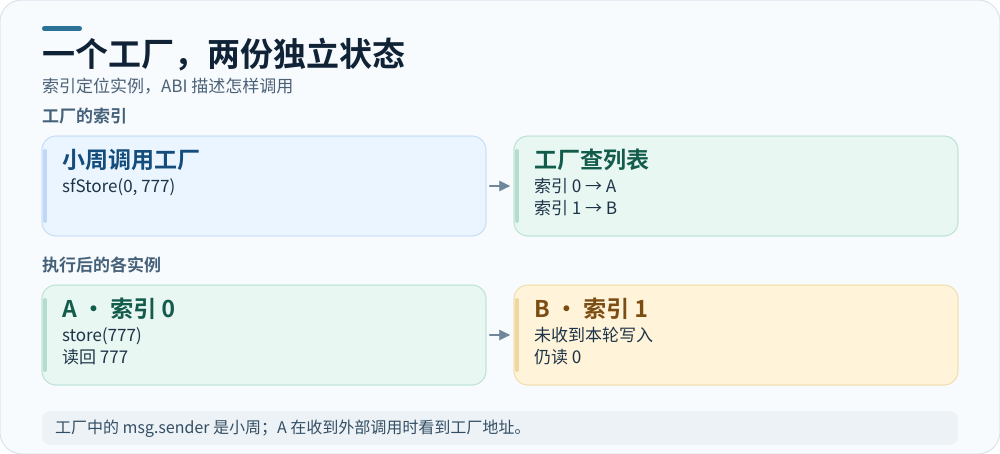

# 第 09 章 · 数据位置、ABI 与合约之间的调用

第 08 章里，小周把 777 写进一块共享记事板。现在给实验室加第二块同样的板。两块板上都只有一个数字。你希望写 A 时，B 继续显示 0。与其抄两份程序，不如让一个工厂合约按需创建两份实例，并记下它们的地址。

这个实验同时回答三个问题：编号 0 怎样找到 A，A 为什么和 B 各有状态，调用方如何把「写入 777」传给另一个合约。先回忆[上章的读写实验](./08-first-solidity-contract.md)。

## 让一份程序创建两个实例

课程的 `StorageFactory.sol` 用 `import {SimpleStorage} from "./SimpleStorage.sol";` 引入合约名字。这里的导入（import）供编译器解析类型和代码。它不会自动创建一个链上实例。工厂执行 `new SimpleStorage()` 时才会产生新的合约地址，并将该实例放入自己的持久列表。

以下是根据课程函数整理的核心读法。请将它与同一项目内的 `SimpleStorage.sol` 一起阅读。这个片段省去了工厂的外层声明和导入。

```solidity
SimpleStorage[] public listOfSimpleStorageContracts;

function createSimpleStorageContract() public {
    listOfSimpleStorageContracts.push(new SimpleStorage());
}

function sfStore(uint256 index, uint256 value) public {
    listOfSimpleStorageContracts[index].store(value);
}

function sfGet(uint256 index) public view returns (uint256) {
    return listOfSimpleStorageContracts[index].retrieve();
}
```

在 Remix 中从固定项目取得三个实际文件，选择能同时满足 `^0.8.19` 和精确版本 `0.8.19` 的编译器 `0.8.19`。部署 `StorageFactory`，调用两次 `createSimpleStorageContract()`，然后按表走一次。数组（array）以位置取元素，位置从 0 开始。

| 操作 | 索引 0 / 实例 A | 索引 1 / 实例 B |
| --- | --- | --- |
| 创建两次之后 | 独立地址，值 0 | 另一地址，值 0 |
| 调 `sfStore(0, 777)` | 写 777 | 保持 0 |
| 调 `sfGet(0)`、`sfGet(1)` | 返回 777 | 返回 0 |



*图 09　同一代码生成两个有独立状态的实例。工厂把列表索引指向的地址作为调用目标。* [课程 StorageFactory.sol](https://github.com/Cyfrin/remix-storage-factory-cu/blob/18957a919d245c59e445292214a846ca2cfa2486/StorageFactory.sol#L8-L32)

工厂持有的是能作为 `SimpleStorage` 使用的合约地址。它的列表属于工厂；数字则保存在每个 `SimpleStorage` 地址的状态中。如果把两条索引都指向同一地址，它们会看到同一状态。本案例执行了两次 `new`，所以有两个实例。

## 一笔调用的两个发送者

小周直接对工厂发交易，在 `sfStore` 入口里看到的 `msg.sender` 是小周的地址。工厂随后对 A 做一次合约调用，在 A 的 `store` 里看到的 `msg.sender` 是工厂地址。整个过程可以在小周发出的一笔交易中发生。地址和参数跳了一次，中间的合约借这笔交易的执行做自己的调用。

合约的应用二进制接口（Application Binary Interface，ABI）给出了编码和解码调用的约定。工具对目标 A 发的调用数据（calldata）包含入口标识和参数。函数签名（function signature）用名字与参数类型表达，例如 `store(uint256)`，不包含参数名和返回类型。对规范化签名取 Keccak-256 的前 4 字节，得到函数选择器（function selector）。其后与 ABI 参数编码拼接。读取 `retrieve()` 时没有输入参数，返回的数据按照声明的 `uint256` 解码。

Solidity 的类型信息让 `listOfSimpleStorageContracts[index].store(value)` 可以由编译器生成这套调用。前端加载 ABI 会做类似的编码工作，见[第 13 章](./13-wallet-to-dapp.md)。合约地址给出「送到哪里」，接口给出「以什么格式说话」。实际代码如果在目标地址没有对应行为，拥有一份 ABI 文件也不会让它出现。[第 23 章](../05-optional-projects/23-storage-abi-and-uups.md)会在代理场景进一步对照调用语境。

## 人员列表中的三种数据位置

课程 `SimpleStorage.sol` 还定义了人员记录。结构体（struct）把一个人的数字和名字组合起来。数组按加入顺序保存记录；映射（mapping）把键对应到一个值，适合按名字查询。

- 函数 `addPerson(string memory _name, uint256 _favoriteNumber)` 将记录附加到 `listOfPeople`，并给 `nameToFavoriteNumber` 设置这个名字的值。
- 如果给 `小周` 存 3，再给同名键存 9，数组有两条记录，映射查 `小周` 得 9。前者是记录集合，后者是按键读取目前的对应值。
- 只读映射一个没出现过的键得到该类型的默认值。若要区分「从未登记」和「登记了 0」，需要设计额外的信息。

| 位置 | 类比 | 对本例的影响 |
| --- | --- | --- |
| 存储（storage） | 某地址长期保存的记录 | 状态数组和映射跨交易保留。一个指向已有结构体的局部 `storage` 引用可以更新原处 |
| 内存（memory） | 本次执行的草稿 | 从存储读出一份结构体到 `memory` 后，改这一份不会直接写回原处 |
| 调用数据（calldata） | 调用随附的输入 | 外部调用传进的数据在相应函数使用时只读。适合读取字符串或数组参数而无须改它 |

例如，写入一条 `Person` 后，`Person storage selected = listOfPeople[0];` 让 `selected` 指向原记录。写 `selected.favoriteNumber = 9;` 会改变列表里的值。若声明为 `Person memory copy = listOfPeople[0];`，同样的字段赋值只改变这份临时副本。即便列表改了，映射也需要明确更新才能跟着变。教程同时保存数组和映射，是观察状态形状的好例子。

## 同一签名可以有不同实现

课程项目的基类把 `store` 声明为 `virtual`，表示继承它的合约可以覆写。派生的 `AddFiveStorage` 用 `override` 声明重写，并写入 `_favoriteNumber + 5`。

在另一实例上部署 `AddFiveStorage`，调用 `store(7)`，读回 12。函数的调用形状仍是 `store(uint256)`，结果由目标代码决定。部署派生合约时也会获得独立地址和状态。这样的继承（inheritance）在编译时组合定义，工厂与 A 的对话则是已经部署的地址之间的调用。下一章将把手工观察改成[可重复的测试](./10-local-foundry-loop.md)。

用 Solidity `0.8.19` 运行示例时，先读取 A 的 777 与 B 的 0，再对派生实例调用 `store(7)`，预期读到 12。

## 常见误区

- **把文件导入当成执行 `new`。** 导入让编译器能引用类型，执行创建逻辑才在环境里出现新实例。
- **用工厂的发送者代替子合约看到的发送者。** 调用路径经过新合约入口时，要在每一层重新确定 `msg.sender`。
- **看到一个 ABI 就认定部署地址正确。** 在同一网络核对实际地址和接口，再看返回或回执。
- **把 `memory` 的副本当作长期状态。** 先看赋值的来源和目标；如果要写回，需要显式更新状态变量。

## 练习与核对

1. **只创建了两份实例就调用 `sfStore(2, 10)` 会怎样？** 核对：有效索引只有 0 和 1。越界导致回退，两个已有值都保持原样。
2. **画两层发送者。** 小周发给工厂，工厂再调用 A。核对：在工厂里是小周，在 A 的这次外部调用里是工厂。
3. **改列表里的第一条记录会自动改映射吗？** 核对：两种数据结构分别存储，`storage` 引用只改变被指向的那条记录。映射要由另一条赋值更新。

## 来源

- [Cyfrin/remix-storage-factory-cu · StorageFactory.sol，L7–32](https://github.com/Cyfrin/remix-storage-factory-cu/blob/18957a919d245c59e445292214a846ca2cfa2486/StorageFactory.sol#L7-L32)、[SimpleStorage.sol，L9–33](https://github.com/Cyfrin/remix-storage-factory-cu/blob/18957a919d245c59e445292214a846ca2cfa2486/SimpleStorage.sol#L9-L33) 和 [AddFiveStorage.sol，L3–11](https://github.com/Cyfrin/remix-storage-factory-cu/blob/18957a919d245c59e445292214a846ca2cfa2486/AddFiveStorage.sol#L3-L11) 支撑实例、人员记录和覆写。
- 课程 fork [README.md · Memory, Storage, Calldata，L768–779](https://github.com/yuxiaoli/foundry-full-course-cu/blob/b92616c4212d40cacfeeff4ea0f30501cafad094/README.md#L768-L779) 及 [Storage Factory 与继承，L811–846](https://github.com/yuxiaoli/foundry-full-course-cu/blob/b92616c4212d40cacfeeff4ea0f30501cafad094/README.md#L811-L846)。编码术语对照 [Solidity 0.8.19 · ABI Specification](https://docs.soliditylang.org/en/v0.8.19/abi-spec.html)。
- 《Web3 Fundamentals》，The Tools · Smart Contracts（pp. 38–39，L962–1007），用于执行已部署规则的概念背景。具体署名、数据位置和调用字段以课程代码与 Solidity 规范为准。
