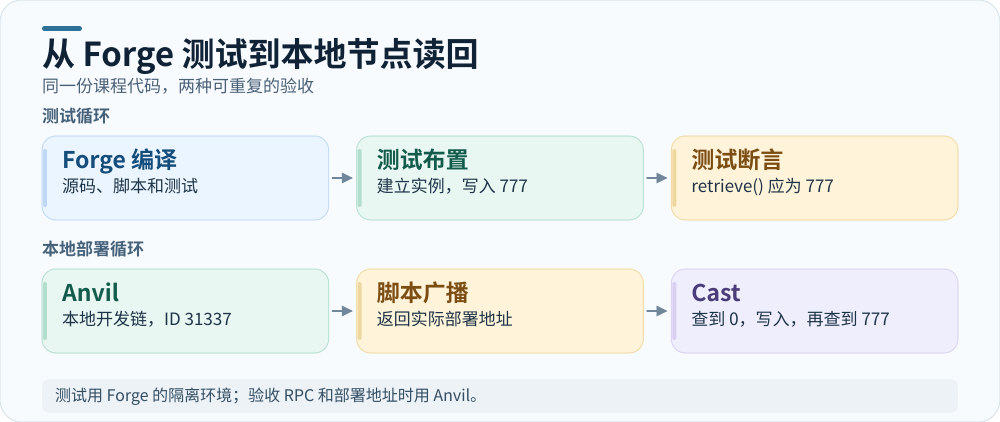

# 第 10 章 · Foundry 本地循环与第一项测试

在 Remix 保存 777 后，你可以当场看见结果。过几天有人改了合约，你愿意每次重做一遍点击吗？更稳妥的做法是把「建好实例、写入 777、读回应等于 777」写成一段能反复运行的测试。测试通过以后，再用本地节点跑一遍部署和调用，确认读到的确实来自正确的地址与网络。

本章复用[第 08 章的读写实验](./08-first-solidity-contract.md)和[第 09 章的地址、函数签名](./09-contract-composition.md)。全程用本地测试地址。

## 项目和三个工具

终端（terminal）是执行命令的窗口。当前工作目录是命令查找相对路径的位置。用 `pwd` 看目录，用 `ls` 看文件，用 `cd` 切换。Git 提交（commit）给一份项目快照提供可定位的版本。本例用课程仓库的固定提交，方便你和同学读到同一份代码和测试。

| 对象 | 这里的用途 |
| --- | --- |
| `src/SimpleStorage.sol` | 保存和读回数字的应用合约 |
| `script/DeploySimpleStorage.s.sol` | 统一创建合约的部署动作 |
| `test/SimpleStorageTest.t.sol` | 测试部署实例的行为 |
| `foundry.toml` | 项目配置，此处指定源码、产物和依赖目录 |
| `lib/` | 由项目提交锁定的依赖 |
| Forge | 编译、运行测试、模拟和广播部署脚本 |
| Anvil | 启动隔离的本地以太坊开发链 |
| Cast | 从终端读状态、发交易、查看链 ID 或回执 |

项目文件是磁盘上的源码；Anvil 运行的账本是一份单独的状态。重新启动一个新的本地节点时，要使用这一次部署的地址和状态，即使项目文件一个字也没改。



*图 10　从手工读写到两个可重复循环。测试在 Forge 的执行环境里验证规则，Anvil 和 Cast 验证本地链上的连接与调用。* [课程部署脚本](https://github.com/Cyfrin/foundry-simple-storage-cu/blob/5292eaf09b510b0f0ad168b7f90cfc0a11cbf08f/script/DeploySimpleStorage.s.sol#L8-L16) · [课程测试](https://github.com/Cyfrin/foundry-simple-storage-cu/blob/5292eaf09b510b0f0ad168b7f90cfc0a11cbf08f/test/SimpleStorageTest.t.sol#L9-L32)

## 从固定版本运行第一项测试

核查环境用了 Foundry `v1.3.1` 和 Solidity `0.8.19`。Foundry 安装后先执行 `forge --version`、`anvil --version`、`cast --version`，确认工具来自同一套安装。Windows 上可在 Git Bash 或 WSL 使用 Foundryup，也可取官方发布的 Windows 二进制，解压后从 PowerShell 调用；下面的命令块使用 Bash 语法。官方安装入口和具体版本见篇末。

在你用来做实验的目录取得独立的项目副本。课程的 `forge-std` 还引用了 `ds-test`，递归初始化会拉到对应提交。

```bash
git clone https://github.com/Cyfrin/foundry-simple-storage-cu
cd foundry-simple-storage-cu
git checkout --detach 5292eaf09b510b0f0ad168b7f90cfc0a11cbf08f
git submodule update --init --recursive
forge test --match-path test/SimpleStorageTest.t.sol
```

最后一步编译并运行测试。首次编译可能需要下载 Solidity 编译器；若提示找不到 `ds-test/test.sol`，在当前项目根目录核对递归子模块状态。这里使用项目固定的 `forge-std` 提交 `fc560fa34fa12a335a50c35d92e55a6628ca467c`。Windows 若报路径过长，可从短路径的实验目录执行，或在子模块命令加 `git -c core.longpaths=true`。用当前标签运行本章命令时，应看到 `testStoreNumber` 与 `testCreatePerson` 两个测试。本书用上述 Foundry 版本实跑，2 项通过。

课程的 `setUp()` 实例化 `DeploySimpleStorage`，执行 `run()`，为测试得到一份干净的 `simpleStorage`。`testStoreNumber` 可以按三个动作读：

1. **布置（arrange）**。准备预期的 `uint256` 数字 777。
2. **行动（act）**。在实例上执行 `store(777)`。
3. **断言（assert）**。比较 `retrieve()` 和预期值，相等才通过。

`testCreatePerson` 则写入 `Jon` 与 `25`，再用 `nameToFavoriteNumber(name)` 查映射。它验证按名结果；若也想检查列表长度，应再编写相应断言。Forge 测试可以独立运行，不需要另启动 Anvil，因为测试用 Forge 的执行环境。一个断言通过只说明对应的检查成立。

## 在 Anvil 上验证一次部署和调用

在终端一启动本地节点，并保持运行。默认开发链 ID 是 `31337`；如果端口已被占用，可另选一个端口并同步修改后续 RPC 地址。

```bash
anvil --host 127.0.0.1 --port 8545
```

在终端二进入同一项目。先取得链 ID 和本地的测试账户：

```bash
RPC=http://127.0.0.1:8545
cast chain-id --rpc-url "$RPC"
cast rpc eth_accounts --rpc-url "$RPC"
```

从返回列表复制一个地址，替换下一段的占位符 `<ANVIL_ACCOUNT>`。这些账户由本次 Anvil 管理，实验中可提交 `eth_sendTransaction` 请求。保留它们只供本地使用。脚本中 `vm.startBroadcast()` 与 `vm.stopBroadcast()` 划定要记录为交易的调用，末尾会返回新实例。先运行模拟，再按需要给脚本加 `--broadcast` 真正发送给本地节点。

```bash
SENDER='REPLACE_WITH_ANVIL_ACCOUNT'
forge script script/DeploySimpleStorage.s.sol:DeploySimpleStorage --rpc-url "$RPC" --sender "$SENDER" --unlocked
forge script script/DeploySimpleStorage.s.sol:DeploySimpleStorage --rpc-url "$RPC" --sender "$SENDER" --unlocked --broadcast
```

占位符需要换成真实的本地地址后才运行。第二条命令输出已部署的实例，据此填入 `ADDR`。也可在 `broadcast/DeploySimpleStorage.s.sol/31337/run-latest.json` 找这一轮 `CREATE` 记录的 `contractAddress`。不同运行产生的交易哈希、是否已有历史交易都可能改变地址或输出，读写使用本轮地址。

```bash
ADDR='REPLACE_WITH_DEPLOYED_ADDRESS'
cast call "$ADDR" "retrieve()(uint256)" --rpc-url "$RPC"
cast send "$ADDR" "store(uint256)" 777 --from "$SENDER" --unlocked --rpc-url "$RPC"
cast call "$ADDR" "retrieve()(uint256)" --rpc-url "$RPC"
```

| 实验动作 | 怎么判定结果 |
| --- | --- |
| `forge test` | 报告出现两项课程测试，断言通过 |
| `forge script` 无广播标志 | 看到模拟或预测结果，Anvil 上不应因这次模拟创建实例 |
| 脚本广播 | 在本地链产生创建实例的交易，取得实际部署地址 |
| 读、写、再读 | 两次只读分别返回 0、777，中间写入有单独的交易结果 |

如果第三个动作异常，先看命令使用的 RPC、地址以及第一次读取结果。确认地址上确实由本地部署添加了代码，再查看交易状态。下一章把这个循环用于[接收 ETH 的合约](./11-fund-me-and-price-feeds.md)，届时会看到更多输入、角色和依赖。

本书用 Foundry `v1.3.1` 和本机 Anvil 实跑部署、读取、写入和再次读取，观察到 `0 → 777`。

## 常见误区

- **把运行测试和广播部署当作一步。** 测试在隔离环境里观察行为。部署时还要检查网络、发出交易和目标代码。
- **误用 Git 分支当前版本。** 课程涉及多个编译器与依赖组合。先核对固定提交、`pragma` 和子模块 SHA。
- **把测试地址带出 Anvil。** 本地默认账户的密钥是公开的教学材料。使用独立的实验链与测试余额。
- **把模拟地址当成已经部署的地址。** 真正上链的结果应从广播记录和目标链确认。

## 练习与核对

1. 在测试文件找到产生输入和检查输出的两行。把输入临时改为你自己的值时，哪处预期也要跟着变？核对：若将同一个变量用于行动与断言，测试的意图保持，仍检查读回是否等于写入。可以在独立实验副本里尝试。
2. 只运行模拟而没有广播，为什么 Cast 用预测地址读不到既定结果？核对：模拟没有提交创建交易。检查 RPC 和目标链上的实际代码，等广播结果确认后指定新地址。
3. 浏览器在网络 A，Cast RPC 指向网络 B，显示同一个地址。两边的 777 是否必须一致？核对：各节点读取各自链上的状态。先比较链 ID 及部署记录，再比较数值。

## 来源

- 课程 fork [README.md · Foundry Fundamentals §1，L1072–1199](https://github.com/yuxiaoli/foundry-full-course-cu/blob/b92616c4212d40cacfeeff4ea0f30501cafad094/README.md#L1072-L1199) 与项目 [README.md · Setup / Usage](https://github.com/Cyfrin/foundry-simple-storage-cu/blob/5292eaf09b510b0f0ad168b7f90cfc0a11cbf08f/README.md#L59-L79)。
- 固定项目中的 [foundry.toml](https://github.com/Cyfrin/foundry-simple-storage-cu/blob/5292eaf09b510b0f0ad168b7f90cfc0a11cbf08f/foundry.toml#L1-L6)、[DeploySimpleStorage.s.sol](https://github.com/Cyfrin/foundry-simple-storage-cu/blob/5292eaf09b510b0f0ad168b7f90cfc0a11cbf08f/script/DeploySimpleStorage.s.sol#L1-L17) 与 [SimpleStorageTest.t.sol](https://github.com/Cyfrin/foundry-simple-storage-cu/blob/5292eaf09b510b0f0ad168b7f90cfc0a11cbf08f/test/SimpleStorageTest.t.sol#L1-L36)。
- [Foundry 官方安装文档](https://www.getfoundry.sh/introduction/installation) 与 [v1.3.1 发布页](https://github.com/foundry-rs/foundry/releases/tag/v1.3.1)，用于安装、版本与工具帮助。关于为什么部署的程序能被多次调用，可回看 [refs/B3_Web3_Fundamentals.md](../../../refs/B3_Web3_Fundamentals.md) 的 Smart Contracts（pp. 38–39，L962–1007）。

[全书目录](../README.md) · [本章来源映射](../../../planning/beginner/source-map.md#ch-10)
