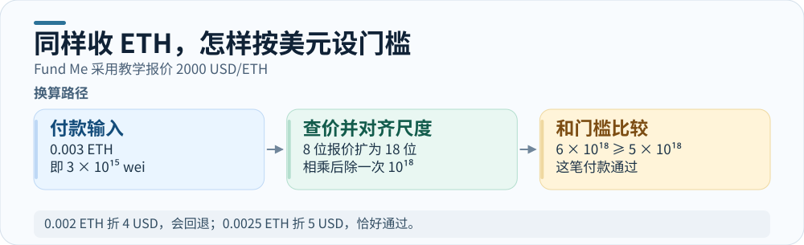

# 第 11 章 · Fund Me 的 ETH 收付、权限与价格预言机

小周给班级的开源工具筹款页面送去一笔 ETH。发起人约定每次至少折合 5 美元，因为太小的汇款会增加处理负担。小周第一次填 `0.002 ETH` 被拒，第二次改成 `0.003 ETH` 通过。这个合约必须知道三件事：用户送来多少 ETH、当时采用什么报价，以及筹款结束后谁能提走余额。

这里的报价固定为教学值 `1 ETH = 2000 USD`，只用于核对课程代码的数字。调用地址、只读和写入概念见[第 09 章](./09-contract-composition.md)，Solidity 数值和状态见[第 08 章](./08-first-solidity-contract.md)。

## 第一份可核对的付款表

智能合约里的 `msg.value` 是这一次调用附带的原生币数量，Solidity 在 EVM 上以 wei 表达它。以 payable（可收款）修饰的函数能接受这种附带金额。我们选课程的 `fund()` 作为入口，先问有没有达到门槛，然后记下是谁付了多少。

| 小周输入 | 调用中的 wei | 按 2000 USD/ETH 折合 | 预期 |
| --- | ---: | ---: | --- |
| 0.002 ETH | 2,000,000,000,000,000 | 4 USD | 回退 |
| 0.0025 ETH | 2,500,000,000,000,000 | 5 USD | 刚好通过 |
| 0.003 ETH | 3,000,000,000,000,000 | 6 USD | 通过 |



*图 11　将付款和报价统一到可比较的整数尺度。图中报价与金额用于教学。* [课程 PriceConverter.sol](https://github.com/Cyfrin/foundry-fund-me-cu/blob/d2834ea3b78a67dd4db6790e66c6c63971feebc5/src/PriceConverter.sol#L2-L22)

## 合约怎样知道美元价格

节点要能在同一份链上状态上重复执行一笔交易。让每个节点临时查网页价格，会遇到请求时刻、来源、网络可用性都不一致的问题。**预言机（oracle）**提供外部数据输入。本项目由 Chainlink 的价格馈送（price feed）合约在链上提供聚合报价，Fund Me 读取该合约已经登记的结果。被读取的数据有特定网络上的地址和精度；使用者要确认它实际上代表哪一组资产。

合约接口（interface）描述可用的函数签名与返回格式。项目使用 `AggregatorV3Interface.latestRoundData()` 获取一组轮次信息，其中 `answer` 是经过整数缩放的报价。课程调用把这一个字段取出来。**定点数（fixed-point number）**用整数和事先约定的小数位表示数值。在本地 fixture 的 8 位小数下，`2000 × 10^8 = 200000000000` 是合约看到的整数；它的意思是 2000 USD/ETH。

如果把这份报价换到 18 位，就要再乘 `10^10`。`0.003 ETH` 又是 `3 × 10^15 wei`。课程换算相当于：

```text
price18 = 2000 × 10^8 × 10^10 = 2000 × 10^18
ethAmountInUsd = price18 × (3 × 10^15) ÷ 10^18
               = 6 × 10^18
minimum       = 5 × 10^18
```

分子有两个尺度，要除去一份 `10^18`，得到以 18 位小数表示的美元量。最后对两个同单位整数做 `>=` 比较。对这里的非负整数，Solidity 除法会去掉不足一个最小单位的余数，所以接近门槛的例子需要按实际整数计算。课程用固定倍数演示 8 位报价；换其他 feed 时应核对 `decimals()` 和价格是否有效。[第 18 章](../04-assets-protocols-and-governance/18-overcollateralized-stablecoin.md)会补充时间戳、轮次和报价过期的检查。

## 谁可以把余额提走

在 Foundry 版中，`fund()` 先用 `require` 检查换算金额，再把 `msg.value` 累加到 `s_addressToAmountFunded[msg.sender]`，并把出资者加入列表。用新实例单独执行表中的 `0.003 ETH` 付款时，若合约起初没有余额且期间没有其他入账，合约余额和小周累计支付都增加 `0.003 ETH`。若门槛失败，执行回退（revert），这次附带的 ETH 和合约状态更新都不会保留。作为实际已执行交易的 Gas 仍另算。

`withdraw()` 受修饰器（modifier）`onlyOwner` 约束。这里的所有者由构造函数（constructor）在部署时记录。修饰器先拿本层 `msg.sender` 比较，检查通过再执行函数体。课程 Foundry 版在越权时使用自定义错误（custom error）`FundMe__NotOwner()`。小周可以付款；如果他没有部署者角色，就不能因此提款。角色取决于函数及条件，见[第 20 章](../04-assets-protocols-and-governance/20-governance-before-dao.md)的治理规则与执行权。

接着，提款函数清除出资记录及列表，再用 `call{value: ...}` 将当前余额交给所有者，检查返回的布尔值。这样读起来有三个步骤，先检查权限，按期望修改本合约状态，最后与外部账户交互。如果对外调用失败，`require(success)` 把这轮提款执行整体回退。合约存储的出资映射与 ETH 余额仍对应各自的职责，前者是本应用的记账规则，后者是链的余额字段。

## 两份课程实现怎样对照

本章引用的 Remix EVM 版声明 `^0.8.18`，`PriceConverter.getPrice()` 使用课程时点的 Sepolia 地址。Foundry 项目固定 Solidity `0.8.19`，构造参数接收 `priceFeed`，`PriceConverter.getConversionRate` 因此带有这个依赖。讲原理可以用同一张表；运行本地实验时选 Foundry 脚本注入 mock。第 12 章会[模拟报价和复核提款](./12-testing-external-dependencies.md)，第 13 章再用[同一收款入口](./13-wallet-to-dapp.md)接前端。直接向地址转币能否触发特定函数，取决于目标版本的入口和调用数据。按本书实验明确调用 `fund()`。

Remix 版的 `receive()` 与 `fallback()` 调用 `fund()`，所以某些直接给合约发送 ETH 的请求也会走金额门槛。固定 Foundry 版没有这两个入口，本书后续实验均显式调用 `fund()`。

## 常见误区

- **把 5 当成 5 ETH。** `MINIMUM_USD` 表示按 18 位小数编码的 5 USD，`msg.value` 仍是 wei。比较前先转换单位。
- **以为查询网页价格等同于合约的报价。** 应查本合约配置的链上 feed 及它提供的精度、时点和资产对。
- **以为任何捐款人都可以提款。** 看具体入口的调用者检查。课程按部署者设所有者。
- **以为函数声明 payable 就会认可任意金额。** 这个声明允许带值调用，业务门槛和交易执行仍要通过。

## 练习与核对

1. 仍付 `0.003 ETH`，把报价换成 `1000 USD/ETH`。核对：折合 3 USD，`3 × 10^18 < 5 × 10^18`，应回退。第 12 章用它设计两报价练习。
2. 试用 8 位课程报价重新算 `0.0025 ETH`，解释边界是否通过。核对：折合正好 5 USD，代码使用 `>=`，所以通过。
3. 所有者成功提款后，出资映射和合约 ETH 余额应显示什么？若实际收款失败呢？核对：课程成功路径清理映射及列表并转出余额；失败引发回退，清理不应局部保留。交易 Gas 仍由相应规则计费。

## 来源

- 课程 fork [README.md · Solidity 101 §3，L854–1023](https://github.com/yuxiaoli/foundry-full-course-cu/blob/b92616c4212d40cacfeeff4ea0f30501cafad094/README.md#L854-L1023)，及 Remix [FundMe.sol](https://github.com/Cyfrin/remix-fund-me-cu/blob/35d7b13ee0c495c32fbe1295d497294d1b9f9744/FundMe.sol#L1-L79)、[PriceConverter.sol](https://github.com/Cyfrin/remix-fund-me-cu/blob/35d7b13ee0c495c32fbe1295d497294d1b9f9744/PriceConverter.sol#L10-L30)。
- Foundry 版 [FundMe.sol · 状态、构造、付款和提款](https://github.com/Cyfrin/foundry-fund-me-cu/blob/d2834ea3b78a67dd4db6790e66c6c63971feebc5/src/FundMe.sol#L23-L87)、[PriceConverter.sol](https://github.com/Cyfrin/foundry-fund-me-cu/blob/d2834ea3b78a67dd4db6790e66c6c63971feebc5/src/PriceConverter.sol#L2-L22) 与 [HelperConfig.s.sol · 本地精度和初始报价](https://github.com/Cyfrin/foundry-fund-me-cu/blob/d2834ea3b78a67dd4db6790e66c6c63971feebc5/script/HelperConfig.s.sol#L7-L16)。
- [refs/B3_Web3_Fundamentals.md](../../../refs/B3_Web3_Fundamentals.md)，The Economy · Oracles（pp. 42–43，L1079–1099），用于外部数据进入链上应用的背景。

[全书目录](../README.md) · [本章来源映射](../../../planning/beginner/source-map.md#ch-11)
