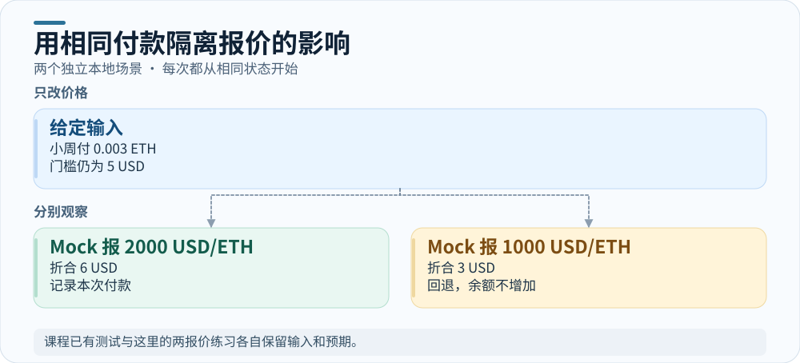

# 第 12 章 · Fund Me 的部署配置、模拟依赖与测试

同样付 `0.003 ETH`，小周在报价为 `2000 USD/ETH` 时筹款成功，在报价为 `1000 USD/ETH` 时被拒。若每次测试都去读一个随时间变化的公共报价，就很难知道失败是代码变了还是价格变了。本章先把报价和付款拆开控制，再用断言验证筹款结果。

先读[第 11 章的 5 USD 门槛](./11-fund-me-and-price-feeds.md)。测试依然按[第 10 章](./10-local-foundry-loop.md)的「布置、行动、断言」三步组织。

## 一个依赖，两份固定答案

合约从链上价格合约取得报价。对 Fund Me 来说，外部价格合约就是依赖（dependency）。本地测试用**模拟对象（mock）**实现同一个读取接口，但由测试设置返回值。固定两个独立场景中的支付者、初始余额、部署者和付款金额，仅改变报价。

| 场景 | Mock 返回的整数，8 位小数 | 付款 | 折合 | 应检查 |
| --- | ---: | ---: | ---: | --- |
| A | 2000 × 10⁸ | 0.003 ETH | 6 USD | 调用通过，合约和该用户记录各增加 0.003 ETH |
| B | 1000 × 10⁸ | 0.003 ETH | 3 USD | 门槛不足而回退，本次未增加合约和用户记录 |



*图 12　从同一付款分成两个独立测试。固定的报价代表测试输入，输出由 Fund Me 的门槛规则决定。* [HelperConfig.s.sol · 本地 mock 设定](https://github.com/Cyfrin/foundry-fund-me-cu/blob/d2834ea3b78a67dd4db6790e66c6c63971feebc5/script/HelperConfig.s.sol#L7-L16) · [MockV3Aggregator.sol](https://github.com/Cyfrin/foundry-fund-me-cu/blob/d2834ea3b78a67dd4db6790e66c6c63971feebc5/test/mock/MockV3Aggregator.sol#L26-L70)

两组对照是本书练习。2000 USD/ETH 沿用课程的默认报价，1000 USD/ETH 是这项练习另设的输入。固定课程的 `HelperConfig` 创建本地 mock 时用 `DECIMALS = 8` 和 `INITIAL_PRICE = 2000e8`；真实的单元测试可能采用其他付款输入，例如 fixture 定义 `SEND_VALUE = 0.1 ether`。用课文验证函数行为时须对照实际测试，不要把这张表当成已有测试的运行记录。

## 部署如何找到正确的价格合约

`DeployFundMe.deployFundMe()` 建立 `HelperConfig`，按 `block.chainid` 取报价地址，再把它交给 `new FundMe(priceFeed)`。这种在创建时指定依赖的做法叫**依赖注入（dependency injection）**。同一份 Fund Me 代码可以接不同的地址，配置负责本地与测试网络的区分。

课程的本地分支由 `getOrCreateAnvilEthConfig()` 创建并复用 mock。核对当前 `block.chainid`、当前配置中的 feed 地址和合约自己保存的地址。测试的 `testPriceFeedSetCorrectly` 就是对这一配置关系的检查。模拟对象由支持该接口的 Solidity 合约实现，`MockV3Aggregator.updateAnswer` 能替换报价，`latestRoundData` 返回测试可读取的字段。依赖被替换后，Fund Me 的金额换算和权限分支仍由真实项目代码执行。

## 看懂已有断言和测试工具

Foundry 的测试辅助调用（cheatcode）改变测试执行环境。课程里的 `vm.deal` 给测试地址分配余额，`vm.prank` 只改下一次调用的发送者，`vm.startPrank` 持续到相应的 `stopPrank`，`vm.expectRevert` 声明下一次操作应回退。这些能力属于测试环境。创设不同用户和失败条件后，仍需写出状态或回退的具体预期。

| 测试 | 从代码读出的主要断言 |
| --- | --- |
| `testFundFailsWithoutEnoughETH` | 附带金额不足的调用应回退 |
| `testFundUpdatesFundedDataStructure` | 用户的累计付款记录等于测试中的输入 |
| `testOnlyOwnerCanWithdraw` | 使用非所有者调用提款应回退 |
| `testWithdrawFromASingleFunder` | 成功提款后合约余额清空，所有者收到应收金额 |
| `testUserCanFundAndOwnerWithdraw` | 把用户付款和提款脚本连起来检查合约余额、付款者和所有者余额 |

查一个失败时，先把问题缩到一个入口和一个条件。在当前目录运行匹配测试名的命令，记录实际触发的错误或状态，之后才加日志。断言只声明「会回退」时，即使错误原因与预期不符也可能通过。如果你希望确认特定原因，按源码选相应自定义错误或回退信息，并确认该断言确实用于此次调用。

## 四类结果有什么用

- **单元测试（unit test）**聚焦一个行为，如付款门槛。用可控的依赖把其他条件固定。
- **集成测试（integration test）**串起组件，如合约、依赖和提款脚本。资金流需要在测试末尾核对。
- **分叉测试（fork test）**在本地借用某网络某一块的状态。记录 RPC 所指网络与区块高度；本地动作不会因此提交到原链。网络可用性仍会影响运行。
- **测试网实验（testnet exercise）**确实在远程测试网络发交易，所以还涉及账户、确认、RPC、已有部署和测试余额。它回答的问题与本地单元测试不同。

覆盖率（coverage）帮助找出哪些代码没被练习覆盖。断言决定练习验证了什么。目标是明确覆盖角色、边界和状态结果，不能只凭行覆盖数字为整个流程下结论。

## 本地复现

在独立副本中检出下列提交，初始化递归依赖。核查采用 Foundry `v1.3.1`、Solidity `0.8.19`。本地默认分支会创建 mock，无需远端价格 RPC；某些夹具显式跳过 ZKsync，迁移测试前读其修饰器。

```bash
git clone https://github.com/Cyfrin/foundry-fund-me-cu
cd foundry-fund-me-cu
git checkout --detach d2834ea3b78a67dd4db6790e66c6c63971feebc5
git submodule update --init --recursive
forge test --match-path test/unit/FundMeTest.t.sol
forge test --match-path test/integration/InteractionsTest.t.sol
```

核查目录中单元文件 7 项通过，集成文件 1 项通过。可以用 `forge test --match-test testOnlyOwnerCanWithdraw -vv` 集中观察权限检查。课堂两报价练习可以在另一个测试文件实现，先按实际条目取得 mock，再分别重置状态执行 A、B，避免第一个断言的余额影响第二个。浏览器从哪里读余额、怎样发起同一款操作见[第 13 章](./13-wallet-to-dapp.md)；异步回调用[第 14 章](./14-raffle-async-events.md)的例子。

## 常见误区

- **把模拟返回当成公共价格证据。** 它是本次实验的输入，用于验证我们在给定输入下的逻辑。
- **把所有地址和网络写死在合约里。** 先看构造函数和配置如何选择依赖；测试与部署应使用同一套参数含义。
- **以为 `prank` 给账号充值。** 它改变调用者身份，余额由测试另行设置。
- **把测试通过解释为整条远端业务通过。** 写清测试选择的网络、先决条件、覆盖路径和具体断言。

## 练习与核对

1. 在两个独立场景分别设置 `2000e8` 和 `1000e8`，用同一个 `0.003 ETH`。核对：一份通过并记录付款，另一份回退，初始余额保持。
2. 若课程测试只写 `vm.expectRevert()`，能否知道为什么回退？核对：仅知预期路径上发生回退。进一步核对错误选择器、消息或追踪，才可定位原因。
3. 你想验证「测试网 feed 地址配置正确」和「最低金额的计算正确」。需要哪两类验证？核对：先做本地单位与边界测试，再按具体网络检查配置及依赖接口；本地 mock 不验证某个远端地址。

## 来源

- [Foundry Fund Me · HelperConfig.s.sol](https://github.com/Cyfrin/foundry-fund-me-cu/blob/d2834ea3b78a67dd4db6790e66c6c63971feebc5/script/HelperConfig.s.sol#L7-L87)、[DeployFundMe.s.sol](https://github.com/Cyfrin/foundry-fund-me-cu/blob/d2834ea3b78a67dd4db6790e66c6c63971feebc5/script/DeployFundMe.s.sol#L7-L22)、[foundry.toml](https://github.com/Cyfrin/foundry-fund-me-cu/blob/d2834ea3b78a67dd4db6790e66c6c63971feebc5/foundry.toml#L1-L17)。
- 测试证据 [FundMeTest.t.sol，L28–138](https://github.com/Cyfrin/foundry-fund-me-cu/blob/d2834ea3b78a67dd4db6790e66c6c63971feebc5/test/unit/FundMeTest.t.sol#L28-L138) 和 [InteractionsTest.t.sol，L27–57](https://github.com/Cyfrin/foundry-fund-me-cu/blob/d2834ea3b78a67dd4db6790e66c6c63971feebc5/test/integration/InteractionsTest.t.sol#L27-L57)。课程补读 [Updraft · Running tests on chains forks，L9–89](https://github.com/Cyfrin/Updraft/blob/1d7138f18fbe26bfff82a091df118efda52f29e7/courses/foundry/2-foundry-fund-me/10-running-tests-on-chains-forks/%2Bpage.md#L9-L89)。
- [refs/B3_Web3_Fundamentals.md](../../../refs/B3_Web3_Fundamentals.md)，Oracles（pp. 42–43，L1079–1099）。用于解释模拟对象所代表的外部数据角色。

[全书目录](../README.md) · [本章来源映射](../../../planning/beginner/source-map.md#ch-12)
