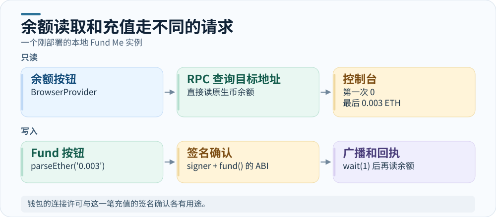

# 第 13 章 · 从网页按钮到钱包确认和合约调用

小周打开本地筹款页。刚部署的 Fund Me 余额是 0。他点一次余额按钮，看见 0，再输入 `0.003 ETH` 并点击 Fund。钱包要求确认这笔充值。等交易有回执后，他再点同一个余额按钮，看见 `0.003 ETH`。先走完这一次操作，然后再拆开按钮、钱包、请求和合约。

## 先走一遍最小流程

沿用[第 11 章的 2000 USD/ETH 教学报价](./11-fund-me-and-price-feeds.md)与[第 12 章的本地 mock 部署](./12-testing-external-dependencies.md)。例子开始时合约刚部署，小周有独立本地测试账号及足够测试 ETH。假设没有其他人入账或提款。

1. 按下方命令部署 Fund Me，记下名称为 `FundMe` 的地址。脚本在本地链 ID `31337` 上会同时创建价格 mock，网页要用 `FundMe` 的地址。
2. 在独立副本准备 [html-fund-me-cu 的固定网页版本](https://github.com/Cyfrin/html-fund-me-cu/tree/740cd435e52fefacbab4f9dc5c6f4cf3c5e9f414)。将 `constants.js` 的 `contractAddress` 改成刚部署的地址，保留与该部署相匹配的 ABI。在网页目录开一个仅绑定本地的静态服务器。
3. 让浏览器钱包连接到同一个本地 RPC 和对应链 ID，选本地测试账号。打开页面并连接账号。如果钱包弹出「允许此网站查看账户」，这是连接权限。随后点余额按钮，在开发者工具的 Console 读第一行余额，预期为 0。
4. 输入 `0.003` 并点 Fund。钱包应显示目标和附带金额。在本地测试网络确认，从钱包活动中确认成功回执，然后再点余额按钮。Console 中第二次余额输出预期为 `0.003`。课程网页把结果写进控制台，不会自动更新一个余额标签。

### 本地部署与网页启动

按[第 10 章](./10-local-foundry-loop.md)启动 Anvil，记下本地 RPC 与其中一个有测试余额的地址。进入[第 12 章](./12-testing-external-dependencies.md)准备的独立 Fund Me 副本，仅在该副本的 `foundry.toml` 中去掉 `[etherscan]` 节的标题与下面两行。固定课程配置引用了浏览器验证所用环境变量，Foundry `v1.3.1` 在本地广播时也会载入这项配置。将下面 `SENDER` 的占位文本换成 Anvil 已解锁的地址，然后运行命令。 [课程验证配置 L11–13](https://github.com/Cyfrin/foundry-fund-me-cu/blob/d2834ea3b78a67dd4db6790e66c6c63971feebc5/foundry.toml#L11-L13)

```bash
RPC=http://127.0.0.1:8545
SENDER='REPLACE_WITH_ANVIL_ACCOUNT'
forge script script/DeployFundMe.s.sol:DeployFundMe \
  --rpc-url "$RPC" --sender "$SENDER" --unlocked --broadcast
```

使用脚本输出中 `FundMe` 的地址。将浏览器测试钱包的本地网络指向同一 RPC，链 ID 填 `31337`。可在独立的测试钱包配置中导入 Anvil 本次启动显示的另一临时账号，使付款人与部署者分开。只在这一轮本地实验使用该账号。另开终端启动网页。

```bash
# 在独立的网页项目根目录运行
python -m http.server 8000 --bind 127.0.0.1
```

浏览器打开 `http://127.0.0.1:8000/`。若想单独核对回执，可从钱包活动里复制哈希，在配置了同一 `RPC` 的终端执行 `cast receipt "$TX_HASH" --rpc-url "$RPC"`，其中 `TX_HASH` 使用复制到的值。按钮路径对照网页源码。



*图 13　小周的读、写、再读。读取请求从节点返回余额；写入请求经钱包确认，由本地节点执行。* [课程 index.js · fund 与 getBalance](https://github.com/Cyfrin/html-fund-me-cu/blob/740cd435e52fefacbab4f9dc5c6f4cf3c5e9f414/index.js#L48-L81)

## 两个按钮，经过的部件各有用途

在 `index.html` 中，按钮有对应的 `id`，脚本按这些 ID 绑定点击事件（click event）。`index.js` 导入该项目内的 ethers **6.7** ESM 模块。JavaScript 的 `async` 与 `await` 表示等待返回后，再继续当前异步函数的后续操作。用户点一次按钮不表示 RPC 已返回；页面可以在响应前保持可操作。

**提供者（provider）**给网页一个节点连接。项目把钱包注入的 `window.ethereum` 交给 `ethers.BrowserProvider`。余额按钮通过 `provider.getBalance(contractAddress)` 读取这个地址的 ETH 余额。结果以 wei 给出，脚本用 `ethers.formatEther` 转成人读的 ETH 数。这个按钮既无需把值送进 Fund Me 的 ABI，也无需创建一笔交易：节点本来就能报告地址的原生币余额。

**签名者（signer）**代表一个可以授权交易的账户。Fund 按钮取网页输入，调用 `ethers.parseEther` 将十进制字符串转换为 wei，然后用 provider 取得 signer，并以目标地址和 ABI 建立合约对象。沿[第 09 章](./09-contract-composition.md)的约定，ABI 让调用端把 `fund()` 的入口编码正确。传入的 `{ value: ... }` 是附加交易金额。它不写成 `fund(amount)` 的 Solidity 参数。

项目在提交后用 `transactionResponse.wait(1)` 等待一份满足确认条件的交易回执。读回结果要看本次交易成功以及目标状态。用户拒绝授权、错误的网络、余额不足或金额低于门槛都可能使流程提前结束。把「拿到交易响应」「执行成功」和「已达到跨网络的最终性要求」分别判断，参照[第 01 章](../01-ethereum-l1/01-trace-a-transfer.md)。

| 界面动作 | 所用身份或接口 | 读者可观察的结果 |
| --- | --- | --- |
| 允许网页查看账户 | 钱包连接权限 | 网页得到已授权地址 |
| 点击余额 | provider 查询目标地址 | 控制台输出数值 |
| 点击 Fund 并确认 | signer 提交对合约的有值调用 | 钱包、交易记录与回执 |
| 再点余额 | provider 再查同一地址 | 本例从 0 变为 0.003 ETH |

## 排查时先检查四个值

- **当前网络和 RPC**。在钱包里查看链 ID，与 Anvil 的结果比对。切换网络后同一地址可以有完全不同的账本。
- **目标合约地址与代码**。对照刚广播的地址；在本地可用 `cast code "$ADDR" --rpc-url "$RPC"` 确认它不是空代码。读到地址余额为 0 本身不足以确认部署成功。
- **ABI 和金额单位**。页面用的是 `fund()` 的签名与一份消息金额。检查把 `"0.003"` 转为 `3000000000000000` wei 的过程。
- **回执与失败原因**。如果提交成功但执行失败，检查状态与门槛。附带 ETH 不应在回退后留在合约，Gas 另计。若连提交都没有，先看钱包弹窗与控制台错误。

## 常见误区

- **把 Connect 当成一次付款确认。** 它只是允许网站访问账户信息。充值是另一项明确授权的交易。
- **把合约对象当成持币钱包。** 地址和 ABI 描述目标。signer 所代表的测试账户为发出的交易负责。
- **拿到响应就假定余额已经改变。** 先等执行回执，再发新的读取请求。课程页面不会自动替你更新界面。
- **使用 ethers v5 的例子套在这份项目上。** 项目导入 6.7，使用 `BrowserProvider` 以及顶层的 `parseEther` 和 `formatEther`。

## 练习与核对

1. 写出「读余额」与「充值」各经过哪些部件。核对：读取只需要 provider 和目标地址；充值多了 signer、ABI 所编码的调用、附带价值和回执。
2. 在同一初值下改输 `0.002`，报价仍为 2000。核对：折 4 USD，应在估算或执行阶段显示失败，余额不增加。查看是否实际提交，二者有不同的记录。
3. 接错网络却看到余额 0。核对：余额可以是有效的读数，但对应另一份账本；先核对 RPC 和链 ID，再核对部署地址与代码，最后比对已发生的交易。

## 来源

- [html-fund-me-cu · index.html](https://github.com/Cyfrin/html-fund-me-cu/blob/740cd435e52fefacbab4f9dc5c6f4cf3c5e9f414/index.html#L1-L19)、[index.js · 钱包与按钮](https://github.com/Cyfrin/html-fund-me-cu/blob/740cd435e52fefacbab4f9dc5c6f4cf3c5e9f414/index.js#L1-L26)、[index.js · fund 与 getBalance](https://github.com/Cyfrin/html-fund-me-cu/blob/740cd435e52fefacbab4f9dc5c6f4cf3c5e9f414/index.js#L48-L81)、[constants.js · 地址与 ABI](https://github.com/Cyfrin/html-fund-me-cu/blob/740cd435e52fefacbab4f9dc5c6f4cf3c5e9f414/constants.js#L1-L45)。
- [Updraft · How MetaMask works with the Browser，L9–194](https://github.com/Cyfrin/Updraft/blob/1d7138f18fbe26bfff82a091df118efda52f29e7/courses/foundry/3-html-fund-me/4-metamask/%2Bpage.md#L9-L194) 和 [ethers v6 · Providers](https://docs.ethers.org/v6/api/providers/)。
- 《Web3 Fundamentals》，Crypto Wallet、Public & Private Keys（pp. 24–25，L606–646）。钱包与签名接口按实际课程代码理解，原书的托管和密钥类比用于背景。
