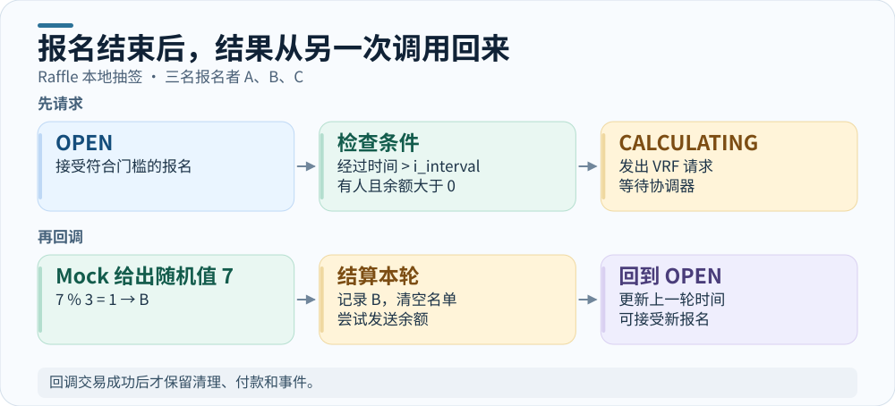

# 第 14 章 · Raffle 的事件、状态机与异步回调

想象三个学生在本地测试链模拟一次抽签。报名在星期一完成，名单和测试金早已到齐，抽签所需的随机数却要等另一方稍后送来。负责登记的人先关闭报名、取得请求编号，收到编号对应的结果才开奖。这一轮结束后，名单被清理，又可开始下一轮。

第 12 章里，Fund Me 调用价格 mock 就拿到现成的答案。现在沿用 mock 与断言的办法，观察答案在**另一笔调用**里回来。本章只在隔离的课程测试环境推演。

## 先在纸面上走完一轮

为教学取三个不同地址 A、B、C，各附带 `0.01` 测试 ETH。假设最低入口费允许这个输入，并且此前无入账。记开轮的时刻为 `t0`，最后要比较 `block.timestamp - t0` 和课程配置 `i_interval`。为了专注流程，图里随机值用 7，实际测试用 mock 的结果及断言。

| 阶段 | 执行的入口 | 合约可以观察的状态 |
| --- | --- | --- |
| 三次报名 | `enterRaffle` | `OPEN`，名单为 A、B、C，余额 0.03 测试 ETH |
| 刚到间隔 | `checkUpkeep` | 本版本要求严格大于，刚等于时仍为 false |
| 条件成立、请求结果 | `performUpkeep` | 切换 `CALCULATING`，产生请求编号 |
| 模拟协调器给出 7 | `fulfillRandomWords` | `7 % 3 = 1`，按零基索引得到 B |
| 本轮成功结束 | 回调里完成状态更新和付款 | B 取得当时的 0.03，名单清空，记录最近胜者和时间，状态回到 `OPEN` |



*图 14　Raffle 的一轮状态机。随机值 7 与三名参与者是教学输入，状态和触发条件来自固定课程代码。* [课程 Raffle.sol](https://github.com/Cyfrin/foundry-smart-contract-lottery-cu/blob/742fc90fcadc2b89559b97607115793547fba831/src/Raffle.sol#L92-L184)

## 状态机怎样限制动作

状态机（state machine）用一组明确状态及转换约束动作。课程用枚举（enum）`RaffleState` 定义 `OPEN`、`CALCULATING`。`enterRaffle` 检查付款达到入口费，并要求状态为开放。符合条件才把发送者加入名单。一个新的报名交易会改变状态，反之仅查看当前状态不会改变名单。

智能合约不会因为时间流逝就自动执行一条指令。课程的 Chainlink Automation 是链下检查与提交交易的角色。`checkUpkeep` 只读地报告条件，要求间隔已严格超过阈值、状态为 `OPEN`、至少有一个人、合约还有正余额。达到条件之后，经 `performUpkeep` 才实际发起请求。这个入口自己再检查，避免依据已经过时的只读结果转换状态。创建请求前切换到 `CALCULATING`，关闭这一轮继续报名。

## 请求和回答为什么分开

可验证随机函数（Verifiable Random Function，VRF）为合约提供可验证的随机结果。在订阅模型里，合约向协调器提交参数与随机数请求，得到标识这份请求的编号（request ID）。服务随后处理请求，协调器核验证明，并经消费者基类允许的入口调用 `fulfillRandomWords`。这一步是异步回调（asynchronous callback）。发出请求和处理结果在链上可以相隔若干区块。课程本地测试用协调器 mock 模拟答案何时到达；mock 测试关注消费合约的状态与结算逻辑。

回调取首个随机字，用 `randomWords[0] % s_players.length` 得到列表索引。纸面例子里 7 除以 3 的余数为 1，所以是第二位 B。回调记录最近胜者，清空名单，重设时间与状态，随后尝试将合约余额付给胜者。如果付款失败，代码通过自定义错误（custom error）回退这次回调；本次预先清理的状态与事件也随回调回退。上一次交易成功写入的请求和 `CALCULATING` 状态仍在。Chainlink VRF V2.5 不会替这个失败的 `fulfillRandomWords` 重试。 [Chainlink VRF 回调要求](https://docs.chain.link/vrf/v2-5/security#fulfillrandomwords-must-not-revert)这个故事适合复核一轮行为，本地随机协调器模拟不验证实际远端证明系统或服务可用性。

## 日志可观测，状态供合约使用

事件（event）把信息写入交易日志（log），便于区块浏览器、测试和界面按条件查找。这个项目在报名发 `RaffleEnter`，成功提交请求时发 `RequestedRaffleWinner`，开奖时发 `WinnerPicked`。请求编号方便把两阶段对起来。合约自己的执行仍要依赖可访问的存储字段和相应参数。回想[第 03 章](../01-ethereum-l1/03-state-execution-and-gas.md)的回执与状态：日志记录一件事发生，状态字段记住应用当前所处阶段。

## 让测试控制时间和回调

`vm.warp` 在测试里设置时间戳，`vm.roll` 设置区块号。课程的 `testCheckUpkeepReturnsFalseIfEnoughTimeHasntPassed` 与 `testCheckUpkeepReturnsTrueWhenParametersGood` 检验时间和前置条件。练习另外明确测 `t0 + interval` 与 `t0 + interval + 1`。测试事件可以用 `vm.expectEmit` 匹配日志，或用 `vm.recordLogs` / `getRecordedLogs` 提取一个请求编号。固定测试中的三个观察点如下。

| 既有测试 | 读代码时要核对 |
| --- | --- |
| `testEmitsEventOnEntrance` | 报名后哪个地址随指定事件被记录 |
| `testPerformUpkeepUpdatesRaffleStateAndEmitsRequestId` | 发出请求之后状态是否为 `CALCULATING`，编号从哪条日志提取 |
| `testFulfillRandomWordsPicksAWinnerResetsAndSendsMoney` | 模拟回调后胜者、余额、状态、参与人数与时间是否满足断言 |

本地实跑使用 Foundry `v1.3.1`、Solidity `0.8.19`、课程固定 `chainlink-brownie-contracts` Git 子模块，以及 `foundry-devops` 的明确重映射。指定测试路径共 14 项通过。以下命令在独立副本运行。长路径的 Windows 工作目录可改为较短路径。

```bash
git clone https://github.com/Cyfrin/foundry-smart-contract-lottery-cu
cd foundry-smart-contract-lottery-cu
git checkout --detach 742fc90fcadc2b89559b97607115793547fba831
git -c core.longpaths=true submodule update --init --recursive
forge test --remappings 'foundry-devops/=lib/foundry-devops/' --match-path test/unit/RaffleTest.t.sol
```

本例导入 `VRFConsumerBaseV2Plus` 和 `VRFV2PlusClient`，参照 Chainlink VRF V2.5 请求结构。早期课文中的 V2 名称和 `>=` 条件与本项目快照不完全一致。以本合约的导入、签名和 `>` 条件为准。新版本部署时重新核对依赖和网络配置；本书实验只用 mock。[第 26 章](../05-optional-projects/26-invariants-and-defensive-review.md)会把多个动作的顺序变为重复验证的性质。

## 常见误区

- **以为到点就会凭空触发合约。** 到点只是条件，状态变化还要经交易执行入口。
- **把请求编号当成随机值。** 编号用来关联请求和结果，随机字由经过协调器的回调提供。
- **把事件当作应用后续执行能读的变量。** 事件供外部观察。持续状态保存在合约自己的字段里。
- **以为本地协调器测试覆盖了远端服务。** 它覆盖教学合约如何消费结果，网络配置、费用与真实证明过程另有先决条件。

## 练习与核对

1. 状态为 `OPEN`、三人已有入场且余额为正。时钟正好等于阈值时能否开始？核对：本快照返回 false；将时间再加一秒可以使时间条件成立。
2. 随机字改为 8，名单不变。核对：`8 % 3 = 2`，索引 2 为 C。观察回调后列表长度、状态和赢家字段。
3. 请求已发出，另一个同学尝试报名。核对：状态为 `CALCULATING`，`enterRaffle` 应拒绝。对照测试中的输入、发送者与已存在的调用顺序。

## 来源

- 固定项目 [Raffle.sol，L24–184](https://github.com/Cyfrin/foundry-smart-contract-lottery-cu/blob/742fc90fcadc2b89559b97607115793547fba831/src/Raffle.sol#L24-L184)、[RaffleTest.t.sol，L60–273](https://github.com/Cyfrin/foundry-smart-contract-lottery-cu/blob/742fc90fcadc2b89559b97607115793547fba831/test/unit/RaffleTest.t.sol#L60-L273)、[foundry.toml](https://github.com/Cyfrin/foundry-smart-contract-lottery-cu/blob/742fc90fcadc2b89559b97607115793547fba831/foundry.toml#L1-L14) 与 [.gitmodules](https://github.com/Cyfrin/foundry-smart-contract-lottery-cu/blob/742fc90fcadc2b89559b97607115793547fba831/.gitmodules#L1-L12)。
- [Updraft · Implement the Chainlink VRF，L9–37](https://github.com/Cyfrin/Updraft/blob/1d7138f18fbe26bfff82a091df118efda52f29e7/courses/foundry/4-smart-contract-lottery/9-implement-the-chainlink-vrf/%2Bpage.md#L9-L37)、[Implementing Chainlink Automation](https://github.com/Cyfrin/Updraft/blob/1d7138f18fbe26bfff82a091df118efda52f29e7/courses/foundry/4-smart-contract-lottery/19-implementing-chainlink-automation/%2Bpage.md#L8-L150)、[Chainlink VRF V2.5 · Subscription](https://docs.chain.link/vrf/v2-5/overview/subscription)。
- [refs/B3_Web3_Fundamentals.md](../../../refs/B3_Web3_Fundamentals.md)，Oracles（pp. 42–43，L1079–1099），用于将外部结果接入链上应用的概念背景。

[全书目录](../README.md) · [本章来源映射](../../../planning/beginner/source-map.md#ch-14)
