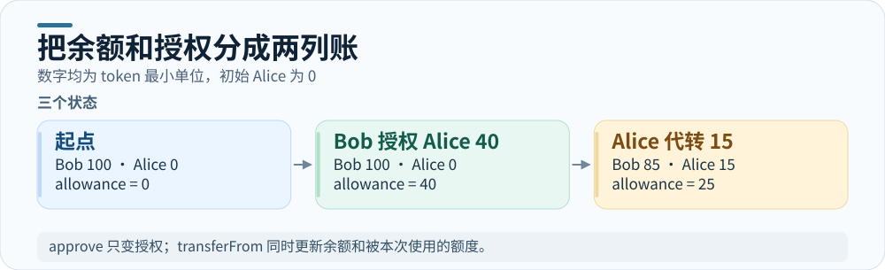

# 第 15 章 · ERC-20 代币、余额与授权

Bob 的钱包有 ETH，也显示 100 个最小单位的教学代币。他想允许 Alice 从中代转 15 个单位，先给了她 40 个单位的额度。交易完成后，Bob 的代币余额、Alice 的代币余额和剩余授权各是多少？钱包的 ETH 余额又为什么会有自己的变化？

理解这次转账需要读两张表。原生币余额属于网络账户状态，代币余额和授权存放在代币合约中。合约调用的 Gas 则仍由该笔交易的付费方以原生币承担。可以先回看[第 03 章的账户状态与费用](../01-ethereum-l1/03-state-execution-and-gas.md)。

## 同一地址的两份余额

在以太坊上，ETH 是原生币（native coin）。节点维护账户的 ETH 余额。ERC-20 代币（ERC-20 token）由合约记录，钱包要向指定合约调用 `balanceOf(owner)` 才能得到代币数量。一个地址可以同时出现在许多代币的余额表里，判断资产时应一起核对网络和合约地址。

以太坊改进提案（Ethereum Improvement Proposal，EIP）记录以太坊相关的规范和提案。ERC（Ethereum Request for Comments）是以太坊应用层标准的类别。ERC-20 定义统一的代币接口。钱包、交易所和其他合约借助相同接口读余额、转账和处理授权。ERC-20 记录可替代（fungible）资产的数量，同一合约下的两个最小单位在接口中无需分别编号。[ERC-20 规范](https://eips.ethereum.org/EIPS/eip-20#specification)

金额按最小单位存成整数。假设某代币用 `decimals()` 返回 `2`，余额 `125` 通常显示为 `1.25` 个代币。显示换算除以 `10 ** 2`，发送 `1.25` 时传入的整数仍是 `125`。`decimals` 是标准里的可选元数据。课程的 `ManualToken` 采用 18 位，并把构造参数 `initialSupply` 乘以 `10 ** 18` 写入供应量。`OurToken` 把构造参数作为最小单位直接交给继承来的 `_mint`。[ManualToken 构造](https://github.com/Cyfrin/foundry-erc20-cu/blob/4dd1a8ec845e207a180000a3b5f6c8ddc4aa91fe/src/ManualToken.sol#L13-L53) · [OurToken 构造](https://github.com/Cyfrin/foundry-erc20-cu/blob/4dd1a8ec845e207a180000a3b5f6c8ddc4aa91fe/src/OurToken.sol#L1-L11)

## 转账改变余额，授权改变额度

课程的手写版用 `balanceOf[owner]` 记录余额，用 `allowance[owner][spender]` 记录某个花费者（spender）在指定持有人名下的剩余额度。普通 `transfer(to, amount)` 把调用者的代币转给收款地址。授权转账的三种角色可以是不同的人。持有人设额度，花费者发起 `transferFrom(from, to, amount)`，收款人按 `to` 决定。下例由 Alice 同时担任花费者和收款人。[ManualToken 中的余额、额度与转账](https://github.com/Cyfrin/foundry-erc20-cu/blob/4dd1a8ec845e207a180000a3b5f6c8ddc4aa91fe/src/ManualToken.sol#L19-L130)

| 步骤 | 调用者与动作 | Bob 余额 | Alice 余额 | `allowance(Bob, Alice)` |
| --- | --- | ---: | ---: | ---: |
| 初始 | 纸面设定 | 100 | 0 | 0 |
| 授权 | Bob 调用 `approve(Alice, 40)` | 100 | 0 | 40 |
| 代转 | Alice 调用 `transferFrom(Bob, Alice, 15)` | 85 | 15 | 25 |



*图 15　同一次代转后的余额和额度。数值为教学设定，更新关系依据课程合约。 [ManualToken.sol](https://github.com/Cyfrin/foundry-erc20-cu/blob/4dd1a8ec845e207a180000a3b5f6c8ddc4aa91fe/src/ManualToken.sol#L83-L130)*

手写版中，`approve` 用新值覆盖当前额度，发出 `Approval` 事件。`transferFrom` 按源地址和实际调用者查询额度，通过后扣减额度；内部 `_transfer` 再检查余额、更新双方并发出 `Transfer` 事件。后续检查回退时，同一调用前面已经做的额度修改也会回滚。余额不足和额度不足都可能使代转失败。[ManualToken 相关方法](https://github.com/Cyfrin/foundry-erc20-cu/blob/4dd1a8ec845e207a180000a3b5f6c8ddc4aa91fe/src/ManualToken.sol#L55-L130)

总供应量（total supply）描述这个代币合约发行的总量。本例两次操作后总供应量仍为 100 个最小单位，因为已有代币只是在持有人之间移动。铸造（mint）会创建新单位，课程库版的构造铸造增加供应量并为部署者增加余额。事件（event）便于索引操作，当前余额仍可由合约状态核对。

## 按测试核对实际实现

课程项目快照使用两个 Solidity 版本，`ManualToken.sol` 是 `0.8.19`，`OurToken.sol` 是 `0.8.24`。手写版适合看状态变化，库版通过 OpenZeppelin 的 `ERC20` 提供同类接口。构造铸造与合约向谁开放铸造是两个问题。测试 `testInitialSupply` 核对供应量，`testUsersCantMint` 通过声明了 `mint` 的测试接口发起调用并预期回退，`OurToken` 项目合约没有公开 `mint` 入口。[OurToken 源码与测试](https://github.com/Cyfrin/foundry-erc20-cu/blob/4dd1a8ec845e207a180000a3b5f6c8ddc4aa91fe/test/OurTokenTest.t.sol#L24-L65)

`testAllowances` 在 Bob 授权 1,000 个最小单位后，由 Alice 代转 500，最后断言两人的余额。若要同时覆盖额度表，可以在原测试的两条余额断言之后设计下面这条额外断言。课程的 3 项原有测试用 Foundry `v1.3.1` 实跑通过。下方额度断言是基于源码设计的附加练习。测试安排可回看[第 12 章的测试布置](../03-contracts-and-foundry/12-testing-external-dependencies.md)。

```solidity
assertEq(ourToken.allowance(bob, alice), initialAllowance - transferAmount);
```

## 常见误区

| 容易混淆的说法 | 核对方式 |
| --- | --- |
| Bob 授权 40 时已经转出 40 | 此时只有额度表变为 40，余额在代转成功后更新。 |
| 一次代转使用收款地址的授权 | 额度的第二个键是发起 `transferFrom` 的地址。调用者与收款人碰巧同为 Alice。 |
| `decimals = 18` 表示有 18 个代币 | `decimals` 用于显示换算，总供应量读 `totalSupply()`。 |
| 同一钱包里的两种同名代币是一种资产 | 核对网络和代币合约地址。符号只用于展示。 |

## 练习与核对

1. **Bob 已授权 40，随后在任何代转之前又调用 `approve(Alice, 20)`。Alice 可以使用多少额度？**  
   **核对**　20。手写合约用新值覆盖旧值。
2. **表中的代转已经完成，Alice 接着尝试从 Bob 代转 30。三个状态如何变化？**  
   **核对**　剩余额度为 25，手写版的额度检查失败。Bob 为 85，Alice 为 15，额度仍为 25。
3. **真实课程测试的余额断言能直接证明哪两个金额？附加断言又证明什么？**  
   **核对**　现有测试断言 Alice 得到 500，Bob 比初始值少 500。附加断言检验剩余额度是否为 500。

在[第 16 章](./16-nft-ownership-and-metadata.md)，合约开始用独立编号跟踪每项资产。[第 18 章](./18-overcollateralized-stablecoin.md)则复用本章的授权、铸造与销毁来处理抵押和债务。

## 来源

- 《Web3 Fundamentals》Crypto Coin vs. Token（第 32–33 页，L804–834）。[参考书 Markdown](../../../refs/B3_Web3_Fundamentals.md)
- ERC-20 的接口、可选元数据和事件。[ERC-20 Token Standard](https://eips.ethereum.org/EIPS/eip-20#specification)
- 课程 Advanced Foundry §1 的 ERC/EIP、手写 ERC-20 和 OpenZeppelin 版。[课程索引 L1840–1885](https://github.com/yuxiaoli/foundry-full-course-cu/blob/b92616c4212d40cacfeeff4ea0f30501cafad094/README.md#L1840-L1885)
- 课程项目的余额与额度、构造铸造和实际测试。[ManualToken.sol](https://github.com/Cyfrin/foundry-erc20-cu/blob/4dd1a8ec845e207a180000a3b5f6c8ddc4aa91fe/src/ManualToken.sol#L13-L130) · [OurToken.sol](https://github.com/Cyfrin/foundry-erc20-cu/blob/4dd1a8ec845e207a180000a3b5f6c8ddc4aa91fe/src/OurToken.sol#L1-L11) · [OurTokenTest.t.sol](https://github.com/Cyfrin/foundry-erc20-cu/blob/4dd1a8ec845e207a180000a3b5f6c8ddc4aa91fe/test/OurTokenTest.t.sol#L24-L65)

[全书目录](../README.md) · [本章来源映射](../../../planning/beginner/source-map.md#ch-15)
