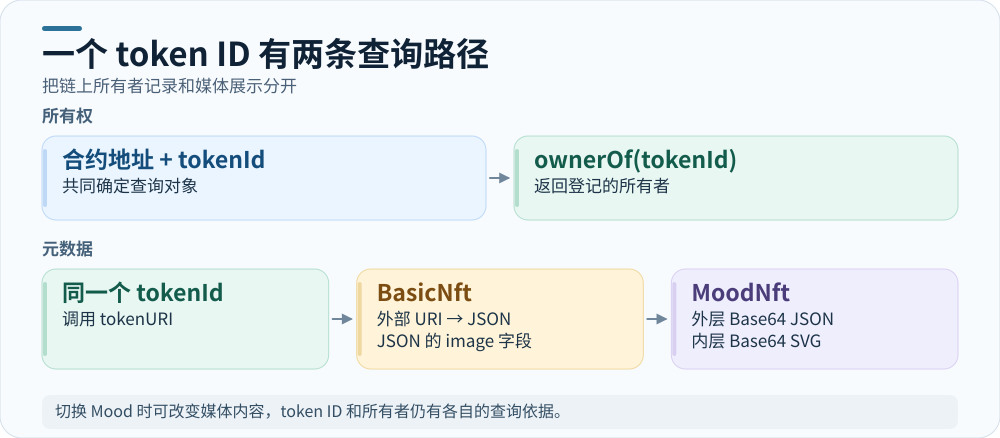

# 第 16 章 · ERC-721、NFT 所有权与元数据

钱包展示了一只名为 Dogie 的小狗，编号是 0。合约能够回答谁持有这枚 NFT，但图片可能来自另一个系统。换成课程里的 Mood NFT，持有人还可以在保留同一编号的情况下把表情从开心切到难过。两次读取究竟查了哪些数据？

本章用到[第 09 章的映射、继承和只读调用](../03-contracts-and-foundry/09-contract-composition.md)。测试部分只需要[第 10 章的测试布置和断言](../03-contracts-and-foundry/10-local-foundry-loop.md)。

## 编号和所有人

ERC-721 给非同质化代币（non-fungible token，NFT）定义了标准接口。应用应一起记录网络、合约地址和代币编号（token ID）。两个合约都可以铸造自己的 0 号。对同一个 ERC-721 合约，`ownerOf(0)` 查询 0 号当前的所有人，`balanceOf(owner)` 查询该地址持有多少枚。数量为 1 只回答持有数量，查询具体一枚仍须知道编号。[ERC-721 的所有权接口与元数据扩展](https://eips.ethereum.org/EIPS/eip-721#specification)

课程的 `BasicNft` 从 0 开始计数。`mintNft(tokenUri)` 先保存编号与 URI 的映射，再用继承来的 `_safeMint(msg.sender, tokenId)` 将该编号铸造给调用者，最后更新计数器。所有人可由继承接口查询。合约覆写 `tokenURI(tokenId)`，返回和该编号关联的 URI。[BasicNft.sol](https://github.com/Cyfrin/foundry-nft-cu/blob/a3e8d17cc951dbd5c7261eae440354b89e9c6203/src/BasicNft.sol#L6-L32)

## 铸造、持有和转移：一张门票的三步

1. **铸造（mint）。** 活动方在测试链的门票合约里给 Alice 创建第 42 号 NFT。铸造给这条记录设定初始持有人，不等于服务器生成了一张图片。ERC-721 可以读取 `ownerOf(42)` 来确认。
2. **持有（own）。** Alice 查询时核对网络、门票合约地址和编号 42，这三个值一起识别同一枚票。另一个合约也能发行 42 号；名称、截图或图片不是链上身份。
3. **转移（transfer）。** Alice 或经她授权的操作者把 42 号票转给 Bob。ERC-721 转移会改变 `ownerOf(42)` 并产生 `Transfer` 事件。网络、合约与编号不变。

## ERC-721 和 ERC-1155 有什么不同

| 要比较的事 | ERC-721 | ERC-1155 |
| --- | --- | --- |
| 编号代表什么 | 每个编号代表一件独立的代币 | 每个编号代表一种代币类型，供应量可为 1，也可以有多份 |
| 怎么查持有 | `ownerOf(id)` 找出该件的持有人 | `balanceOf(account, id)` 查该地址持有这一类型的数量 |
| 怎么看转移 | 按一个编号转移，查询 `Transfer` | 可单次或批量转移，查询 `TransferSingle` 或 `TransferBatch` |
| 怎么找元数据 | 可选扩展 `tokenURI(id)` | 可选元数据扩展 `uri(id)`，客户端按规范替换模板中的 `{id}` |

如果 42 号是一张编号唯一的门票，可以用 ERC-721 表示；如果编号 42 代表同一场次的 100 张普通票，ERC-1155 可以用同一个编号记录每个地址有几张。不要对所有 NFT 都调用 `ownerOf`，先看合约实现的接口。[ERC-721 规范](https://eips.ethereum.org/EIPS/eip-721) · [ERC-1155 规范](https://eips.ethereum.org/EIPS/eip-1155)

## 钱包怎样找到图片

元数据（metadata）为应用提供名称、描述和图片等显示信息。`tokenURI` 是 ERC-721 的可选元数据扩展，返回统一资源标识符（Uniform Resource Identifier，URI）。典型钱包会沿 URI 读取 JSON，再从 JSON 的 `image` 字段取得图片。以下路径从相同的合约地址和编号出发，回答两个不同的问题。

*图 16　同一编号可分别查询所有人和媒体。BasicNft 指向外部 JSON，MoodNft 返回可直接解码的 JSON。 [BasicNft.sol](https://github.com/Cyfrin/foundry-nft-cu/blob/a3e8d17cc951dbd5c7261eae440354b89e9c6203/src/BasicNft.sol#L16-L27) · [MoodNft.sol](https://github.com/Cyfrin/foundry-nft-cu/blob/a3e8d17cc951dbd5c7261eae440354b89e9c6203/src/MoodNft.sol#L72-L102)*

| URI 形式 | 应用接下来要做什么 | 可用性取决于什么 |
| --- | --- | --- |
| `https://…` | 向指定服务器请求对应路径 | 服务器与路径仍可访问，服务端可以更新路径内容 |
| `ipfs://…` | 用 IPFS 的内容标识符（Content Identifier，CID）查找数据 | 有节点保存并提供对应数据，应用能连接网络或可用网关 |
| `data:…` | 根据开头的媒体类型与编码说明直接读取内嵌内容 | 应用支持该格式，在课程合约里可以从返回值解析内容 |

IPFS（InterPlanetary File System）按内容寻址。同一 CID 标识同一内容，从某个节点或网关取回时仍是该内容。是否还有节点可以提供数据是另一项条件。固定保存（pinning）用于让节点继续持有内容。`BasicNftTest` 的 `PUG_URI` 是一个 IPFS URI，测试可核对字符串但不访问外部媒体。[课程文字课 IPFS](https://github.com/Cyfrin/Updraft/blob/1d7138f18fbe26bfff82a091df118efda52f29e7/courses/advanced-foundry/2-how-to-create-an-NFT-collection/5-what-is-ipfs/%2Bpage.md#L9-L54) · [BasicNftTest.t.sol](https://github.com/Cyfrin/foundry-nft-cu/blob/a3e8d17cc951dbd5c7261eae440354b89e9c6203/test/BasicNftTest.t.sol#L11-L47)

元数据和媒体未必存于同一处。合约可以返回链上生成的 JSON，而 JSON 的 `image` 仍指向外部文件；也可以像下节示例那样将图片嵌入返回值。分别核对两者的位置、访问条件，以及合约是否允许修改 URI。「持有人可查」不能保证媒体永久可用或不可改。[IPFS · 内容标识符（CID）](https://docs.ipfs.tech/concepts/content-addressing/)

## 持有代币与作品版权是两件事

Bob 在钱包里看到自己持有第 42 号票，只表明合约记录的持有人变了。它不自动表明 Bob 获得图案的版权、独家展示权或商用权。作品使用权要另看创作者授权或项目许可；门票能否入场也取决于票务规则。链上接口并不定义这些链下权利。[美国版权局与专利商标局 · NFT 知识产权联合研究](https://www.copyright.gov/policy/nft-study/)

## Mood NFT 的两层编码

可缩放矢量图形（Scalable Vector Graphics，SVG）以文本描述形状。课堂脚本 `DeployMoodNft` 读取 happy、sad 两份 SVG，将各自用 Base64 编码，附上 `data:image/svg+xml;base64,`，然后把两条图片 URI 交给构造函数。Base64 把字节表示为可携带的文本，客户端可以还原原文。[DeployMoodNft.s.sol](https://github.com/Cyfrin/foundry-nft-cu/blob/a3e8d17cc951dbd5c7261eae440354b89e9c6203/script/DeployMoodNft.s.sol#L12-L31)

每个编号的默认枚举值为 `HAPPY`。持有人或该编号的直接获批地址可以调用课程的 `flipMood(tokenId)`，将该编号的情绪状态切换为另一值。合约读取情绪，选中一条图片 URI，组装 JSON 的 `image` 字段，最后再对整个 JSON 编码并加上 `data:application/json;base64,`。理解两层媒体类型便能跟上渲染过程。[MoodNft 的状态与 URI](https://github.com/Cyfrin/foundry-nft-cu/blob/a3e8d17cc951dbd5c7261eae440354b89e9c6203/src/MoodNft.sol#L33-L102)

| 解码次序 | 读到的格式 | 要找的内容 |
| --- | --- | --- |
| 外层 `tokenURI(0)` | Base64 包装的 JSON | `image` 字段里的图片 URI |
| 内层 `image` | Base64 包装的 SVG | 供应用渲染的矢量图 |

在选定快照中两个主合约使用 Solidity `0.8.20`。`testTokenURIDefaultIsCorrectlySet` 将第 0 枚的 URI 与预期的开心 URI 比较，`testFlipTokenToSad` 用同一个用户铸造并切换情绪后比较难过 URI。测试里的 `vm.prank(USER)` 让下一次合约调用以 `USER` 身份发出。这些断言检验了合约输出，实际渲染还要由客户端完成。[MoodNftTest.sol](https://github.com/Cyfrin/foundry-nft-cu/blob/a3e8d17cc951dbd5c7261eae440354b89e9c6203/test/MoodNftTest.sol#L44-L83)

固定课程版本使用 Solidity `0.8.20`，练习可使用 Foundry `v1.3.1`。Windows 若把 `images/dynamicNft/happy.svg` 和 `sad.svg` 取出为 CRLF，两个写死 URI 的断言会失败。换行字节会被编码进 URI，实验副本使用 LF 后即可复现课程预期值。

## 常见误区

| 容易混淆的说法 | 核对方式 |
| --- | --- |
| 钱包里的图像足以证明所有权 | 核对网络、合约、编号和 `ownerOf`。图片可以被不同应用展示。 |
| 取得 NFT 就取得图片的一切权利 | 识别链上记录的持有人，再按项目许可条款了解作品使用范围。 |
| IPFS 地址一旦写进链上，图片就会一直可取 | 地址确定要找的内容，可取性取决于数据是否还被提供。 |
| Base64 让数据保密 | Base64 是可逆的编码，客户端可据此解析 JSON 和 SVG。 |

## 练习与核对

1. **Alice 铸造课程的 0 号 Mood NFT 后切换到 `SAD`。编号、持有人、图片各怎样变化？**  
   **核对**　编号仍为 0，持有人仍为 Alice，返回的 JSON 中图片 URI 按新状态变为难过版本。可以对照 `flipMood` 的唯一状态写入和 `testFlipTokenToSad`。
2. Alice 把门票合约的 42 号 ERC-721 转给 Bob。Bob 能据此确定他取得了图片版权吗？若 42 指的是 ERC-1155 的票种，又该查什么？\
   **核对**　ERC-721 的 `ownerOf(42)` 可核对持有人，版权要另看授权。ERC-1155 查 `balanceOf(Bob, 42)` 来核对 Bob 持有这个票种的数量。
3. **客户端第一层解码得到 JSON 后，该用哪个字段查图片？**  
   **核对**　用 `image`。对于 Mood NFT，再按内层 URI 的媒体类型与 Base64 前缀解码 SVG。

[第 19 章](./19-reading-project-metrics.md)会回到 NFT 市场，区分一次买卖中的成交金额、市场服务费与创作者版税。

## 来源

- 《Web3 Fundamentals》NFTs（第 35 页，L876–898）。
- ERC-721 规范中的所有权、数量与可选的元数据扩展。[ERC-721 Non-Fungible Token Standard](https://eips.ethereum.org/EIPS/eip-721#specification)
- 课程文字课的 IPFS、内容标识与 SVG/JSON 编码。[What is IPFS?](https://github.com/Cyfrin/Updraft/blob/1d7138f18fbe26bfff82a091df118efda52f29e7/courses/advanced-foundry/2-how-to-create-an-NFT-collection/5-what-is-ipfs/%2Bpage.md#L9-L54) · [SVG NFT Encoding](https://github.com/Cyfrin/Updraft/blob/1d7138f18fbe26bfff82a091df118efda52f29e7/courses/advanced-foundry/2-how-to-create-an-NFT-collection/14-svg-onchain-encoding/%2Bpage.md#L9-L190)
- 课程项目的铸造、URI 与测试断言。[BasicNft.sol](https://github.com/Cyfrin/foundry-nft-cu/blob/a3e8d17cc951dbd5c7261eae440354b89e9c6203/src/BasicNft.sol#L6-L32) · [BasicNftTest.t.sol](https://github.com/Cyfrin/foundry-nft-cu/blob/a3e8d17cc951dbd5c7261eae440354b89e9c6203/test/BasicNftTest.t.sol#L31-L47) · [MoodNft.sol](https://github.com/Cyfrin/foundry-nft-cu/blob/a3e8d17cc951dbd5c7261eae440354b89e9c6203/src/MoodNft.sol#L29-L115) · [MoodNftTest.sol](https://github.com/Cyfrin/foundry-nft-cu/blob/a3e8d17cc951dbd5c7261eae440354b89e9c6203/test/MoodNftTest.sol#L44-L83)
