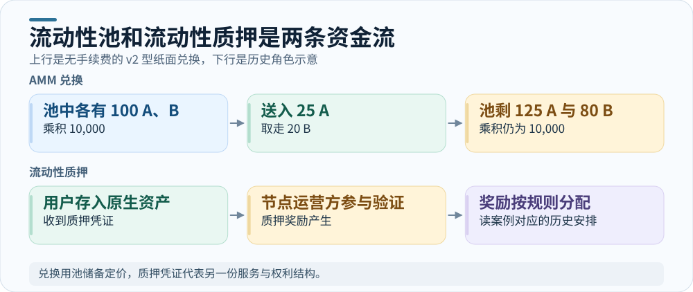

# 第 17 章 · 从一次兑换读懂流动性池与质押凭证

小周想拿 25 个 A 换 B。应用找到一个存有 A 和 B 的合约，报出大约 20 个 B。另一页也有一个「池」，让人存入 ETH 并取得一份质押凭证。两个池都收资产，为什么前者交付另一种资产，后者交付一份凭证？

先看池里是谁的资产、合约依据什么规则处理、收益来自哪里。至此只需会读[第 15 章的代币余额](./15-erc20-token-accounting.md)以及[第 04 章的 PoS 角色](../01-ethereum-l1/04-blocks-and-consensus.md)。

## 兑换池里发生了什么

**中心化交易所（CEX）**通常代用户保管余额，用自己的系统撮合订单；用户提走资产才在相应账本上产生提现交易。**去中心化交易所（DEX）**则让用户和链上合约按协议成交。自动做市商（AMM）是 DEX 的一种机制，成交价受池子储备和公式影响；并非所有 DEX 都使用同一种池。实际成交时分清托管、执行路径与报价来源。可对照 [Uniswap 官方机制说明](https://developers.uniswap.org/docs/get-started/concepts/how-uniswap-works)。

去中心化交易所（decentralized exchange，DEX）用链上规则完成资产交换。本章观察其中一种做法，自动做市商（automated market maker，AMM）根据池的储备和约束计算可以成交的数量。流动性提供者（liquidity provider，LP）先把资产转入池合约。池里的持有量叫储备（reserve）。此后交易者可向池交一种资产并取走另一种，按池规则计算成交量。

流动性提供者在池里持有份额。以常见的两资产池为例，份额记录对池中资产的赎回权。兑换手续费如何归集取决于协议规则和配置，部分设计让费用留在池内，使份额对应的资产随交易变化。《Web3 Fundamentals》Liquidity Pool · [Uniswap v2 Pricing](https://developers.uniswap.org/docs/protocols/v2/concepts/pricing)

### 用 25 个 A 换出 20 个 B

下面是源于 Uniswap v2 型常数乘积的课外纸面简化，忽略手续费和整数舍入。令池中 A、B 储备为 `x`、`y`，一次兑换保持 `x × y = k`。在这个模型里，储备比例会随交易变化。

| 核对项 | 计算 | 结果 |
| --- | --- | --- |
| 初始储备 | `x = 100`，`y = 100` | `k = 10,000` |
| 换入 25 A 后的 A | `x' = 100 + 25` | `125 A` |
| 换出后还在池里的 B | `y' = 10,000 / 125` | `80 B` |
| 交易者取得的 B | `100 - 80` | `20 B` |
| 平均成交率 | `20 B / 25 A` | `0.8 B/A` |

初始储备比是 `1 B/A`，可以看作极小输入下的起始边际价格。交易者买走 B 后，池里 A 更多而 B 更少，整笔的平均成交率只有 `0.8 B/A`。这笔订单对价格造成的变化叫价格影响（price impact）。同样是 25 A 的投入，若初始储备各为 1,000，能换出约 24.39 B，因为交易相对于储备更小。[Uniswap v2 · How are prices determined?](https://developers.uniswap.org/docs/protocols/v2/concepts/pricing#how-are-prices-determined)

*图 17　兑换以储备变化交付 B，流动性质押以凭证记录参与关系。储备数字为纸面推演，质押角色依 Lido 历史案例整理。 [Uniswap v2 Pricing](https://developers.uniswap.org/docs/protocols/v2/concepts/pricing) · 分析指南，Lido 案例*

### 报价、执行与费用

报价是按当时状态估算的输出。其他交易可能在自己的交易前改变池状态，最终输出会偏离报价，这里称为滑点（slippage）。滑点容忍度（slippage tolerance）是用户接受的执行差异。对固定输入的示例，可把它理解为用最低输出表达的界线。假设报价是 20 B，最低输出为 19 B，执行时只剩 18.7 B 可得，交换就达不到该条件。已经上链并回退的调用仍可能消耗 Gas。

Updraft 的 Uniswap 文字课展示了一次 Sepolia 兑换。可以把其复核页当观察案例，把**预计收到量、价格影响、滑点上限、兑换费用和网络 Gas**逐项抄到表中。兑换费用按相关应用和池的规则分配，Gas 属于网络执行费用。同一界面能列出两者，但账本和收款方各有其规则。课程费率、代币和界面属于课例快照。[Updraft 兑换示例](https://github.com/Cyfrin/Updraft/blob/1d7138f18fbe26bfff82a091df118efda52f29e7/courses/blockchain-basics/5-blockchain-use-cases/6-uniswap-demo/%2Bpage.md#L27-L66)

## 质押与流动性质押凭证

在权益证明（proof of stake，PoS）中，原生质押（staking）把一定的资产用于参与验证，以协议规则约束验证者，并按其职责和表现计奖惩。《Web3 Fundamentals》Staking（第 31 页，L784–796）

流动性质押（liquid staking）服务让用户通过一个协议参与这种质押，并取得代表相关权益的代币化凭证。分析指南的 Lido 历史案例有三类动作。用户将原生资产交给协议并得到质押凭证，协议通过节点运营者参与验证，验证奖励按当时的规则在质押者和相关服务参与方之间分配。持有人可以按适用规则处置凭证。治理代币 LDO 用于相关决策，报告把它和用户拿到的质押凭证分别讨论。分析指南，Lido 历史案例

| 场景 | 用户交付的资产 | 收到的东西 | 相关收入来源 |
| --- | --- | --- | --- |
| 用 A 交换 B | 交易者输入 A | 当笔获出的 B | 兑换按池规则支付费用 |
| 给兑换池提供资产 | LP 存入合约要求的资产 | 池的份额 | 池规则分配的兑换费用 |
| 通过服务参与质押 | 质押者交付原生资产 | 代表质押权益的凭证 | 网络验证奖励及按服务规则分配的部分 |

## 常见误区

- **把储备比当成大额订单的成交率。** 储备比可以给出交易起点，实际成交按订单大小和池约束计算。
- **把浮动报价和最大可接受差异混在一起。** 报价是估算，最低输出是执行条件，价格影响描述本单改变池的程度。
- **把池份额、质押凭证和治理票权视为同一权益。** 先看它们对应的资产或权力，再检查谁负责兑付或执行。

## 练习与核对

1. **无手续费池初始各有 100，若换入 100 A，可换出多少 B？**  
   **核对**　新的 A 储备为 200，B 储备为 50，因此换出 50 B，平均为 `0.5 B/A`。
2. **纸面报价为 20 B，最低输出 19 B，实际可执行输出为 19.2 B。条件满足吗？**  
   **核对**　满足这一项，输出至少为 19 B。是否最终成功还需检查交易的其他条件。
3. **把 ETH 交给流动性质押服务后，谁负责验证，凭证有什么用？**  
   **核对**　历史案例中由节点运营者参与验证。凭证用来表示质押权益，具体流转和兑现受协议规则约束。验证奖励的分配也要另看当时规则。

下一章把「交付资产后记什么」用在[抵押与债务](./18-overcollateralized-stablecoin.md)上。读[第 19 章](./19-reading-project-metrics.md)时，可以用本章的参与者表追踪不同的费用去向。

## 来源

- 《Web3 Fundamentals》Staking（第 31 页，L784–796）、Decentralized Finance 与 Liquidity Pool（第 40–42 页，L1017–1078）。
- 《A Guide to Fundamental Analysis in Crypto》Uniswap、Lido（目录第 18、20 页，L328–368，2023 年 2 月报告）。
- 课程 Sepolia 兑换、报价复核和交易观察。[Updraft · How to Swap Tokens on the Uniswap DEX](https://github.com/Cyfrin/Updraft/blob/1d7138f18fbe26bfff82a091df118efda52f29e7/courses/blockchain-basics/5-blockchain-use-cases/6-uniswap-demo/%2Bpage.md#L1-L78)
- 课外补充采用 Uniswap v2 的指定版本文档。无手续费的数字是简化推演，真实约束考虑费用。[Uniswap v2 Pricing](https://developers.uniswap.org/docs/protocols/v2/concepts/pricing)
