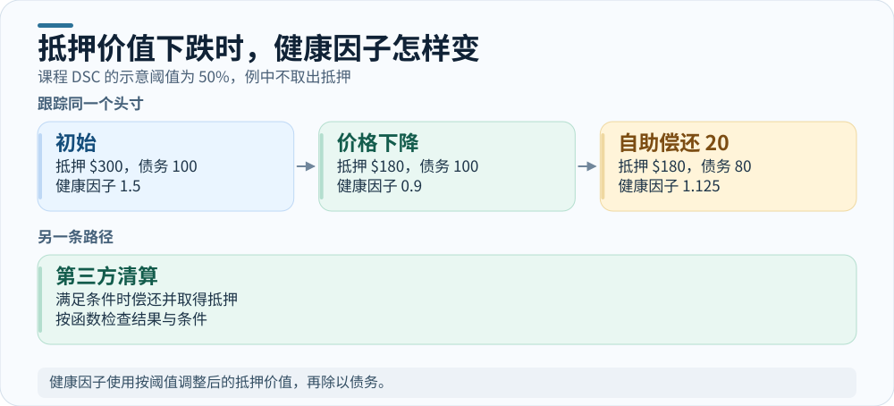

# 第 18 章 · 超额抵押稳定币与清算

Alice 在课程的稳定币合约里存入价值 300 美元的抵押品，铸出 100 DSC。下一次报价把同样数量的抵押品估为 180 美元。她没有取出抵押，债务也没变，为什么合约会改变对这笔头寸的判断？还掉 20 DSC 会怎样？

本章顺着两张账本和一条价格输入算出结果。需要时回看[第 11 章的价格换算](../03-contracts-and-foundry/11-fund-me-and-price-feeds.md)、[第 12 章的模拟依赖](../03-contracts-and-foundry/12-testing-external-dependencies.md)和[第 15 章的 ERC-20 授权](./15-erc20-token-accounting.md)。

## 抵押品和债务分别记录

稳定币（stablecoin）尝试把价值锚定在某种参照物上，比如美元。不同设计的储备、赎回路径和市场机制各有不同。课堂的 DSC 是以合约内资产担保的超额抵押（overcollateralization）例子，目标是挂钩美元。以下核算使用协议约定的计价方式。

项目把可转账的 DSC 与管控抵押和债务的 `DSCEngine` 分成两个合约。部署脚本把代币合约的所有权交给引擎，引擎调用的 `mint` 和 `burn` 两个入口都检查所有者权限。引擎把用户存入的资产数量和该用户已经铸出、尚未偿还的 DSC 分别记录。债务跟随引擎中的用户头寸。用户把手上的 DSC 转给别人时，接收人得到代币，原用户的债务记录仍在引擎里。[DecentralizedStableCoin.sol](https://github.com/Cyfrin/foundry-defi-stablecoin-cu/blob/f04bb04a77e4aa4390e6df38b0dc0c214c5a7c6a/src/DecentralizedStableCoin.sol#L47-L76) · [DeployDSC.s.sol](https://github.com/Cyfrin/foundry-defi-stablecoin-cu/blob/f04bb04a77e4aa4390e6df38b0dc0c214c5a7c6a/script/DeployDSC.s.sol#L13-L27)

| 操作 | 引擎检查或更新什么 | 相关入口 |
| --- | --- | --- |
| 存入抵押 | 检查资产在支持范围内，更新抵押记录，并从用户转入代币 | `depositCollateral` |
| 铸造稳定币 | 增加该用户拟承担的 DSC 债务，核查健康因子，成功后铸出 DSC | `mintDsc` |
| 偿还 | 拉入并销毁相应 DSC，降低用户债务，并核查结果 | `burnDsc` |
| 取回抵押 | 减少抵押记录并转出资产，核查剩余头寸 | `redeemCollateral` |
| 偿还并取回 | 在一次调用内一起销毁、降低债务并转出抵押 | `redeemCollateralForDsc` |

`depositCollateralAndMintDsc` 也能在一次调用里完成存入和铸造。用户存入 ERC-20 前须授权引擎代转。偿还或清算时，支付 DSC 的地址也要先给引擎相应的代转额度。一次组合调用中的后续检查回退时，此前那一步的状态变化也随交易回滚。[DSCEngine.sol 的抵押、铸造和赎回入口](https://github.com/Cyfrin/foundry-defi-stablecoin-cu/blob/f04bb04a77e4aa4390e6df38b0dc0c214c5a7c6a/src/DSCEngine.sol#L131-L290)

## 用健康因子核对这笔头寸

抵押率（collateralization ratio）描述抵押品美元价值与债务计价的比值。健康因子（health factor）先用协议的清算阈值（liquidation threshold）对抵押值打折，再除以债务。在本课程项目，清算阈值为 `50 / 100`，最小健康因子为 `1`。因此，债务为 100 DSC 时，以每 DSC 的目标计价折算，要有至少 200 美元抵押品才达到这条健康边界。

健康因子在代码中以 `1e18` 表示 1。`_calculateHealthFactor` 先算 `collateralValueInUsd * 50 / 100`，再将结果乘以 `1e18` 后除以 DSC 债务。债务为零时返回 `type(uint256).max`，以单独表示无债务。下表先用人可读的值算比例。

| 状态 | 抵押品估值 | 债务 | 健康因子 |
| --- | ---: | ---: | ---: |
| 成功铸出 100 DSC | 300 美元 | 100 DSC | `(300 × 0.5) / 100 = 1.5` |
| 抵押品价格下降 | 180 美元 | 100 DSC | `(180 × 0.5) / 100 = 0.9` |
| 偿还 20 DSC，保留全部抵押 | 180 美元 | 80 DSC | `(180 × 0.5) / 80 = 1.125` |

*图 18　以同一笔 DSC 头寸观察价格和偿债的影响。数值是教学推演，计算规则取自课程实现。 [DSCEngine.sol](https://github.com/Cyfrin/foundry-defi-stablecoin-cu/blob/f04bb04a77e4aa4390e6df38b0dc0c214c5a7c6a/src/DSCEngine.sol#L323-L369)*

价格换算也有各自的尺度。以课程的 8 位小数价格源、18 位尺度的资产数值为例，报价 `2_000 * 1e8` 和数量 `0.15 * 1e18` 进入 `_getUsdValue` 时，先把报价乘 `1e10` 对齐到 18 位尺度，再把与数量相乘的结果除以 `1e18`，得到 `300 * 1e18`。计算美元值和将美元值反换成抵押品数量，都需要同一个价格口径。这些常数对应课程本地练习的 18 位资产和 8 位报价假设。接入其他资产或报价源前，先核对这两处精度。[价格换算与健康因子](https://github.com/Cyfrin/foundry-defi-stablecoin-cu/blob/f04bb04a77e4aa4390e6df38b0dc0c214c5a7c6a/src/DSCEngine.sol#L332-L425)

## 清算与报价失效

健康因子低于 1 时，另一个地址可以发起清算（liquidation）。清算人交出自己的 DSC 替这笔头寸还债，得到按当前报价换算的抵押品及课程设定的 10% 额外抵押品。引擎会核对被清算头寸的健康因子是否严格改善，也检查清算人自己的健康因子。沿表中健康因子为 0.9 的状态算，若清算人偿还 25 DSC，按同一价格取得等值 27.5 美元的抵押品，头寸剩余 152.5 美元抵押和 75 DSC 债务，健康因子约为 1.0167。这里以比例忽略整数舍入，教学数字用来核对机制。[课程清算流程](https://github.com/Cyfrin/foundry-defi-stablecoin-cu/blob/f04bb04a77e4aa4390e6df38b0dc0c214c5a7c6a/src/DSCEngine.sol#L205-L253)

引擎需要价格时调用 `OracleLib.staleCheckLatestRoundData`。该库检查更新时间为零、回答轮次小于请求轮次，以及报价距当前时间是否超过 3 小时。发现此类无效或过期报价会回退。3 小时是该项目的设定，价格源的实际更新方式要按具体配置读。价格停更时合约会拒绝依赖该价格的操作，因而要把报价新鲜度和价格值分别观测。[OracleLib.sol](https://github.com/Cyfrin/foundry-defi-stablecoin-cu/blob/f04bb04a77e4aa4390e6df38b0dc0c214c5a7c6a/src/libraries/OracleLib.sol#L18-L34)

## 测试覆盖了什么

| 测试 | 从夹具到断言 |
| --- | --- |
| `testCanMintDsc`、`testRevertsIfMintAmountBreaksHealthFactor` | 已有抵押时，分别断言允许的铸造和跨健康边界时的回退。 |
| `testHealthFactorCanGoBelowOne` | 用模拟报价把抵押估值降至 180 美元，断言 100 DSC 债务的健康因子为 `0.9e18`。 |
| `testCantLiquidateGoodHealthFactor`、`testMustImproveHealthFactorOnLiquidation` | 分别断言健康头寸不能清算、特定夹具中不能改善健康因子的清算会回退。 |
| `testPriceRevertsOnStaleCheck` | 推进模拟时间后，断言查询触发 `OracleLib__StalePrice`。 |

还有一个名为 `testPriceRevertsOnBadAnsweredInRound` 的用例。它把更新时间设为零，而 mock 返回的回答轮次与轮次相等。这个用例覆盖共同的过期价格错误，单独的 `answeredInRound < roundId` 分支要从库条件另行核对。以上是 Solidity `0.8.19` 课程快照的源码与测试走读。纸面运算、mock 所覆盖的输入和实际价格源的行为各有自己的证据范围。[引擎单元测试](https://github.com/Cyfrin/foundry-defi-stablecoin-cu/blob/f04bb04a77e4aa4390e6df38b0dc0c214c5a7c6a/test/unit/DSCEngineTest.t.sol#L387-L458) · [报价测试](https://github.com/Cyfrin/foundry-defi-stablecoin-cu/blob/f04bb04a77e4aa4390e6df38b0dc0c214c5a7c6a/test/unit/OracleLibTest.t.sol#L21-L45) · [MockV3Aggregator.sol](https://github.com/Cyfrin/foundry-defi-stablecoin-cu/blob/f04bb04a77e4aa4390e6df38b0dc0c214c5a7c6a/test/mocks/MockV3Aggregator.sol#L38-L70)

## 常见误区

- **把铸出的代币余额当作个人债务。** 看引擎中记在谁名下的头寸，再看代币合约里谁持有 DSC。
- **把 50% 阈值读成需要 50 美元就能为 100 DSC 提供健康抵押。** 课程先按 50% 折算，再与债务比较，达到边界需要至少 200 美元。
- **把偿还债务和清算视为相同的资产变化。** 主动还款可保留抵押，第三方清算取得相应抵押及奖励。
- **按测试名称认定所有分支都已覆盖。** 结合输入、mock 返回值及断言判断实际经过的条件。

## 练习与核对

1. **抵押品估值仍是 300 美元，尝试一次铸造 160 DSC，最终记多少债务？**  
   **核对**　预检查的健康因子为 `150 / 160 = 0.9375`，铸造回退。若原债务为零，回退后仍为零。
2. **抵押品价值 180 美元，债务 100 DSC。主动偿还 20 但不取回资产后，头寸健康吗？**  
   **核对**　健康因子为 `90 / 80 = 1.125`，符合该项目的健康条件。
3. **固定 8 位报价源，原始值为 `2_000 * 1e8`，用 `1e18` 尺度读它，应乘哪个倍率？**  
   **核对**　乘 `1e10`。此后如果与同为 18 位尺度的资产数量相乘，需再除以 `1e18` 来校正积的尺度。

本章从单笔业务检查状态。[第 26 章](../05-optional-projects/26-invariants-and-defensive-review.md)再观察合约经历一串操作时需要持续满足的条件。

## 来源

- 《Web3 Fundamentals》Decentralized Finance / Stablecoins（第 40 页，L1017–1035），稳定币的用途背景。[参考书 Markdown](../../../refs/B3_Web3_Fundamentals.md)
- 课程抵押、债务与清算。[DSCEngine.sol，入口](https://github.com/Cyfrin/foundry-defi-stablecoin-cu/blob/f04bb04a77e4aa4390e6df38b0dc0c214c5a7c6a/src/DSCEngine.sol#L64-L310) · [DSCEngine.sol，金额和阈值](https://github.com/Cyfrin/foundry-defi-stablecoin-cu/blob/f04bb04a77e4aa4390e6df38b0dc0c214c5a7c6a/src/DSCEngine.sol#L323-L425)
- 铸造边界、健康因子与清算断言。[DSCEngineTest.t.sol，铸造](https://github.com/Cyfrin/foundry-defi-stablecoin-cu/blob/f04bb04a77e4aa4390e6df38b0dc0c214c5a7c6a/test/unit/DSCEngineTest.t.sol#L232-L263) · [DSCEngineTest.t.sol，清算](https://github.com/Cyfrin/foundry-defi-stablecoin-cu/blob/f04bb04a77e4aa4390e6df38b0dc0c214c5a7c6a/test/unit/DSCEngineTest.t.sol#L387-L458)
- 报价检查、夹具和 mock 返回值。[OracleLib.sol](https://github.com/Cyfrin/foundry-defi-stablecoin-cu/blob/f04bb04a77e4aa4390e6df38b0dc0c214c5a7c6a/src/libraries/OracleLib.sol#L18-L34) · [OracleLibTest.t.sol](https://github.com/Cyfrin/foundry-defi-stablecoin-cu/blob/f04bb04a77e4aa4390e6df38b0dc0c214c5a7c6a/test/unit/OracleLibTest.t.sol#L21-L45) · [MockV3Aggregator.sol](https://github.com/Cyfrin/foundry-defi-stablecoin-cu/blob/f04bb04a77e4aa4390e6df38b0dc0c214c5a7c6a/test/mocks/MockV3Aggregator.sol#L38-L70)

[全书目录](../README.md) · [本章来源映射](../../../planning/beginner/source-map.md#ch-18)
