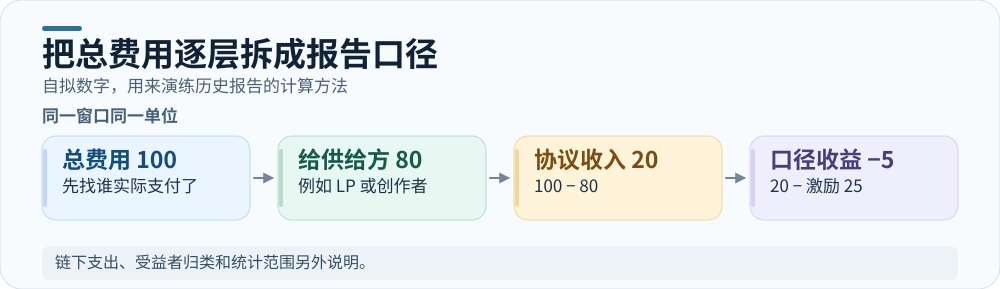

# 第 19 章 · 从资金流读懂协议指标和代币激励

一个市场收到了 100 个单位的费用，随后把 80 个单位分给提供服务的人。在报表中，它的协议收入是 20。如果同期还发放价值 25 的代币激励，报告采用的收益口径得到 −5。同一份活动记录为什么会出现三个数？

先画钱经过谁的账户，再给每个数字写口径。用[第 16 章的 NFT 市场对象](./16-nft-ownership-and-metadata.md)、[第 17 章的兑换与质押角色](./17-swaps-pools-and-staking.md)和[第 18 章的抵押头寸](./18-overcollateralized-stablecoin.md)，可以区分谁在付费、谁提供资产或服务，以及哪个主体获得收入。

## 先辨角色，再算收入

读一个应用时，可以先问四个问题。

1. 用户得到了什么服务，支付了什么钱？
2. 创作者、流动性提供者或节点运营者怎样提供服务，收入怎么分？
3. 协议与金库依据什么规则取得一部分资金？
4. 代币持有人能投票、能获得分配，还是仅在特定条件下享有其他用途？

《A Guide to Fundamental Analysis in Crypto》把这条资金流整理成几个链上指标。总费用（total fees）是其口径内用户支付的经济价值。供给侧分成（supply-side fees）是其中转给服务提供者的部分。协议收入（protocol revenue）按报告定义从总费用扣除供给侧分成。代币激励（token incentives）是用新发行或分配的代币激励使用或供给时，报告计入的成本。按这一口径，收益（earnings）从协议收入再扣激励。[分析指南，Fundamental Analysis in Action，L199–219](../../../refs/A-Guide-to-Fundamental-Analysis-in-Crypto.md)

| 教学账目 | 算式 | 金额 |
| --- | --- | ---: |
| 用户支付总费用 | 已知 | 100 |
| 供给侧分成 | 已知 | 80 |
| 协议收入 | `100 - 80` | 20 |
| 代币激励 | 已知，按同一计价单位折算 | 25 |
| 报告口径收益 | `20 - 25` | −5 |

*图 19　将总费用、归集收入和报告口径收益分步计算。100、80、25 是教学数字，计算口径来自分析指南第 12 页。 [Fundamental Analysis in Action，L207–219](../../../refs/A-Guide-to-Fundamental-Analysis-in-Crypto.md)*

交易量衡量交换了多少资产，费用衡量用户因活动支付多少，收入再问钱归谁。网络 Gas 也有自己的账本，是否计入应用费用须看该数据集的定义。报告中的收益未必计入工资、服务器等链下费用。进一步判断经营盈亏，要知道还有哪些收入或支出在统计范围之外。[分析指南，By Earnings 与 OpenSea 案例，L261–273、L317–327](../../../refs/A-Guide-to-Fundamental-Analysis-in-Crypto.md)

## 三个历史案例

分析指南发表于 2023 年 2 月。它用 2022 年和截至 2023 年 2 月的区间或快照进行比较。下表按报告当时记录的规则画资金去向。

| 报告中的案例 | 用户支付或获得什么 | 哪里发生分流 | 该例帮助核对的口径 |
| --- | --- | --- | --- |
| OpenSea，NFT 市场 | 买家购买 NFT，同时可能支付平台费和创作者版税 | 平台费归市场，版税转给创作者 | 成交额、用户费用总额和市场留存的收入各有定义 |
| Uniswap，去中心化交易所 | 交易者兑换代币，支付交换费 | 报告观察期内，案例里的费用给流动性提供者，协议收入记为零 | 成交量和交换费可以很高，仍须按费用接收人核对协议收入 |
| Lido，流动性质押服务 | 用户参与质押并取得凭证，质押产生奖励 | 报告把从奖励中收取的费用写为收入，再分给节点运营者与 DAO 金库 | 比较前先确认是否把节点运营者的分配视为供给侧成本，以及激励如何记账 |

报告对 Lido 的归类提醒我们检查「收入」这个字段记录的是分配前的金额，还是某个主体最终留存的金额。同一套图可同时标注这两个位置。在没有统一归类前，先保留报告的原始字段含义，避免横向相减或直接排名。[分析指南，案例 L301–368](../../../refs/A-Guide-to-Fundamental-Analysis-in-Crypto.md)

## 统计窗口和可见范围

横向比较前写下**单位、时间窗、来源、覆盖的链与应用合约、统计对象**。报告同时有过去 365 天的费用、收入或收益榜单，也有取单日的活跃用户与开发者榜单。区间累加值和单日计数回答不同的问题。应用若还提供链下服务，链上合约调用会漏记其中部分使用；一个地址也可能无法映射到唯一的自然人。阅读活跃地址和开发者活动时，要问计数单位、去重规则和未观测到的活动范围。[分析指南，Ecosystem Overview，L239–299](../../../refs/A-Guide-to-Fundamental-Analysis-in-Crypto.md)

| 常见指标 | 先问 |
| --- | --- |
| 锁定价值（total value locked，TVL） | 哪些资产在什么时点按什么价格计入存量？ |
| 日活跃地址 | 哪些合约交互算一次活跃，跨合约地址如何去重？ |
| 开发者活动 | 统计了哪些仓库和参与行为，时间有多长？ |
| 费用或协议收入 | 时间窗和计价单位是什么，哪些收款方计入？ |

相对估值（relative valuation）的读法也从口径开始。分析指南举出市销率（price-to-sales ratio，P/S），通常要先核对分子使用完全稀释估值（fully diluted valuation，FDV）还是其他资本化口径，再看分母是年化总收入还是年化协议收入。量纲、年化窗口和协议业务都可比，倍数才便于比较。这里把倍数当作字段阅读练习。[分析指南，Valuation，L151–172、L370–384](../../../refs/A-Guide-to-Fundamental-Analysis-in-Crypto.md)

## 从激励转向治理

代币经济（tokenomics）关心分配、解锁、发行和用途。先问不同参与方一开始占多少份额，再问锁定的供应何时释放、激励从哪里来、代币可用于做什么。把代币持有人的收益安排和投票安排分开核对。例如，同一持有人可能有票权，报告中的费用却归给服务提供者或金库。[《Web3 Fundamentals》Tokenomics，L836–870](../../../refs/B3_Web3_Fundamentals.md) · [分析指南，Tokenomics，L175–189](../../../refs/A-Guide-to-Fundamental-Analysis-in-Crypto.md)

如果有人提出改变费用分配，接下来要问规则由谁掌握以及一项决定怎样执行。[第 20 章](./20-governance-before-dao.md)用课程的 Box 提案追踪一项简单规则变更。

## 常见误区

- **把所有收到的费用都当作协议收入。** 根据信息确定分给 LP、创作者或节点运营者的部分，再读协议留存口径。
- **把报告口径收益当成完整经营利润。** 先看报告计入了哪些分成、激励和链下支出。
- **拿不同应用的日活直接判断谁更受欢迎。** 先对齐活动定义、对象、时间和覆盖范围。
- **把持有治理代币视为自动得到协议收入。** 按实际合约或治理文件查资金的收款方和代币的权利。

## 练习与核对

1. **若总费用 120、供给侧分成 90、激励 15，报告式的协议收入和收益是多少？** 协议收入 30，报告口径收益 15。链下经营支出需另计。
2. **甲应用的文件写「过去 365 天总费用 100」，乙写「单日协议收入 20」。可以用 100 与 20 比谁收入高吗？** 应先取得相同窗口、相同计价单位的协议收入口径；当前数字的统计时长和分配项目各不相同。
3. **某项目的治理代币可以投票，费用表显示金库有收入。还需要哪些证据来判断持有人是否分到收入？** 应另外核对收款地址、分配规则和代币具体权利，票权记录回答的是决策权限。

## 来源

- 《A Guide to Fundamental Analysis in Crypto》（2023 年 2 月）What to Look Out for?（目录第 7–11 页，L111–197）、Fundamental Analysis in Action（第 12 页，L199–237）、Ecosystem Overview（第 13–16 页，L239–299）、Case Studies（第 17–20 页，L301–368）、Valuation（第 22 页，L370–384）。附件保留图题和文字，案例表使用可读的正文。公式取 L207–219。[分析指南 Markdown](../../../refs/A-Guide-to-Fundamental-Analysis-in-Crypto.md)
- 《Web3 Fundamentals》Tokenomics（第 33–34 页，L836–870），供应、分配与用途。[参考书 Markdown](../../../refs/B3_Web3_Fundamentals.md)
- 课程中的兑换费用、网络 Gas 和报价复核场景。[Updraft Uniswap Demo，L27–66](https://github.com/Cyfrin/Updraft/blob/1d7138f18fbe26bfff82a091df118efda52f29e7/courses/blockchain-basics/5-blockchain-use-cases/6-uniswap-demo/%2Bpage.md#L27-L66)

[全书目录](../README.md) · [本章来源映射](../../../planning/beginner/source-map.md#ch-19)
