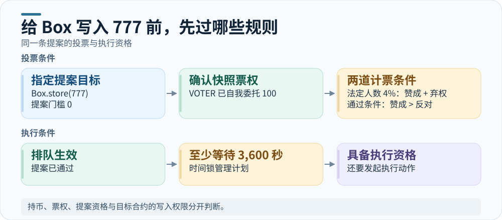

# 第 20 章 · 治理基础：权限、票权与提案

一份名叫 Box 的合约能存一个数。有人提出把它写成 777。参与者投票赞成后，Box 已经变成 777 了吗？课程测试把提案成立、票数达标、等待和真正写入排成了几个阶段。本章先用课程的同一条 `Box.store(777)` 提案，看懂这几道条件。[MyGovernorTest.t.sol 的提案与执行](https://github.com/Cyfrin/foundry-dao-cu/blob/6f634deb8587d1a0c508e43680bebf16b3f34cb4/test/MyGovernorTest.t.sol#L52-L103)

## 谁能决定，谁能改状态

[第 04 章](../01-ethereum-l1/04-blocks-and-consensus.md)区分了网络的访问权限和规则治理。节点按底层协议验证交易，具体应用还会检查调用者是否具备应用层权限。[第 11 章](../03-contracts-and-foundry/11-fund-me-and-price-feeds.md)的 Fund Me 通过所有者限制提款。在 Box 例子里，合约也只接受所有者写入，测试将这个所有者设成时间锁（timelock）。参加投票的人通过治理规则表达决定，时间锁在执行条件满足后调用 Box。提案人、投票人、执行的触发者和实际调用 Box 的合约可以是不同主体。[Box 的权限检查](https://github.com/Cyfrin/foundry-dao-cu/blob/6f634deb8587d1a0c508e43680bebf16b3f34cb4/src/Box.sol#L7-L23) · [测试角色配置](https://github.com/Cyfrin/foundry-dao-cu/blob/6f634deb8587d1a0c508e43680bebf16b3f34cb4/test/MyGovernorTest.t.sol#L31-L54)

去中心化自治组织（decentralized autonomous organization，DAO）通过一组共同规则协调决策。链下讨论可以提出问题、比较方案或争取支持。链上的治理合约将某些规则落为可核对的状态和权限，例如允许谁提交提案、怎样统计票数、哪个合约在什么时候执行。读权限时也要看是否仍有单独的管理角色。能读公开讨论、持有代币、能决定配置和能调用目标各有条件。[《Web3 Fundamentals》Decentralized Autonomous Organization，L940–960](../../../refs/B3_Web3_Fundamentals.md)

## 提案怎样依次通过四道检查

链上提案（proposal）需要能识别实际执行对象与动作。在本案例里，目标是 Box，动作是调用 `store(777)`。课程的提案人负责提交，治理合约 Governor 跟踪票权和提案状态。成功条件满足后，提案排队（queue），时间锁设置最早执行时刻。到点还要有人发起执行交易（execute），这才有机会改写 Box。

*图 20　同一条 Box 提案中，提交、通过和可以执行分别由不同条件决定。 [MyGovernor.sol](https://github.com/Cyfrin/foundry-dao-cu/blob/6f634deb8587d1a0c508e43680bebf16b3f34cb4/src/MyGovernor.sol#L16-L70) · [MyGovernorTest.t.sol](https://github.com/Cyfrin/foundry-dao-cu/blob/6f634deb8587d1a0c508e43680bebf16b3f34cb4/test/MyGovernorTest.t.sol#L57-L103)*

| 检查 | 在问什么 | 课程的 Box 提案 |
| --- | --- | --- |
| 能否提交 | 提案门槛（proposal threshold）规定提交人须有多少票权 | 设置为 0，所以此项目允许没有投票权的地址发起提案 |
| 以哪一刻的票权投票 | 委托（delegation）指定谁能使用票权，快照（snapshot）固定提案使用哪一时点的票权 | 等待 1 个区块的投票延迟，按提案快照计权，投票期为 50,400 个区块 |
| 是否达到并通过 | 法定人数（quorum）是最低参与票权口径，通过条件比较赞成和反对票 | 法定人数为快照总代币供应量的 4%，赞成与弃权计入；同时需要赞成多于反对 |
| 何时和怎样执行 | 通过后由提案进入队列，时间锁等待，执行还要满足合约配置 | 最小延迟为 3,600 秒，到时间后由一笔执行交易触发 |

这些是课程快照的参数，其他治理系统可能采用不同门槛、快照时钟或计票规则。法定人数关心指定类别的票权是否足量，通过规则关心结果。课程采用 OpenZeppelin 的具体计票模块，两项检查都满足才进入成功状态。[课程治理参数](https://github.com/Cyfrin/foundry-dao-cu/blob/6f634deb8587d1a0c508e43680bebf16b3f34cb4/src/MyGovernor.sol#L16-L55) · [固定版本的计票条件](https://github.com/OpenZeppelin/openzeppelin-contracts/blob/0a25c1940ca220686588c4af3ec526f725fe2582/contracts/governance/extensions/GovernorCountingSimple.sol#L64-L80) · [法定人数比例的基数](https://github.com/OpenZeppelin/openzeppelin-contracts/blob/0a25c1940ca220686588c4af3ec526f725fe2582/contracts/governance/extensions/GovernorVotesQuorumFraction.sol#L63-L76)

## 用课程的同一张票算一次

测试布置给 `VOTER` 铸造 100 个治理代币，并由它把票权委托给自己。委托指定投票权的使用者，代币余额仍在原地址。课程用票权检查点（checkpoint）记录不同时点的可用票权，提案取快照时点的值。在这份夹具里，总代币供应量是 100，快照中的 `VOTER` 有 100 份票权，法定人数阈值是 4。数字以下均按可读的代币单位写。[测试中的铸造、委托和投票](https://github.com/Cyfrin/foundry-dao-cu/blob/6f634deb8587d1a0c508e43680bebf16b3f34cb4/test/MyGovernorTest.t.sol#L31-L85)

| 同一提案的计票情景 | 赞成 | 反对 | 弃权 | 法定人数 | 赞成多于反对 |
| --- | ---: | ---: | ---: | --- | --- |
| 测试中的 `VOTER` 投赞成 | 100 | 0 | 0 | 100 ≥ 4，达标 | 是 |
| 纸面反问，`VOTER` 改投弃权 | 0 | 0 | 100 | 100 ≥ 4，达标 | 否 |
| 纸面反问，`VOTER` 不参与 | 0 | 0 | 0 | 0 < 4，未达标 | 否 |

课程里同一位投票人掌握全部夹具票权，是为了方便检验流程。读实际协议还要问投票权委托给谁、是否集中以及提案范围有多大。[第 19 章](./19-reading-project-metrics.md)讨论过代币分配与资金归集，治理权和收取费用的权利需要按各自合约核查。[分析指南，Tokenomics，L175–189](../../../refs/A-Guide-to-Fundamental-Analysis-in-Crypto.md)

## 常见误区

- **过了法定人数就表示提案通过。** 两类条件分别检查。上表的弃权情景展示了参与达标而结果不能通过。
- **投票通过就意味着状态已经更新。** 先看排队和时间锁，再核对执行交易和目标状态。
- **持有治理代币就从当前余额直接计算所有提案票权。** 查询委托和各提案的快照票权。
- **链下支持意见直接改写应用。** 检查应用合约为何接受由特定执行者发出的调用。

## 练习与核对

1. **有 100 份总票权，全部投弃权。课程模块法定人数达标吗？`Box.store(777)` 能按此结果排队吗？** 弃权计入法定人数，100 达标。赞成 0 没有超过反对 0，提案无法由这个结果通过并排队。
2. **真实课程情景的票已投完、两项条件都满足，此时能从票数断言 `retrieve()` 为 777 吗？** 还要完成排队、等待最小延迟和执行，再读取 Box。票数只能说明通过条件已达成。
3. **持有者把票权委托给别的地址，余额的归属和快照中能投票的人会怎样？** 代币仍记在持有者余额中。生效在快照前时，相应票权归委托指定的人使用。

[第 21 章](./21-dao-with-governor.md)用这条提案的实际 calldata、角色设置和测试断言核对写入 777 的每一步。

## 来源

- 《Web3 Fundamentals》Decentralized Autonomous Organization（第 37–38 页，L940–960）及 The economics of community（第 47–48 页，L1183–1199）。[参考书 Markdown](../../../refs/B3_Web3_Fundamentals.md)
- 《A Guide to Fundamental Analysis in Crypto》Tokenomics（目录第 10 页，L175–189），代币分配和治理权。[分析指南 Markdown](../../../refs/A-Guide-to-Fundamental-Analysis-in-Crypto.md)
- 课程 DAO 决策场景与参与权问题。法定人数和执行细节以项目实现为准。[Updraft，Understanding Decentralized Governance and DAOs](https://github.com/Cyfrin/Updraft/blob/1d7138f18fbe26bfff82a091df118efda52f29e7/courses/blockchain-basics/5-blockchain-use-cases/7-decentralized-governance/%2Bpage.md#L1-L45)
- 课程 Box 提案参数、票权委托与调用流程。[MyGovernor.sol](https://github.com/Cyfrin/foundry-dao-cu/blob/6f634deb8587d1a0c508e43680bebf16b3f34cb4/src/MyGovernor.sol#L16-L70) · [MyGovernorTest.t.sol](https://github.com/Cyfrin/foundry-dao-cu/blob/6f634deb8587d1a0c508e43680bebf16b3f34cb4/test/MyGovernorTest.t.sol#L31-L103)
- 固定依赖的票权比例与计票规则。[GovernorVotesQuorumFraction.sol](https://github.com/OpenZeppelin/openzeppelin-contracts/blob/0a25c1940ca220686588c4af3ec526f725fe2582/contracts/governance/extensions/GovernorVotesQuorumFraction.sol#L63-L76) · [GovernorCountingSimple.sol](https://github.com/OpenZeppelin/openzeppelin-contracts/blob/0a25c1940ca220686588c4af3ec526f725fe2582/contracts/governance/extensions/GovernorCountingSimple.sol#L64-L80)

[全书目录](../README.md) · [本章来源映射](../../../planning/beginner/source-map.md#ch-20)
