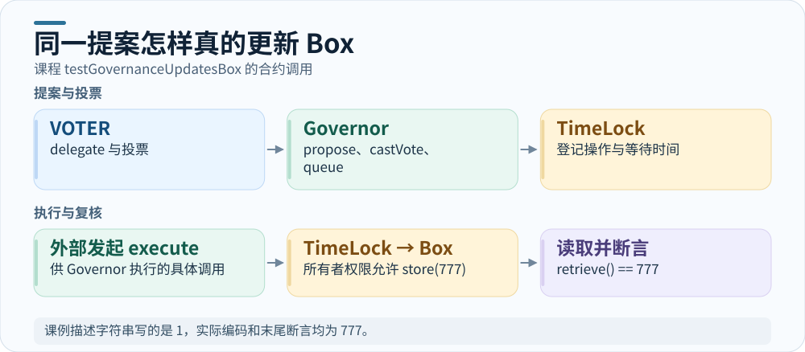

# 第 21 章 · DAO 实践：让 Governor 与时间锁更新 Box

测试布置完成后，直接调用 `box.store(1)` 会回退。另一项测试提交[第 20 章](./20-governance-before-dao.md)的同一条治理提案，最后读到 `777`。检查两段调用的发起者，就能找出不同结果的原因。

本章走读课程快照的两项断言和治理路径。[第 09 章](../03-contracts-and-foundry/09-contract-composition.md)可以帮助回顾调用数据，[第 10 章](../03-contracts-and-foundry/10-local-foundry-loop.md)与[第 12 章](../03-contracts-and-foundry/12-testing-external-dependencies.md)介绍测试布置和模拟调用者。

## 布置四个合约和角色

| 合约 | 在这一例中的职责 | 从哪里读 |
| --- | --- | --- |
| `GovToken` | ERC-20 余额与适用于提案快照的票权 | `ERC20Votes`、`mint`、继承的 `delegate` |
| `MyGovernor` | 提案、记录票数与跟踪状态 | 构造函数、`propose`、`state`、与时间锁连接的 `_execute` |
| `TimeLock` | 记录排队后的动作，检查执行角色与最早执行时间 | `TimelockController` 构造函数和继承的方法 |
| `Box` | 只接受所有者写入，允许读取现值 | 带 `onlyOwner` 的 `store` 与公开的 `retrieve` |

`setUp` 给 `VOTER` 铸造 `100e18` 个最小单位，再以 `VOTER` 身份执行 `token.delegate(VOTER)`。这一步使持仓对应的票权通过检查点（checkpoint）进入历史查询，本例显示为 100 票。`GovToken.mint` 在课程中公开，便于布置数据，真实系统的发行权限需要按其规则核查。[GovToken.sol](https://github.com/Cyfrin/foundry-dao-cu/blob/6f634deb8587d1a0c508e43680bebf16b3f34cb4/src/GovToken.sol#L8-L28) · [MyGovernorTest.t.sol，布置](https://github.com/Cyfrin/foundry-dao-cu/blob/6f634deb8587d1a0c508e43680bebf16b3f34cb4/test/MyGovernorTest.t.sol#L31-L50)

接着，测试把时间锁的提案角色（`PROPOSER_ROLE`）授予 Governor。这个角色可以安排时间锁里的操作。向零地址授予执行角色（`EXECUTOR_ROLE`）使指定版本的执行角色检查对所有调用者开放，操作仍须满足时间锁要求。测试撤销布置者在时间锁的管理角色，最后调用 `box.transferOwnership(address(timelock))`。Box 从此用时间锁地址作为自己的所有者。[TimeLock.sol](https://github.com/Cyfrin/foundry-dao-cu/blob/6f634deb8587d1a0c508e43680bebf16b3f34cb4/src/TimeLock.sol#L6-L13) · [TimelockController 的开放角色检查](https://github.com/OpenZeppelin/openzeppelin-contracts/blob/0a25c1940ca220686588c4af3ec526f725fe2582/contracts/governance/TimelockController.sol#L110-L122) · [Box.sol](https://github.com/Cyfrin/foundry-dao-cu/blob/6f634deb8587d1a0c508e43680bebf16b3f34cb4/src/Box.sol#L7-L23)

`testCantUpdateBoxWithoutGovernance` 先调用 `vm.expectRevert()`，再尝试直接写入。此时 Box 看到的调用者是测试合约，所有者已经是时间锁，`onlyOwner` 检查会回退。这个断言展示该直接调用被拒。[直接更新测试](https://github.com/Cyfrin/foundry-dao-cu/blob/6f634deb8587d1a0c508e43680bebf16b3f34cb4/test/MyGovernorTest.t.sol#L49-L55)

## 读提案里真正要执行的动作

课程测试给 Governor 一组目标地址、一组 ETH 附带金额、一组 calldata 和一条人可读描述。这个提案只包含一个操作，目标是 `address(box)`，金额是 `0`，calldata 从函数签名和参数编码而来。

```solidity
uint256 valueToStore = 777;
string memory description = "Store 1 in Box";
bytes memory encodedFunctionCall = abi.encodeWithSignature("store(uint256)", valueToStore);
```

这是固定课程测试中的三行，所在文件声明 Solidity `^0.8.19`。描述写着 `Store 1 in Box`，参数和最终断言使用 `777`。逐项核对自然语言描述和实际调用，便能发现这项差异。排队与执行使用相同的目标、金额和 calldata，另传描述的哈希来标识同一提案。[提案输入与描述哈希](https://github.com/Cyfrin/foundry-dao-cu/blob/6f634deb8587d1a0c508e43680bebf16b3f34cb4/test/MyGovernorTest.t.sol#L57-L99)

## 从 Pending 跟到 Executed



*图 21　课程测试中的执行链。投票人给票，Governor 编排，TimeLock 调用 Box，测试回读 777。 [MyGovernorTest.t.sol](https://github.com/Cyfrin/foundry-dao-cu/blob/6f634deb8587d1a0c508e43680bebf16b3f34cb4/test/MyGovernorTest.t.sol#L31-L103)*

| 阶段 | 测试做了什么 | 代码中观察到的状态 |
| --- | --- | --- |
| 提交 | `governor.propose(…)`，保存 `proposalId` | `Pending`，断言值 0 |
| 进入投票 | 推进到超过快照区块 | `Active`，断言值 1 |
| 投票并结束 | 以 `VOTER` 调用 `castVoteWithReason`，投赞成，再推进到投票期之后 | `Succeeded`，断言值 4 |
| 排队与等待 | `governor.queue(…)`，将时间推进到最小延迟之后 | `Queued`，断言值 5 |
| 执行与回读 | `governor.execute(…)` 通过时间锁调用 `Box.store(777)`，再执行读取 | `Executed`，断言值 7，`box.retrieve() == valueToStore` |

测试使用两种时钟。`vm.roll` 修改区块号，供此版本 Governor 的投票快照、截止区块比较。`vm.warp` 修改时间戳，供时间锁计算排队后的最早执行时间。课程给投票延迟和投票期分别设置 1 与 50,400 个区块，时间锁最小延迟设置 3,600 秒。夹具在几个阶段同时推进两种时钟，判断哪一种决定状态时，应读合约里的时间比较条件。[Governor 的区块比较](https://github.com/OpenZeppelin/openzeppelin-contracts/blob/0a25c1940ca220686588c4af3ec526f725fe2582/contracts/governance/Governor.sol#L145-L178) · [Timelock 的排队条件](https://github.com/OpenZeppelin/openzeppelin-contracts/blob/0a25c1940ca220686588c4af3ec526f725fe2582/contracts/governance/TimelockController.sol#L242-L273)

最后的调用会经过 Governor，再由时间锁调用目标。Box 检查的是这一跳的 `msg.sender`，因此看到的是自己的所有者 TimeLock。能否执行也取决于已排队的动作和就绪时间。课例以测试断言展示成功路径及一次直接写入被拒，尚未覆盖不同投票组合或每个等待边界。本书以 Foundry `v1.3.1` 和 Solidity `0.8.19` 实跑了 `MyGovernorTest`，两项均通过。[GovernorTimelockControl 的排队和执行](https://github.com/OpenZeppelin/openzeppelin-contracts/blob/0a25c1940ca220686588c4af3ec526f725fe2582/contracts/governance/extensions/GovernorTimelockControl.sol#L90-L125) · [TimelockController 的目标调用](https://github.com/OpenZeppelin/openzeppelin-contracts/blob/0a25c1940ca220686588c4af3ec526f725fe2582/contracts/governance/TimelockController.sol#L322-L353)

## 常见误区

- **把时间锁的提案角色和在 Governor 提交提案混在一起。** 前者决定谁能把操作安排进时间锁，后者由 Governor 的提案门槛控制。
- **只看提案描述判断会做什么。** 本例读目标、ETH 金额和 calldata，才能看出真正写入的数是 777。
- **把有执行资格理解为可以直接写 Box。** 开放角色允许向时间锁发起执行，Box 的所有者检查仍然适用。
- **认为增加区块号就满足所有等待条件。** 投票状态用区块号，时间锁就绪由时间戳决定。

## 练习与核对

1. **把目标和参数逐项写出。通过后最终给 Box 传入什么？** 目标是测试里的 `address(box)`，ETH 附带金额为 0，calldata 对应 `store(uint256)` 及参数 `777`。
2. **测试能看到 `Queued`，但尚未执行，旧值已经变为 777 吗？** 此阶段只登记待执行的操作。应等到执行交易结束，再用 `retrieve()` 核验。
3. **谁调用 `governor.execute`，以及 Box 看到谁调用 `store`？** 测试中的执行发起者是测试合约，Box 看到的直接调用者是 TimeLock。
4. **哪两条断言共同给出访问与结果证据？** `testCantUpdateBoxWithoutGovernance` 对直接写入预期回退。`testGovernanceUpdatesBox` 最后断言状态 `Executed`，并核对回读等于 `valueToStore`。

治理票权和执行资格的概念可回看[第 20 章](./20-governance-before-dao.md)。至此主线把写入一笔交易、读取应用状态和追踪谁能改变状态连在了一起。

## 来源

- 课程 Advanced Foundry §8 的治理代币、Governor 和测试。[课程索引 L2694–2749](https://github.com/yuxiaoli/foundry-full-course-cu/blob/b92616c4212d40cacfeeff4ea0f30501cafad094/README.md#L2694-L2749)
- 课程项目的四个合约及目标权限。[GovToken.sol](https://github.com/Cyfrin/foundry-dao-cu/blob/6f634deb8587d1a0c508e43680bebf16b3f34cb4/src/GovToken.sol#L8-L28) · [MyGovernor.sol](https://github.com/Cyfrin/foundry-dao-cu/blob/6f634deb8587d1a0c508e43680bebf16b3f34cb4/src/MyGovernor.sol#L16-L104) · [TimeLock.sol](https://github.com/Cyfrin/foundry-dao-cu/blob/6f634deb8587d1a0c508e43680bebf16b3f34cb4/src/TimeLock.sol#L6-L13) · [Box.sol](https://github.com/Cyfrin/foundry-dao-cu/blob/6f634deb8587d1a0c508e43680bebf16b3f34cb4/src/Box.sol#L7-L23)
- 课程测试的角色、提案动作、状态与结果断言。[MyGovernorTest.t.sol](https://github.com/Cyfrin/foundry-dao-cu/blob/6f634deb8587d1a0c508e43680bebf16b3f34cb4/test/MyGovernorTest.t.sol#L31-L103)
- 课程的 OpenZeppelin Contracts 固定子模块与执行路径。[Governor.sol](https://github.com/OpenZeppelin/openzeppelin-contracts/blob/0a25c1940ca220686588c4af3ec526f725fe2582/contracts/governance/Governor.sol#L145-L178) · [GovernorTimelockControl.sol](https://github.com/OpenZeppelin/openzeppelin-contracts/blob/0a25c1940ca220686588c4af3ec526f725fe2582/contracts/governance/extensions/GovernorTimelockControl.sol#L90-L125) · [TimelockController.sol](https://github.com/OpenZeppelin/openzeppelin-contracts/blob/0a25c1940ca220686588c4af3ec526f725fe2582/contracts/governance/TimelockController.sol#L322-L353) · [ERC20Votes.sol 的历史票权查询](https://github.com/OpenZeppelin/openzeppelin-contracts/blob/0a25c1940ca220686588c4af3ec526f725fe2582/contracts/token/ERC20/extensions/ERC20Votes.sol#L57-L92)
- 《Web3 Fundamentals》Decentralized Autonomous Organization（第 37–38 页，L940–960）用于区分组织协调与合约执行。[参考书 Markdown](../../../refs/B3_Web3_Fundamentals.md)

[全书目录](../README.md) · [本章来源映射](../../../planning/beginner/source-map.md#ch-21)
