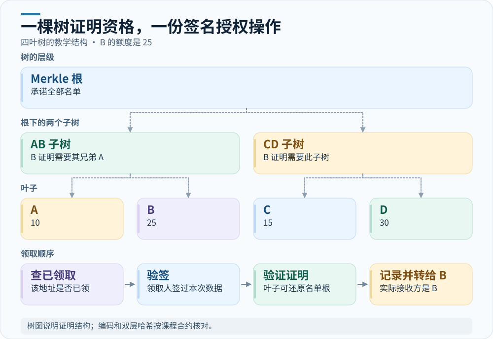

# 第 22 章 · 签名与 Merkle 证明：空投资格验证

一份代币发放名单有四条记录，小周可以领取 25 枚。她让小林代为提交交易，代币仍应进入小周的余额。合约要回答两个问题：小周的地址和金额是否在名单上，以及小周是否同意这次领取。Merkle 证明回答第一个，签名回答第二个。提交交易的小林支付这笔交易的 Gas。

本章沿用[第 02 章的钱包与签名](../01-ethereum-l1/02-wallets-keys-signatures.md)、[第 04 章的哈希](../01-ethereum-l1/04-blocks-and-consensus.md)与[第 15 章的代币余额](../04-assets-protocols-and-governance/15-erc20-token-accounting.md)。读完后，你可以从一笔领取读出名单、授权和代币分别由谁验证。

## 四条记录怎样缩成一个根

空投（airdrop）是按某种资格分发代币的方式。本章用 A、B、C、D 代表四个测试地址，金额依次为 10、25、15、30 枚。B 即小周。发放方把每条地址与金额编码后散列为一个叶节点（leaf），再将相邻的两个叶子合成父节点。最后将两棵子树的哈希合成 Merkle 根（Merkle root）。合约保存根，就能用它核对一条记录对应的路径。



图 22　B 的证明提供 A 的叶哈希与 C、D 子树的哈希。合约从 B 的地址金额重建叶节点，再沿这两项重算到根。右侧检查顺序根据课程合约重绘。 [Merkle Proofs 课文](https://github.com/Cyfrin/Updraft/blob/1d7138f18fbe26bfff82a091df118efda52f29e7/courses/advanced-foundry/5-merkle-airdrop/4-merkle-proofs/%2Bpage.md) · [`MerkleAirdrop.claim`](https://github.com/Cyfrin/foundry-merkle-airdrop-cu/blob/bd12de21112b7fcde98868e37bce9b14affd3f57/src/MerkleAirdrop.sol#L49-L79)

图中用字母和整数说明结构。真实地址与最小单位的金额按[第 09 章的 ABI](../03-contracts-and-foundry/09-contract-composition.md)编码。课程合约从领取参数算出双哈希叶子，把路径、固定根和该叶子交给 OpenZeppelin 的 `MerkleProof.verify`。生成证明和验证证明需要采用相同的叶子格式与合并规则。 [项目的树生成脚本](https://github.com/Cyfrin/foundry-merkle-airdrop-cu/blob/bd12de21112b7fcde98868e37bce9b14affd3f57/script/MakeMerkle.s.sol)

```solidity
bytes32 leaf = keccak256(bytes.concat(keccak256(abi.encode(account, amount))));
```

假如小林把金额从 25 改成 30，合约会用和原名单不同的新叶哈希开始重算。原本那条证明对应的是 B 与 25 的组合。通过验证只说明这条记录与合约保存的根匹配。选择名单、分配金额与部署时填入哪个根，仍是发放方作出的决定。

## 小周签了什么

EIP-712 定义类型化结构数据（typed structured data）的散列和签名。项目使用类型 `AirdropClaim(address account,uint256 amount)`。`getMessageHash` 对领取结构散列，再经 OpenZeppelin 的 `_hashTypedDataV4` 得出待签摘要。这个摘要也绑定签名域（signing domain），域包括项目设置的名称 `Merkle Airdrop`、版本 `1.0.0`，以及当前链 ID 和验证合约地址。这样同一份地址金额在两份合约中的授权语境可区分。 [项目的类型和摘要](https://github.com/Cyfrin/foundry-merkle-airdrop-cu/blob/bd12de21112b7fcde98868e37bce9b14affd3f57/src/MerkleAirdrop.sol#L29-L88) · [EIP-712 规范](https://eips.ethereum.org/EIPS/eip-712)

| 角色 | 示例中的动作或结算结果 |
| --- | --- |
| 小周，领取人 | 用自己的密钥给领取摘要签名。她的地址写在 `account`。 |
| 小林，提交者 | 把 `account`、金额、证明和签名分量 `v, r, s` 交给 `claim`，支付这笔交易的 Gas。 |
| 空投合约 | 恢复签名者，与 `account` 比较，通过全部检查后将代币发给 `account`。 |

`claim` 先查 `s_hasClaimed[account]`，再核验签名和 Merkle 证明。通过后，合约设置已领取标记，发出 `Claimed` 事件，以 `safeTransfer(account, amount)` 发放代币。域分隔约束授权的语境，同一合约的一次性领取由已领取标记约束。这个项目把签名者与领取地址比较，后面的账户抽象专题把验证规则交给可编程账户。 [`claim` 与 `_isValidSignature`](https://github.com/Cyfrin/foundry-merkle-airdrop-cu/blob/bd12de21112b7fcde98868e37bce9b14affd3f57/src/MerkleAirdrop.sol#L49-L125) · [第 25 章 · 账户抽象](./25-account-abstraction.md)

## 从测试核对余额

按[第 12 章的方法读测试](../03-contracts-and-foundry/12-testing-external-dependencies.md)，先区分夹具、执行和断言。课程的 `MerkleAirdrop.t.sol` 用 `makeAddrAndKey("user")` 生成临时用户。测试辅助函数 `signMessage` 通过 `vm.sign` 签 `getMessageHash` 给出的摘要。随后 `vm.prank(gasPayer)` 设置下一次调用的发送者，测试用预置证明让这个代付地址提交，最后断言 `endingBalance - startingBalance == amountToCollect`。夹具金额是 `25 * 1e18` 个最小单位。测试读取的余额属于 `user`，这就是代付场景的验证点。 [课程测试 L18–60](https://github.com/Cyfrin/foundry-merkle-airdrop-cu/blob/bd12de21112b7fcde98868e37bce9b14affd3f57/test/unit/MerkleAirdrop.t.sol#L18-L60)

在课程项目提交 `bd12de21112b` 的项目根目录，安装该提交记录的 Git 子模块并使用普通 Foundry，可用以下选择器只运行领取用例。项目的 `foundry.toml` 固定 Solidity `0.8.24`。本书用 Foundry `v1.3.1` 运行该命令，`testUsersCanClaim` 通过。 [编译配置](https://github.com/Cyfrin/foundry-merkle-airdrop-cu/blob/bd12de21112b7fcde98868e37bce9b14affd3f57/foundry.toml) · [依赖清单](https://github.com/Cyfrin/foundry-merkle-airdrop-cu/blob/bd12de21112b7fcde98868e37bce9b14affd3f57/.gitmodules)

```bash
forge test --match-test testUsersCanClaim
```

## 常见误区

- **看到证明就认定有人授权。** 成员证明随名单发布即可被他人取得，授权证据来自领取人签过的摘要。
- **把支付 Gas 的地址当成收款地址。** 看 `safeTransfer` 的第一个参数。项目固定将代币发给 `account`。
- **把一次性领取归功于签名格式。** EIP-712 负责待签内容及签名域。一次性领取由本项目的 `s_hasClaimed[account]` 保证。

## 练习与核对

1. 图中的 B 要向验证方提供哪两项兄弟哈希？  
   **答案**　A 的叶哈希与 C、D 的父节点哈希。有了 B 的地址和金额即可从 B 的叶节点推导到根。
2. 领取前，小林保留原签名，把 B 的 25 枚改为 30 枚。第一次失败的是哪一项？  
   **答案**　验签。金额是签名消息字段。若小周为 30 枚另签了一个有效消息但仍带原有证明，在名单根和已领取状态相同的条件下，下一项成员验证会失败。两种结果来自代码分支的推演。
3. B 成功领取后再次提交同一份参数，会走到哪一步？  
   **答案**　`s_hasClaimed[account]` 为真，进入 `MerkleAirdrop__AlreadyClaimed` 分支。这个判断早于验签。课程的 `testUsersCanClaim` 直接展示的是首领成功和余额增量。

## 来源

- 《Web3 Fundamentals》，Airdrop（第 36–37 页，Markdown L902–938），用于名单、快照和领取的场景。 [本地书稿](../../../refs/B3_Web3_Fundamentals.md)
- Cyfrin 课程 fork，Advanced Foundry §5 的 Merkle Airdrop and Signatures。 [固定课程索引 L2383–2440](https://github.com/yuxiaoli/foundry-full-course-cu/blob/b92616c4212d40cacfeeff4ea0f30501cafad094/README.md#L2383-L2440) · [签名标准课文 L60–193](https://github.com/Cyfrin/Updraft/blob/1d7138f18fbe26bfff82a091df118efda52f29e7/courses/advanced-foundry/5-merkle-airdrop/11-signature-standards/%2Bpage.md#L60-L193)
- 课程项目 `foundry-merkle-airdrop-cu` 固定源码与测试，确认叶子格式、检查顺序与代提交路径。 [MerkleAirdrop.sol](https://github.com/Cyfrin/foundry-merkle-airdrop-cu/blob/bd12de21112b7fcde98868e37bce9b14affd3f57/src/MerkleAirdrop.sol) · [MerkleAirdrop.t.sol](https://github.com/Cyfrin/foundry-merkle-airdrop-cu/blob/bd12de21112b7fcde98868e37bce9b14affd3f57/test/unit/MerkleAirdrop.t.sol)

[全书目录](../README.md) · [本章来源映射](../../../planning/beginner/source-map.md#ch-22)
