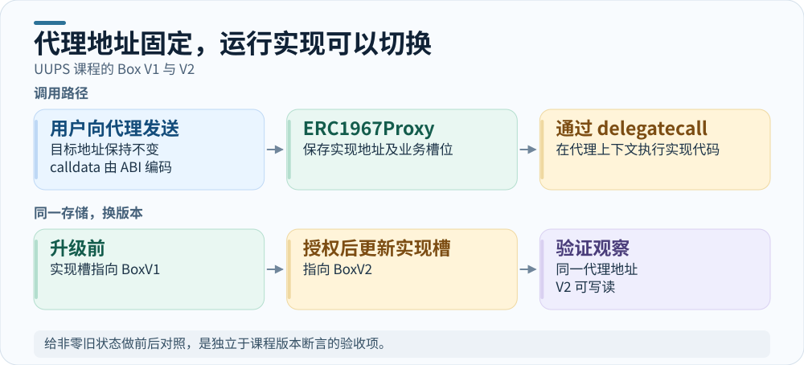

# 第 23 章 · 从存储和 ABI 到 UUPS 代理升级

一个应用已把 Box 的地址给了所有用户。初版 Box 可以读取数值，新版还希望接受 `setValue(2)`。用户继续向同一个地址发送请求，而这个地址改用新版代码。理解其中的两次分离，就能解释为什么升级要关心数据的槽位和更新权限：ABI 让调用者描述要执行什么，代理让应用的地址和业务代码可以分别变化。

这里沿用[第 03 章的链上状态与 Gas](../01-ethereum-l1/03-state-execution-and-gas.md)、[第 09 章的 ABI](../03-contracts-and-foundry/09-contract-composition.md)与[第 10 章的本地测试](../03-contracts-and-foundry/10-local-foundry-loop.md)。本章会追到课程测试中 Box 的初版行为、升级和新版写读。

## 合约状态怎样落在槽位里

存储槽（storage slot）是 EVM 对合约持久状态按 32 字节访问的单位。Solidity 根据类型、声明次序和继承关系把字段安排到槽里，能放进同一槽的相邻小字段可能共享一槽。课程的 `FunWithStorage` 适合观察初次布局，例子中 `uint256 favoriteNumber` 占满槽 0，所以后面的 `bool someBool` 从槽 1 开始。

| 字段 | 构造后与布局相关的观察 |
| --- | --- |
| `favoriteNumber`、`someBool` | 槽 0 中读到 25，槽 1 的布尔值为真。 |
| `myArray` | 槽 2 保存数组长度 1。对这里的 `uint256[]`，首项 222 放在对槽号的 32 字节表示做 Keccak-256 后得到的起始位置。 |
| `myMap` | 槽 3 是映射的布局基址。对于这里的整数键 0，映射项位于 `keccak256(abi.encode(uint256(0), uint256(3)))` 指定的位置。 |

`doStuff` 在源码中读取前两个字段并构造临时值，编译优化后的指令需要按编译器产物检验。Fund Me 的 `withdraw` 在循环中读存储数组，`cheaperWithdraw` 先把地址数组复制到内存，两者仍要写回地址对应的记录。若比较 Gas，使用相同的部署状态、出资人数量、编译器、优化设置和测试场景。源码可说明访问路径，费用差异需要测量。 [FunWithStorage.sol](https://github.com/Cyfrin/foundry-fund-me-cu/blob/d2834ea3b78a67dd4db6790e66c6c63971feebc5/src/exampleContracts/FunWithStorage.sol) · [两种提款函数 L62–87](https://github.com/Cyfrin/foundry-fund-me-cu/blob/d2834ea3b78a67dd4db6790e66c6c63971feebc5/src/FundMe.sol#L62-L87)

## 同一段调用数据可以在哪个地址的语境下执行

ABI（应用二进制接口，Application Binary Interface）规定函数名称和参数怎样编码。课程 `CallAnything.getDataToCallTransfer` 用 `abi.encodeWithSelector` 将 `transfer(address,uint256)` 的 4 字节选择器与编码完成的参数拼接成 calldata。低级调用（low-level call）接收这些字节。选择器定位函数，执行语境由使用的调用指令决定。 [CallAnything.sol L27–53](https://github.com/Cyfrin/foundry-nft-cu/blob/a3e8d17cc951dbd5c7261eae440354b89e9c6203/src/sublesson/CallAnything.sol#L27-L53)

课程的 `DelegateCallExample` 有合约 A 和 B，双方以相同顺序声明 `num`、`sender`、`value`。纸面推演中，小周带 1 wei 调用 `A.setVars(B, 7)`，A 委托执行（`delegatecall`）B 的代码。B 的函数体里把 `num` 写成 7，把 `sender` 写成小周，把 `value` 写成 1；这些写入落在 A。作为对照，假设 A 使用普通 `call` 将 1 wei 一同传给 B，B 在自己的状态里写入，看到的 `msg.sender` 是 A。 [DelegateCallExample.sol](https://github.com/Cyfrin/foundry-upgrades-cu/blob/c964481bf1ab3980632ec58c394cba2977592065/src/sublesson/DelegateCallExample.sol)

| A 调用 B 的方式 | 使用的代码 | 写入的状态 | 被调用代码中的 `msg.sender` |
| --- | --- | --- | --- |
| `call` | B | B | A |
| `delegatecall` | B | A | 此次调用 A 的小周 |

`delegatecall` 保留当前语境的 `msg.sender` 和 `msg.value`。当 B 的代码认为槽 0 是 `num` 时，实际修改的是当前合约 A 的槽 0。布局兼容因此是代理可持续读取数据的前提。

## Box 的升级怎样经过代理



图 23　用户一直调用同一代理。部署时实现槽指向 BoxV1，允许的升级把指针更新为 BoxV2。代理仍用自己的状态，切换的是委托执行的代码。依据课程部署与升级脚本重绘。 [DeployBox.s.sol](https://github.com/Cyfrin/foundry-upgrades-cu/blob/c964481bf1ab3980632ec58c394cba2977592065/script/DeployBox.s.sol) · [UpgradeBox.s.sol](https://github.com/Cyfrin/foundry-upgrades-cu/blob/c964481bf1ab3980632ec58c394cba2977592065/script/UpgradeBox.s.sol)

课程使用通用可升级代理标准（Universal Upgradeable Proxy Standard，UUPS）的结构。部署脚本创建 `BoxV1`，将其地址交给 `ERC1967Proxy`，然后通过代理调用 `initialize` 初始化代理中的状态。ERC-1967 规定代理应在哪个槽保存实现地址。实现的构造函数中调用 `_disableInitializers()`，处理的是实现自身；代理里的初始化通过 `initializer` 保护。两份实现的 `_authorizeUpgrade` 都使用 `onlyOwner`。 [BoxV1.sol](https://github.com/Cyfrin/foundry-upgrades-cu/blob/c964481bf1ab3980632ec58c394cba2977592065/src/BoxV1.sol) · [BoxV2.sol](https://github.com/Cyfrin/foundry-upgrades-cu/blob/c964481bf1ab3980632ec58c394cba2977592065/src/BoxV2.sol) · [ERC-1967](https://eips.ethereum.org/EIPS/eip-1967)

升级脚本通过同一个代理地址调用 `upgradeTo`，把实现改成 BoxV2。此后 `version()` 读到 2，V2 提供的 `setValue` 能修改代理中的 `value`。课程两个版本声明同一个 `uint256 internal value`。阅读更复杂的升级时，需要逐项核对已有字段及继承带来的布局是否兼容。

## 顺着测试读出证据

| 课程测试 | 源码中的观察 |
| --- | --- |
| `testBoxWorks` | 对刚部署的代理调用 `version()`，断言是 1。 |
| `testDeploymentIsV1` | 在升级前从代理调用 V2 才有的 `setValue(7)`，预期回退。 |
| `testUpgradeWorks` | 设置升级所需所有权后切换到新实现，断言 `version() == 2`，用 `setValue(2)` 写入后读到 2。 |

按[第 12 章的测试分层](../03-contracts-and-foundry/12-testing-external-dependencies.md)看，这些断言覆盖初版行为、切换实现与升级后的写读。初始化一次性、拒绝未授权升级、原有非零值保留及布局兼容各自需要相应的验收证据。课程的最后一个测试写入发生在升级之后。 [`DeployAndUpgradeTest.t.sol` L17–51](https://github.com/Cyfrin/foundry-upgrades-cu/blob/c964481bf1ab3980632ec58c394cba2977592065/test/DeployAndUpgradeTest.t.sol#L17-L51)

在升级项目提交 `c964481bf1ab` 的目录，按 Git 子模块版本准备依赖，使用普通 Foundry。该提交的 OpenZeppelin Contracts 和 Contracts Upgradeable 均为 `4.8.3`，提供 `upgradeTo` 和无参 `__Ownable_init()`。以下示例可使用 Foundry `v1.3.1` 与 Solidity `0.8.24`。 [项目编译与导入配置](https://github.com/Cyfrin/foundry-upgrades-cu/blob/c964481bf1ab3980632ec58c394cba2977592065/foundry.toml) · [依赖清单](https://github.com/Cyfrin/foundry-upgrades-cu/blob/c964481bf1ab3980632ec58c394cba2977592065/.gitmodules)

```bash
forge test --match-contract '^DeployAndUpgradeTest$'
```

## 常见误区

- **看到代理地址稳定就假设任何改动都安全。** 相同的代理地址上保存着既有状态。实现解释已有字节的规则需要保持兼容。
- **把实现构造函数当成代理初始化。** 在课程部署路径中，先创建实现与代理，再经代理单独调用 `initialize`。
- **把 V2 写读成功当成原有非零值保留的证据。** 该测试在升级后才写值。如果要核对既有值，应先准备有效的非默认状态，再比较升级前后的读取值。

## 练习与核对

1. 小周调用 A 后，B 的代码执行 `num = 7`。在课程的委托执行路径中，哪个地址的 `num` 变为 7？  
   **答案**　A。读取 A 的 `num()` 对应 A 的存储槽，B 自身的对应字段保持原值。
2. 升级 Box 后，读到 `version() == 2` 说明了什么？  
   **答案**　经代理到达的实现路径已能执行 V2 的版本函数。现有值是否以原语义保留，还要查升级前后的状态及布局。
3. 为什么 `BoxV1` 和 `BoxV2` 在开头都声明 `uint256 internal value`？  
   **答案**　便于两代实现按相同布局读取代理上存放的这个字段。加入新字段时还应一起核对继承和类型的布局。

## 来源

- 《Web3 Fundamentals》，Smart Contracts（第 38–39 页），作为发布字节码与可重复调用的背景。
- 课程 fork 的 Advanced Foundry §6，关于委托执行、小代理及 UUPS。 [固定课程索引 L2475–2539](https://github.com/yuxiaoli/foundry-full-course-cu/blob/b92616c4212d40cacfeeff4ea0f30501cafad094/README.md#L2475-L2539)
- 课程的三个示例项目，分别支撑存储、ABI 编码、升级行为。 [存储声明与访问](https://github.com/Cyfrin/foundry-fund-me-cu/blob/d2834ea3b78a67dd4db6790e66c6c63971feebc5/src/exampleContracts/FunWithStorage.sol) · [调用编码](https://github.com/Cyfrin/foundry-nft-cu/blob/a3e8d17cc951dbd5c7261eae440354b89e9c6203/src/sublesson/CallAnything.sol) · [代理升级测试](https://github.com/Cyfrin/foundry-upgrades-cu/blob/c964481bf1ab3980632ec58c394cba2977592065/test/DeployAndUpgradeTest.t.sol)
