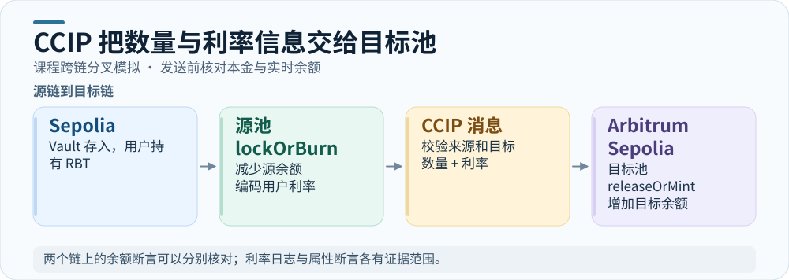

# 第 24 章 · 跨链实践：CCIP 与 Rebase 代币

Alice 在 Sepolia 的保险库里存入 `100000` wei，刚拿到 `100000` 个 RBT 最小单位。她想把这份余额带到 Arbitrum Sepolia，再把在那边累积的余额带回来。两条链各有代币合约，小账本要在两处分别更新。除了代币数量，项目还要把 Alice 的利率传给目标链，否则之后的计息会改变。

先回顾[第 06 章的两条链与桥](../02-scaling-and-multichain/06-networks-and-bridges.md)、[第 12 章的分叉测试](../03-contracts-and-foundry/12-testing-external-dependencies.md)和[第 15 章的余额与授权额度](../04-assets-protocols-and-governance/15-erc20-token-accounting.md)。本章追踪课程的合约、消息字段和余额断言。

## Vault 收到 ETH 后怎样记账

`Vault.deposit` 收到 ETH，调用 `RebaseToken.mint`，把与 `msg.value` 相同的最小单位数量记给存款人。铸造参数还带上存款时读到的合约利率。只持有 `MINT_AND_BURN_ROLE` 的地址能调用 `mint` 或 `burn`。测试给源链的 Vault 和代币池授予角色，目标链授予其代币池。权限决定谁能修改供应量。 [Vault.sol](https://github.com/Cyfrin/foundry-cross-chain-rebase-token-cu/blob/a00d9e09e09eec5609924d6f6a231f10aa2bbfb6/src/Vault.sol#L6-L43) · [跨链测试部署 L55–121](https://github.com/Cyfrin/foundry-cross-chain-rebase-token-cu/blob/a00d9e09e09eec5609924d6f6a231f10aa2bbfb6/test/CrossChain.t.sol#L55-L121)

重基代币（rebase token）允许读到的余额随计息规则变化。课程的 `principalBalanceOf` 返回最近一次结算后的存储余额。它可能已包含过去铸入的利息。`balanceOf` 在读取时将未结算的应计量合进去，时间往前走时读数就可能增加。会变更余额的操作通过 `_mintAccruedInterest` 把这段应计量铸入存储余额，更新用户的时间戳。 [RebaseToken.sol 的余额、计息与铸造](https://github.com/Cyfrin/foundry-cross-chain-rebase-token-cu/blob/a00d9e09e09eec5609924d6f6a231f10aa2bbfb6/src/RebaseToken.sol#L76-L198)

将时点固定在一次完整的计息窗口，可用实际公式推演课程数量级。按初始利率参数 `5e10`、精度 `1e18`、存储余额 `100000` 和 3600 秒，读取余额得到 `100000 × (1e18 + 5e10 × 3600) / 1e18 = 100018` 个最小单位。这里的 18 是公式推演，课程回程测试读取当时实际的 `destBalance` 作为待桥数量。 [利率及精度 L20–26](https://github.com/Cyfrin/foundry-cross-chain-rebase-token-cu/blob/a00d9e09e09eec5609924d6f6a231f10aa2bbfb6/src/RebaseToken.sol#L20-L26) · [回程测试 L250–296](https://github.com/Cyfrin/foundry-cross-chain-rebase-token-cu/blob/a00d9e09e09eec5609924d6f6a231f10aa2bbfb6/test/CrossChain.t.sol#L250-L296)

## 数量和利率怎样跨过两条链

跨链互操作协议（Cross-Chain Interoperability Protocol，CCIP）在本例中承担路由与投递，项目的代币池（token pool）实现相应的销毁和铸造。在桥接测试中，起点是 Sepolia，终点是 Arbitrum Sepolia。CCIP 用链选择器（Chain Selector）标识自己的消息路由目的地。链 ID（Chain ID）标识执行交易的网络，远端池配置指明对端代币和池。测试先在两侧配置彼此的池。 [`configureTokenPool`](https://github.com/Cyfrin/foundry-cross-chain-rebase-token-cu/blob/a00d9e09e09eec5609924d6f6a231f10aa2bbfb6/test/CrossChain.t.sol#L132-L154)



图 24　源链销毁和目标链铸造是两次状态更新。用户利率作为池的数据随消息传送。图中两处余额检查来自课程测试，由源码重绘。 [RebaseTokenPool.sol L10–49](https://github.com/Cyfrin/foundry-cross-chain-rebase-token-cu/blob/a00d9e09e09eec5609924d6f6a231f10aa2bbfb6/src/RebaseTokenPool.sol#L10-L49) · [`bridgeTokens` L156–216](https://github.com/Cyfrin/foundry-cross-chain-rebase-token-cu/blob/a00d9e09e09eec5609924d6f6a231f10aa2bbfb6/test/CrossChain.t.sol#L156-L216)

1. **发送。** 测试以 Alice 的身份给路由器授权所转的 RBT，并另行授权账户支付的 LINK 费用。它调用 `getFee` 和 `ccipSend`，将接收者、代币数量与目标链选择器交给路由流程。测试应用消息的 `data` 字段为空。
2. **源链处理。** `lockOrBurn` 先调用继承的 `_validateLockOrBurn`。它读取 `originalSender` 也就是 Alice 的用户利率，销毁池收到的代币，并按[第 09 章的 ABI 编码](../03-contracts-and-foundry/09-contract-composition.md)，用 `abi.encode` 把利率写到 `destPoolData`。
3. **目标链处理。** `releaseOrMint` 先调用 `_validateReleaseOrMint`，再从 `sourcePoolData` 解出用户利率，按消息中的数量和接收者调用 `mint`。目标代币在既有应计量结算后记录传入的利率，给接收者记上新到的数量。
4. **回程与赎回。** 课程回程测试在目标链模拟经过一小时，然后读取 Alice 当时的完整余额并传回 Sepolia。课程约定在 L1 存取，`Vault.redeem` 烧掉用户交回的代币，并尝试付相同最小单位数量的 ETH。这个桥接测试验证回程余额，赎回步骤来自 Vault 实现和项目说明。项目假设 Vault 已有足够的奖励资金，跨链途中不计新增利息。 [课程设计假设](https://github.com/Cyfrin/foundry-cross-chain-rebase-token-cu/blob/a00d9e09e09eec5609924d6f6a231f10aa2bbfb6/README.md#L153-L168)

信任路径随操作变化。Alice 在源链授予路由器额度，由源链池检查允许的调用并销毁。目标链按路由与远端池配置检查到达的消息，再由有铸造角色的目标池写入余额。对于本地测试，消息投递证据还取决于测试模拟器和两侧配置。链 ID、消息、池权限和目标余额可以逐项对照，源链回执只覆盖源链的提交及执行。

## 课程测试能看见哪些结果

`bridgeTokens` 通过 `vm.selectFork` 在两个分叉环境之间切换，并以 `vm.warp` 在目标环境推进 `900` 秒。这是测试写入的时延。测试从源侧调用 `CCIPLocalSimulatorFork.switchChainAndRouteMessage` 投递消息。源链与目标链各有一个余额断言。

| 取样点 | 课程断言 | Alice 全量转出且目标初始为 0 的纸面结果 |
| --- | --- | --- |
| 源链 `ccipSend` 前后 | `sourceBalanceAfterBridge == balanceBeforeBridge - amountToBridge` | 发送 `100000` 后读到 0。 |
| 目标链模拟投递前后 | `destBalance == initialArbBalance + amountToBridge` | 投递后读到 `100000`。 |

`testBridgeAllTokens` 使用全量出发，`testBridgeAllTokensBack` 加入回程，`testBridgeTwice` 分两次桥接。测试代码会打印目标链看到的用户利率，表中的两个显式断言核对余额。验证利率需要读 `getUserInterestRate` 或为用户利率另写断言。 [`CrossChain.t.sol` L156–361](https://github.com/Cyfrin/foundry-cross-chain-rebase-token-cu/blob/a00d9e09e09eec5609924d6f6a231f10aa2bbfb6/test/CrossChain.t.sol#L156-L361)

课程提交 `a00d9e09e09e` 的跨链测试及池使用 Solidity `0.8.24`。在隔离的课程项目副本准备 Git 子模块，`lib/ccip` 固定为 `8c94ed47c5a437cd51921b42b907cb6364882023`，`lib/chainlink-local` 固定为 `cd3bfb8c42716cfb791174314eba2c0d178551b9`。在自己的配置中给 `eth` 和 `arb` 分别填入经授权访问的 Sepolia、Arbitrum Sepolia RPC，并记录分叉区块。根据自己的实验配置填写这两个别名。以下是普通 Foundry 的测试入口，本章按源码读取断言。 [依赖重映射配置](https://github.com/Cyfrin/foundry-cross-chain-rebase-token-cu/blob/a00d9e09e09eec5609924d6f6a231f10aa2bbfb6/foundry.toml#L6-L13) · [依赖清单](https://github.com/Cyfrin/foundry-cross-chain-rebase-token-cu/blob/a00d9e09e09eec5609924d6f6a231f10aa2bbfb6/.gitmodules)

```bash
forge test --match-contract '^CrossChainTest$' --match-test '^testBridgeAllTokensBack$'
```

单独运行 `forge test --match-contract '^RebaseTokenTest$'` 可以在普通 Foundry 上核对计息、权限与赎回，无需分叉 RPC。本书用 Foundry `v1.3.1` 跑了这一组，12 项通过。上述双分叉测试的跨链步骤和断言来自固定源码。

## 常见误区

- **把利率当成普通的应用 `data`。** 项目的应用 `data` 为空。代币池将利率放在桥接池数据里，目标池从 `sourcePoolData` 读取。
- **看到源链成功便认为目标余额到账。** 源链先扣减，目标池随后处理消息。测试在投递后另外读取目标链余额。
- **从 `vm.warp(… + 900)` 推断网络时延。** 这个值用于模拟。真实交付要分别观察两条链的记录及消息状态。

## 练习与核对

1. 测试中 Alice 在源链有 `100000`、目标链有 `5000`，本次转出 `40000`。忽略这段时间的计息读取差异，两边的断言应分别得到多少？  
   **答案**　源链 `60000`，目标链 `45000`。两者属于各自环境的余额，观察时点在发送及投递前后。
2. 到达目标池的数量是 `40000`，还要从消息里取得什么才能设置 Alice 的计息条件？  
   **答案**　源链为 Alice 记录的用户利率。源池将其编码为 `destPoolData`，目标池从 `sourcePoolData` 解码并传给 `mint`。
3. 怎样判断回程测试检查了赎回？  
   **答案**　沿 `testBridgeAllTokensBack` 找不到赎回调用。测试以反向调用 `bridgeTokens` 核对目标链余额变化。Vault 的支付条件应另外从 `redeem` 和对应测试查证。

## 来源

- 《Web3 Fundamentals》，Crypto Bridge（第 11–12 页，Markdown L266–308），用于理解两条链的资产表示和信任环节。 [本地书稿](../../../refs/B3_Web3_Fundamentals.md)
- 课程 fork Advanced Foundry §4 的 Rebase、Vault、CCIP、代币池和跨链测试。 [固定课程索引 L2240–2378](https://github.com/yuxiaoli/foundry-full-course-cu/blob/b92616c4212d40cacfeeff4ea0f30501cafad094/README.md#L2240-L2378)
- 固定课程项目源码、角色设置和跨链余额证据。 [RebaseToken](https://github.com/Cyfrin/foundry-cross-chain-rebase-token-cu/blob/a00d9e09e09eec5609924d6f6a231f10aa2bbfb6/src/RebaseToken.sol) · [Vault](https://github.com/Cyfrin/foundry-cross-chain-rebase-token-cu/blob/a00d9e09e09eec5609924d6f6a231f10aa2bbfb6/src/Vault.sol) · [代币池](https://github.com/Cyfrin/foundry-cross-chain-rebase-token-cu/blob/a00d9e09e09eec5609924d6f6a231f10aa2bbfb6/src/RebaseTokenPool.sol) · [两链测试](https://github.com/Cyfrin/foundry-cross-chain-rebase-token-cu/blob/a00d9e09e09eec5609924d6f6a231f10aa2bbfb6/test/CrossChain.t.sol)

[全书目录](../README.md) · [本章来源映射](../../../planning/beginner/source-map.md#ch-24)
