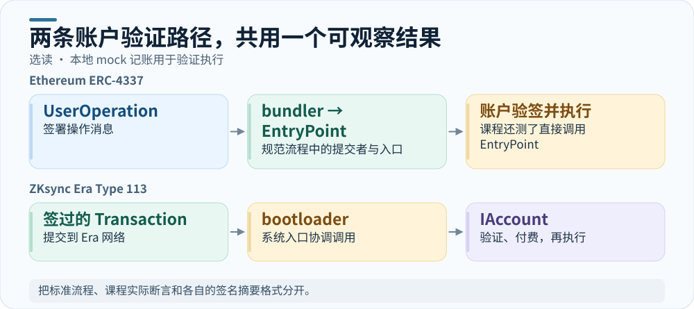

# 第 25 章 · 账户抽象：Ethereum 与 ZKsync 两种路径

小周希望一个智能账户执行一条指令，把测试合约里记给这个账户的余额从 0 增加到 `1e18` 个最小单位。她同意的是这个调用，提交、验证、执行和付费可以由不同角色承担。两条课程测试都用 `ERC20Mock.mint` 观察余额变化。这里把 `mint` 当成一项可观察的记账即可。

认识[第 02 章的账户与签名](../01-ethereum-l1/02-wallets-keys-signatures.md)、[第 03 章的交易与 Gas](../01-ethereum-l1/03-state-execution-and-gas.md)及[第 09 章的目标地址与调用数据](../03-contracts-and-foundry/09-contract-composition.md)就可以开始。签名绑定操作的消息摘要，验证人拿到同一摘要才能核对授权。这个想法也用在[第 22 章的签名域](./22-merkle-airdrop-signatures.md)，本章使用账户项目自己的摘要。

## 账户怎样决定接受一项操作

账户抽象（account abstraction，AA）使账户能够用可编程规则决定是否接受一项操作。把流程拆成三个问题：谁能授权，谁调用目标合约，Gas 从哪里支付。两份课程示例都用所有者的椭圆曲线数字签名算法（Elliptic Curve Digital Signature Algorithm，ECDSA）来做选择，并通过各自网络路径接入验证和执行。ZKsync Era 是[第 05 章讨论过的二层网络](../02-scaling-and-multichain/05-l1-congestion-to-l2.md)，其 EraVM 带原生账户抽象。



图 25　两种路径分别经过 ERC-4337 的 EntryPoint 与 Era 的 bootloader。图中分开标示规范的提交路径、验证与执行入口及付费关系。依据规范和课程实现重绘。 [ERC-4337](https://eips.ethereum.org/EIPS/eip-4337) · [ZKsync Era 账户抽象设计](https://docs.zksync.io/zksync-protocol/era-vm/account-abstraction/design)

## Ethereum 的 UserOperation 怎样进入 EntryPoint

1. 钱包准备用户操作（UserOperation）。操作包括账户地址、nonce、调用数据和费用字段。在课程中，外层调用数据指向 `MinimalAccount.execute`，内层数据指向 mock 合约的 `mint`，ETH `value` 设为 0。
2. 按 ERC-4337，bundler（打包者）可以从替代交易池收集用户操作，检查后以一笔普通链上交易调用 `EntryPoint.handleOps`。`PackedUserOperation` 是 EntryPoint 接收的打包结构。替代交易池传输用户操作，Ethereum 链上结算这笔调用 EntryPoint 的交易。
3. EntryPoint 处理 nonce，调用账户的 `validateUserOp`。课程账户只接受配置的 EntryPoint 调用这个入口，恢复签名者并与 `owner()` 比较。账户收到的 `missingAccountFunds` 大于 0 时，`_payPrefund` 把缺少的预付资金送给调用方。通用 ERC-4337 流程有账户或代付方的预付款及费用结算。课程 `testValidationOfUserOps` 给账户准备余额并传入 `1e18` 的缺额，覆盖该分支。最终断言检查 `validationData == 0`，费用结算需要单独检查。
4. 验证通过后，EntryPoint 按操作的调用数据触发账户。课程的 `execute` 允许 EntryPoint 或所有者进入，由账户发起对目标地址的调用。目标 mock 最终把 `AMOUNT` 记到智能账户。 [课程账户入口与预付](https://github.com/Cyfrin/minimal-account-abstraction/blob/a0b1103867d24b7f2177028fe410c238517cb64e/src/ethereum/MinimalAccount.sol#L31-L99) · [操作编码和签名](https://github.com/Cyfrin/minimal-account-abstraction/blob/a0b1103867d24b7f2177028fe410c238517cb64e/script/SendPackedUserOp.s.sol#L40-L84)

课程将 EntryPoint 依赖固定为 v0.7 实现 `7af70c8993a6f42973f520ae0752386a5032abe7`。这一实现的 `getUserOpHash` 对操作本身的哈希、EntryPoint 地址和链 ID 进行 ABI 编码后散列。课程账户再用 `MessageHashUtils.toEthSignedMessageHash` 施加 EIP-191 消息前缀，签名脚本也使用相同过程。现行 ERC-4337 规范在「Support for EIP-712 signatures」一节定义以 EIP-712 计算 `userOpHash`。规范给出交给账户的哈希及接口，账户的具体签名校验由其实现决定。阅读版本时分别核对 EntryPoint 的摘要算法、签名工具的包装和账户的恢复过程。 [v0.7 源码](https://github.com/eth-infinitism/account-abstraction/blob/7af70c8993a6f42973f520ae0752386a5032abe7/contracts/core/EntryPoint.sol) · [ERC-4337 的 EIP-712 摘要](https://eips.ethereum.org/EIPS/eip-4337#support-for-eip-712-signatures)

## ZKsync Era 的 Type 113 怎样进入账户

EraVM 将类型化交易用于原生账户抽象。Type 113（十六进制 `0x71`）是其 EIP-712 交易类型；常规 EIP-1559 交易是 Type 2。`PackedUserOperation` 是另一套流程里的合约参数。在课程的 Era 例子中，系统的 bootloader（引导程序）带着本地交易结构 `Transaction` 调用实现 `IAccount` 的账户。

| 阶段 | 课程合约的观察点 |
| --- | --- |
| 验证 | `validateTransaction` 只允许 bootloader。它用 NonceHolder 系统合约校验并推进 nonce，检查账户余额能否支付所需金额，再对 `Transaction.encodeHash()` 的摘要直接恢复签名者。所有者匹配时返回验证成功标记。 |
| 付费 | 自付流程调用 `payForTransaction`，课程实现调用 `payToTheBootloader()`。规范还定义 paymaster（代付方）路径，这里观察账户自付入口。 |
| 执行 | `executeTransaction` 允许 bootloader 或账户所有者，随后按 `Transaction` 中的目标、金额和数据调用。本地用例的目标仍是测试 mock。 |

课程的 ZKsync 测试用 `abi.encodePacked(r, s, v)` 序列化签名，验证函数按同一摘要恢复所有者。这条观察来自 Era 示例的 `_signTransaction` 与 `_validateTransaction`。 [ZKsync 合约 L85–193](https://github.com/Cyfrin/minimal-account-abstraction/blob/a0b1103867d24b7f2177028fe410c238517cb64e/src/zksync/ZkMinimalAccount.sol#L85-L193) · [Era 交易类型](https://docs.zksync.io/zksync-protocol/era-vm/transactions/transaction-lifecycle)

## 哪些环节有本地测试证据

两套合约和测试用 Solidity `0.8.24`。下面的「结果」是课程固定提交的断言或预期回退。Ethereum 的 `MinimalAccountTest` 使用标准 Foundry；Era 的用例使用下述支持 ZKsync 的工具链。可参考[第 12 章的读测试方法](../03-contracts-and-foundry/12-testing-external-dependencies.md)核对覆盖范围。

| 测试 | 结果及范围 |
| --- | --- |
| Ethereum `testNonOwnerCannotExecuteCommands` | 用非所有者身份直接调用，预期账户拒绝。它检查 `execute` 的调用者权限。 |
| Ethereum `testValidationOfUserOps` | 以 EntryPoint 身份直接调用验证入口，断言 `validationData == 0`。 |
| Ethereum `testEntryPointCanExecuteCommands` | 测试地址直接调用 `EntryPoint.handleOps`，并以该地址作费用受益人，断言 mock 余额变为 `1e18`。bundler 与替代交易池属于图中的规范路径。 |
| ZKsync `testZkOwnerCanExecuteCommands` | 所有者直接调用执行入口，断言 mock 余额为 `1e18`。 |
| ZKsync `testZkValidateTransaction` | 以 bootloader 身份直接调用验证入口，断言 `ACCOUNT_VALIDATION_SUCCESS_MAGIC`。付费函数及完整链上生命周期来自实现和规范的阅读。 |

在课程提交 `a0b1103867d2` 的项目目录准备固定子模块。Ethereum 路径用普通 Foundry。Era 路径采用项目 Makefile 的历史 Foundry-ZKsync 参数，需用能识别 `--zksync` 和 `--system-mode=true` 的课程工具链。命令为本地测试入口。 [课程 Makefile](https://github.com/Cyfrin/minimal-account-abstraction/blob/a0b1103867d24b7f2177028fe410c238517cb64e/Makefile#L37-L68) · [编译配置](https://github.com/Cyfrin/minimal-account-abstraction/blob/a0b1103867d24b7f2177028fe410c238517cb64e/foundry.toml)

```bash
forge test --match-contract '^MinimalAccountTest$'
```

```bash
forge test --zksync --system-mode=true --match-contract '^ZkMinimalAccountTest$'
```

## 常见误区

- **把 UserOperation 当成 Era Type 113。** 前者交给 ERC-4337 EntryPoint，后者由 EraVM 的交易处理流程送到账户。
- **在两个项目里给同一个签名都加消息前缀。** 课程 Ethereum 账户校验 EIP-191 包装后的摘要，Era 示例直接校验 `Transaction.encodeHash()`。
- **从余额增加推断提交和付费都已覆盖。** 课程的余额断言落在目标 mock，Ethereum 另有直接调用 EntryPoint 的夹具，两者都可以在测试中单独定位。

## 练习与核对

1. 两套示例的所有者都直接调用执行入口时，能用哪个可观察结果比较？  
   **答案**　目标 mock 中相应智能账户的余额。两套课程用例均期望 `1e18`。
2. 用户操作的签名正确，但普通地址直接调用 Ethereum 的 `validateUserOp`。哪一项先检查？  
   **答案**　`requireFromEntryPoint` 先核对调用者。签名只在通过入口权限后用于授权。
3. 哪条测试对应 Era 验证成功？它能证明收费已发生吗？  
   **答案**　`testZkValidateTransaction` 断言验证成功标记。课程中收费入口可从 `payForTransaction` 读到，收费证据应另外观察费用流。

## 来源

- 《Web3 Fundamentals》，Public & Private Keys（第 25 页），用于授权和密钥的背景。摘要与账户流程按本章项目及规范核对。
- 课程项目 `minimal-account-abstraction` 的说明、固定实现和测试。 [README L42–68](https://github.com/Cyfrin/minimal-account-abstraction/blob/a0b1103867d24b7f2177028fe410c238517cb64e/README.md#L42-L68) · [Ethereum 测试 L38–133](https://github.com/Cyfrin/minimal-account-abstraction/blob/a0b1103867d24b7f2177028fe410c238517cb64e/test/ethereum/MinimalAccountTest.t.sol#L38-L133) · [Era 测试 L35–121](https://github.com/Cyfrin/minimal-account-abstraction/blob/a0b1103867d24b7f2177028fe410c238517cb64e/test/zksync/ZkMinimalAccountTest.t.sol#L35-L121) · [子模块](https://github.com/Cyfrin/minimal-account-abstraction/blob/a0b1103867d24b7f2177028fe410c238517cb64e/.gitmodules)
- 规范与课程版本分别用于角色、摘要和执行证据。 [ERC-4337](https://eips.ethereum.org/EIPS/eip-4337) · [固定 EntryPoint 实现](https://github.com/eth-infinitism/account-abstraction/blob/7af70c8993a6f42973f520ae0752386a5032abe7/contracts/core/EntryPoint.sol) · [Era 原生账户抽象设计](https://docs.zksync.io/zksync-protocol/era-vm/account-abstraction/design)
