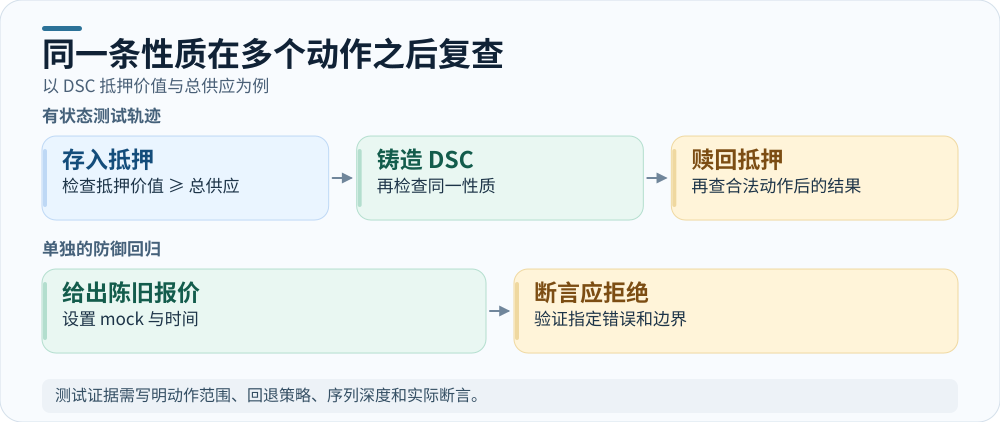

# 第 26 章 · 不变量测试与防御性审阅

小周在一个测试账本存入 1 WETH。按固定模拟报价，这份抵押值 2000 USD。她铸造 600 DSC，再赎回 0.25 WETH，抵押值剩 1500 USD。这三步各自都走得通。接下来查看两条规则：这名用户的健康因子是否满足赎回条件，以及整个测试协议的抵押估值是否覆盖已发行的 DSC。重复尝试不同的金额、动作和顺序，可以在每步之后检查这些规则。

读过[第 12 章的测试与 mock](../03-contracts-and-foundry/12-testing-external-dependencies.md)、[第 14 章的状态推进](../03-contracts-and-foundry/14-raffle-async-events.md)和[第 18 章的 DSC 抵押与清算](../04-assets-protocols-and-governance/18-overcollateralized-stablecoin.md)，就能沿同一笔抵押学会读一项不变量测试，并把测试结果转成可复核的防御性审阅记录。

## 从一个输入到一段操作序列

| 测试方法 | 改变什么 | 在同一例子里检查什么 |
| --- | --- | --- |
| 边界样例（boundary case） | 由开发者挑定金额和初始状态 | 固定抵押、债务与报价，核对一次赎回是否被拒绝。 |
| 参数模糊测试（fuzz testing） | 框架为同一个测试函数生成多个参数 | 用不同抵押金额验证报价换算或边界判断。 |
| 有状态不变量测试（stateful invariant testing） | 框架在同一轮内选择多次调用及参数，前一步留下的状态作为下一步输入 | 交替存入、铸造和赎回，在成功操作后的状态中检查抵押约束。 |

不变量（invariant）是预期在所选状态变化中持续成立的性质。课程测试读取引擎持有的 WETH、WBTC 数量，按 mock 价格换算成同一尺度的 USD 估值，再与 DSC 的总供应比较。这里按协议的记账假设，用 1 DSC 对应 1 USD 的名义单位比较，两边都使用适配后的整数精度。下面是源码中用于检查这条性质的断言。 [抵押估值与断言 L54–66](https://github.com/Cyfrin/foundry-defi-stablecoin-cu/blob/f04bb04a77e4aa4390e6df38b0dc0c214c5a7c6a/test/fuzz/continueOnRevert/ContinueOnRevertInvariants.t.sol#L54-L66) · [`DSCEngine.getUsdValue`](https://github.com/Cyfrin/foundry-defi-stablecoin-cu/blob/f04bb04a77e4aa4390e6df38b0dc0c214c5a7c6a/src/DSCEngine.sol#L392-L400)

```solidity
assert(wethValue + wbtcValue >= totalSupply);
```



图 26　一次操作序列中，在各状态检查抵押估值与 DSC 供应量。右侧单独核对过期报价应被拒绝。依据课程的测试断言与预言机回归测试重绘。 [抵押不变量](https://github.com/Cyfrin/foundry-defi-stablecoin-cu/blob/f04bb04a77e4aa4390e6df38b0dc0c214c5a7c6a/test/fuzz/continueOnRevert/ContinueOnRevertInvariants.t.sol#L44-L74) · [过期报价测试](https://github.com/Cyfrin/foundry-defi-stablecoin-cu/blob/f04bb04a77e4aa4390e6df38b0dc0c214c5a7c6a/test/unit/OracleLibTest.t.sol#L21-L45)

纸面例子只保留一名用户和一个固定报价。用户有债务时，课程引擎将抵押估值乘以 50% 的清算阈值，再除以该用户的 DSC 债务，得到健康因子。金额以便于阅读的单位展示。按照源码的名义计算，状态沿以下路径变化。 [健康因子与检查 L349–368](https://github.com/Cyfrin/foundry-defi-stablecoin-cu/blob/f04bb04a77e4aa4390e6df38b0dc0c214c5a7c6a/src/DSCEngine.sol#L349-L368)

| 操作 | 操作后的抵押估值 | DSC 供应 | 健康因子或结果 |
| --- | ---: | ---: | --- |
| 存入 1 WETH | 2000 USD | 0 | 没有债务，代码返回最大整数。 |
| 铸造 600 DSC | 2000 USD | 600 | 约 1.67。 |
| 赎回 0.25 WETH | 1500 USD | 600 | 1.25，仍符合最低值 1。 |
| 在前一步后申请再赎回 0.30 WETH | 1500 USD | 600 | 候选抵押值为 900 USD，健康因子 0.75，预期回退，实际状态保持前一行。 |

900 USD 仍高于 600 DSC 的名义数字，但这次赎回仍会被用户健康因子规则拒绝。全协议的 `抵押估值 ≥ 总供应` 和每名用户的抵押门槛是两条不同的检查。表中的回退是按课程规则推演，Forge 项目已有独立的健康因子和赎回测试。 [DSCEngineTest.t.sol](https://github.com/Cyfrin/foundry-defi-stablecoin-cu/blob/f04bb04a77e4aa4390e6df38b0dc0c214c5a7c6a/test/unit/DSCEngineTest.t.sol)

## Handler 决定测试会走到哪里

处理器（handler）将测试器生成的调用转换成协议动作。课程两套不变量测试都以 `targetContract(address(handler))` 选定处理器。处理器可选择抵押品，将金额限定在预期范围，或先安排 mock 余额和授权，再调用代币与引擎。例如，`StopOnRevertHandler.mintAndDepositCollateral` 用 `bound` 限定非零抵押金额，为模拟用户铸造和批准 mock 抵押品，再尝试存入。这个函数名中的 `mint` 指的是准备抵押品。检查测试覆盖时，要读它最终调用的是抵押代币还是 DSC。

`foundry.toml` 对默认测试设定 `runs = 64`、`depth = 64` 和 `fail_on_revert = true`。前两个量分别指定操作序列轮数与单轮调用深度。项目默认遇到操作回退即将它判为测试失败。`ContinueOnRevertInvariants.t.sol` 在两个 `invariant_` 函数上用 `/// forge-config: default.invariant.fail-on-revert = false` 覆盖回退策略。默认 profile 下，它们遇到允许的回退仍可继续探索其他动作。另一个测试套件没有这项局部覆盖。应同时阅读项目配置、选中的 profile 和测试函数注释。 [项目配置](https://github.com/Cyfrin/foundry-defi-stablecoin-cu/blob/f04bb04a77e4aa4390e6df38b0dc0c214c5a7c6a/foundry.toml#L17-L33) · [测试函数的覆盖设置](https://github.com/Cyfrin/foundry-defi-stablecoin-cu/blob/f04bb04a77e4aa4390e6df38b0dc0c214c5a7c6a/test/fuzz/continueOnRevert/ContinueOnRevertInvariants.t.sol#L44-L74) · [Foundry 局部测试配置](https://www.getfoundry.sh/config/reference/inline-test-config)

覆盖证据还包括调用是否实际走到协议、完成了哪些状态变更。`callSummary` 在该提交只打印 WETH 总量、WBTC 总量与 DSC 总供应。要核对各动作成功次数，可以另用测试器的调用统计或在自己的 handler 加计数。相比之下，`StopOnRevertInvariants.invariant_gettersCantRevert` 检查若干查询函数能够返回。 [摘要调用 L112–125](https://github.com/Cyfrin/foundry-defi-stablecoin-cu/blob/f04bb04a77e4aa4390e6df38b0dc0c214c5a7c6a/test/fuzz/continueOnRevert/ContinueOnRevertHandler.t.sol#L112-L125) · [另一套测试 L45–81](https://github.com/Cyfrin/foundry-defi-stablecoin-cu/blob/f04bb04a77e4aa4390e6df38b0dc0c214c5a7c6a/test/fuzz/failOnRevert/StopOnRevertInvariants.t.sol#L45-L81)

## 用过期报价做一条审阅记录

第 18 章的稳定币依赖外部报价。针对这个课程项目，可以把规则写成「引擎按最新有效的报价估值，报价超过项目时限时停止依赖该价格的操作」。`OracleLib` 首先检查更新时间与轮次，再检查 `block.timestamp - updatedAt` 是否超过 `TIMEOUT`。固定项目的 `TIMEOUT` 为 3 小时，阈值判断为 `>`。`testPriceRevertsOnStaleCheck` 在本地 mock 环境推进 `4 hours + 1 seconds` 和一个区块，预期 `OracleLib__StalePrice`。 [OracleLib.sol L15–34](https://github.com/Cyfrin/foundry-defi-stablecoin-cu/blob/f04bb04a77e4aa4390e6df38b0dc0c214c5a7c6a/src/libraries/OracleLib.sol#L15-L34) · [OracleLibTest.t.sol L21–45](https://github.com/Cyfrin/foundry-defi-stablecoin-cu/blob/f04bb04a77e4aa4390e6df38b0dc0c214c5a7c6a/test/unit/OracleLibTest.t.sol#L21-L45)

| 审阅字段 | 示例记录 |
| --- | --- |
| 范围与基准 | 课程提交 `f04bb04a77e4`，查看 `OracleLib.staleCheckLatestRoundData` 和本地预言机测试。 |
| 规则与影响 | 依赖报价的抵押估值需要有效更新时间。接受超过时限的报价会让计算继续基于旧估值，拒绝报价则会暂停依赖该读数的路径。 |
| 当前证据 | 源码对超过 3 小时的读数以自定义错误回退。已有测试观察已明显超过阈值时拒绝。 |
| 修复与复核条件 | 若后续改动报价路径，保留该回归。对临界时刻的行为有要求时，用 mock 分别验证恰好 3 小时和超过 1 秒，记录有效配置、期望错误及结果。 |

课程审阅材料将范围、发现、修复和复核分成阶段。这里审阅记录可同时用于确认一条已有防护和指定未来变更的回归条件，测试证据能归到一个明确提交。 [智能合约审阅流程课文](https://github.com/Cyfrin/Updraft/blob/1d7138f18fbe26bfff82a091df118efda52f29e7/courses/advanced-foundry/9-security/4-what-is-smart-contract-audit/%2Bpage.md#L50-L131)

固定 DSC 项目的引擎和预言机库使用 Solidity `0.8.19`。按项目提交准备对应的 Git 子模块，然后在独立课程目录使用普通 Foundry。以下命令定位两套不变量检查和本地预言机回归用例。本书用 Foundry `v1.3.1` 和 Solidity `0.8.19` 实跑固定项目的 52 项课程测试，两套不变量与预言机回归都在其中。

```bash
forge test --match-contract '^(ContinueOnRevertInvariants|StopOnRevertInvariants)$'
forge test --match-contract '^OracleLibTest$' --match-test 'testPriceRevertsOnStaleCheck'
```

## 常见误区

- **把一个协议总量断言当成每名用户都健康。** 先看到 `dsc.totalSupply()` 与引擎持有的全部抵押，就能认出这是一条全局约束。单户健康因子还要读该用户的抵押与债务。
- **只从套件名判断是否允许回退。** 项目默认值、所用 profile 和测试的局部设置共同决定实际策略。
- **从一项检查通过推断所有操作都已覆盖。** 查 handler 的可选动作、取值范围、回退和成功调用。随机测试的证据有次数、深度及模型边界，形式化证明有不同的前提与方法。

## 练习与核对

1. 抵押值 1500 USD，债务 600 DSC。在固定报价和 50% 阈值下，健康因子是多少？  
   **答案**　`1500 × 0.5 / 600 = 1.25`。还可以在此状态尝试一笔合法的后续动作，检查健康因子以及全协议约束。
2. 为什么读到 `runs = 64`、`depth = 64` 之后还要看 handler 和回退配置？  
   **答案**　轮数和深度只给出尝试范围。可达状态由动作和输入限制决定，某些调用会回退，某些操作产生的状态又会影响下一步。
3. 报价刚好 3 小时与超过 1 秒，代码如何处理？  
   **答案**　在更新时间和轮次有效的前提下，恰好 3 小时满足代码条件。超过 1 秒触发 `OracleLib__StalePrice`。这是按 `>` 比较推演的临界结果，既有测试覆盖明显超过阈值的情况。

## 来源

- 《Web3 Fundamentals》，Oracles（第 42–43 页，Markdown L1079–1099），作为外部数据进入合约的背景。 [本地书稿](../../../refs/B3_Web3_Fundamentals.md)
- 课程 fork 的不变量、处理器和测试内容。 [Advanced Foundry §3 索引 L2159–2202](https://github.com/yuxiaoli/foundry-full-course-cu/blob/b92616c4212d40cacfeeff4ea0f30501cafad094/README.md#L2159-L2202) · [固定 DSC 项目](https://github.com/Cyfrin/foundry-defi-stablecoin-cu/tree/f04bb04a77e4aa4390e6df38b0dc0c214c5a7c6a)
- 课程的处理器、价格库、模糊测试和预言机回归证据。 [ContinueOnRevertHandler.t.sol](https://github.com/Cyfrin/foundry-defi-stablecoin-cu/blob/f04bb04a77e4aa4390e6df38b0dc0c214c5a7c6a/test/fuzz/continueOnRevert/ContinueOnRevertHandler.t.sol) · [StopOnRevertHandler.t.sol](https://github.com/Cyfrin/foundry-defi-stablecoin-cu/blob/f04bb04a77e4aa4390e6df38b0dc0c214c5a7c6a/test/fuzz/failOnRevert/StopOnRevertHandler.t.sol) · [OracleLibTest.t.sol](https://github.com/Cyfrin/foundry-defi-stablecoin-cu/blob/f04bb04a77e4aa4390e6df38b0dc0c214c5a7c6a/test/unit/OracleLibTest.t.sol)

[全书目录](../README.md) · [本章来源映射](../../../planning/beginner/source-map.md#ch-26)
